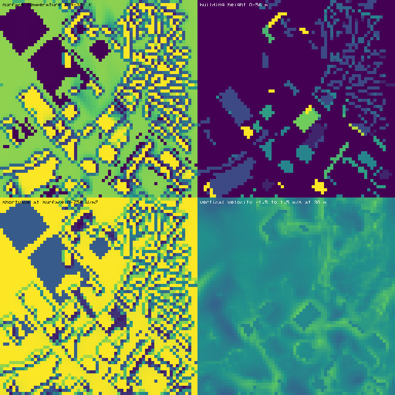

<div align="center">

<picture>
  <source media="(prefers-color-scheme: dark)" srcset="docs/src/assets/aeolus-lockup-dark.svg">
  
</picture>

**A Julia-native large-eddy simulation framework**

*Resolved turbulence, high-fidelity radiation and exact moist thermodynamics —
multithreaded, configured from TOML, with a short dependency list.*

[](https://github.com/badulion/Aeolus.jl/actions/workflows/CI.yml?query=branch%3Amaster)
[](https://github.com/badulion/Aeolus.jl/actions/workflows/Documenter.yml?query=branch%3Amaster)
[](https://badulion.github.io/Aeolus.jl/stable/)
[](https://badulion.github.io/Aeolus.jl/dev/)



<sub><b>Alexanderplatz, Berlin, 13:30 local, sun 50° above the horizon.</b>
322 buildings from OpenStreetMap, 24 h diurnal cycle at Δt = 2 s.
Surface temperature · shortwave reaching the ground, with building shadows ·
building height · resolved vertical velocity at 30 m.</sub>

</div>

---

## At a glance

- **General-purpose LES core** — Boussinesq, anelastic and pseudo-incompressible
  dynamics on a staggered finite-volume grid, behind an `AbstractMesh` interface
  that a spectral-element backend can plug into without touching user code.
- **A radiation stack that is unusual for an LES** — correlated-*k* gas optics,
  two-stream *and* 3-D Monte-Carlo transfer, urban radiosity, spectral BRDF
  surface optics, Mie aerosol.
- **Validated against external references**, not just against itself — MODIS
  kernel constants, Wiscombe's Mie benchmark, Golovin's analytic coalescence
  solution, the DYCOMS-II RF01 intercomparison, FLUXNET towers, the
  CAPITOUL and BUBBLE urban campaigns, ASHRAE 140 and the COARE reference code.
- **106,776 assertions in the fast tier (135 jobs)**, run by CI on every
  pull request; the full tier adds the validation mini-simulations.
  104,000 lines of source, 72,000 lines of tests.
- **Few dependencies** (FFTW, KernelAbstractions, StaticArrays, NCDatasets,
  GRIBDatasets). PNG, Mie scattering, error and Bessel functions are
  written in the package.
- **Single-node CPU, multithreaded** through KernelAbstractions, with
  results bit-identical at every thread count. MPI and GPU are planned,
  not present.
- **Every run is a TOML file**: `julia -m Aeolus run config.toml`, strict
  validation, and a run folder whose `run.toml` replays the run bit for
  bit.

---

## What the stack can do

<table>
<tr><td width="34%"><b>Dynamical core</b></td><td>

Boussinesq · anelastic · pseudo-incompressible · staggered Arakawa-C finite
volume · fractional-step pressure projection · SSP-RK3, IMEX (ARK2,
Rosenbrock2) · adaptive Δt with CFL diagnostics

</td></tr>
<tr><td><b>Pressure solvers</b></td><td>

FFT (triply periodic) · cosine-FFT (Neumann in *z*) · FFT/DCT plus a
tridiagonal solve in *z* for stretched grids and, by default, the
density-weighted anelastic operator · one matrix-free preconditioned
conjugate gradient · geometric multigrid

</td></tr>
<tr><td><b>Advection &amp; geometry</b></td><td>

WENO-5 / WENO-Z / TENO · skew-symmetric energy-conserving operators ·
cut-cell immersed boundaries with ghost-cell wall reconstruction ·
stretched and terrain-following (Gal-Chen) vertical coordinates

</td></tr>
<tr><td><b>Mesh refinement</b></td><td>

One- and two-way grid nesting with flux registers and refluxing · nest
hierarchies with sibling nests and recursive Berger-Oliger subcycling ·
non-aligned children (rational refinement ratios, off-face origins) and
stretched children · offline nesting from a dynamic driver ·
block-structured AMR (Berger-Rigoutsos clustering, Berger-Colella
refluxing)

</td></tr>
<tr><td><b>Radiation</b></td><td>

Correlated-*k* gas optics over 16 longwave and 14 shortwave bands
(H₂O, CO₂, O₃, CH₄, N₂O, O₂) · two-stream δ-Eddington / PIFM / quadrature
with adding-doubling · 3-D Monte-Carlo transfer with next-event estimation ·
urban radiosity with occlusion-tested view factors · spectral surface optics
(16 materials, 4 BRDF models, Cox-Munk water, Wiscombe-Warren snow) ·
Mie aerosol with κ-Köhler growth and OPAC mixtures · Meeus solar position,
Bird clear-sky, Erbs/Reindl direct-diffuse partitioning

</td></tr>
<tr><td><b>Clouds &amp; microphysics</b></td><td>

Exact moist thermodynamics — temperature-dependent latent heat, saturation
vapour pressure as the analytic Clausius-Clapeyron integral, condensate
loading · θ<sub>li</sub> diagnosis and enthalpy-conserving process saturation
adjustment · Köhler activation · Abdul-Razzak &amp; Ghan parameterisation with
an explicit parcel reference · P3 predicted-particle-property ice with
prognostic rime, per-moment sedimentation and radar reflectivity ·
prognostic ice-nucleating particles, immersion / deposition freezing,
Hallett-Mossop · superdroplet Lagrangian microphysics · sub-grid
precipitation fraction · fog and dew with droplet-radiative feedback ·
Koschmieder visibility · sub-grid supersaturation PDF and its effect on
activation and droplet growth · Kessler and two-moment bulk schemes

</td></tr>
<tr><td><b>Surface &amp; urban</b></td><td>

Monin-Obukhov surface-exchange contract shared by every surface ·
CLM-style soil column (Richards water, freeze-thaw, water table) ·
Farquhar / Collatz photosynthesis with Ball-Berry / Medlyn stomata on a
vegetated land column · resolved plant canopy (implicit drag, canopy
two-stream, leaf energy balance) · per-facet multi-layer wall conduction,
angle-dependent glazing, facet temperatures coupled implicitly through the
radiosity longwave, matrix-free GMRES at city scale · building energy
model (zone air, HVAC and exhaust heat, occupancy schedules) · layered
snowpack with grain ageing and percolation, lake and sea ice · water
mixed layer with cool skin and warm layer, COARE 3.5 fluxes, wave-dependent
roughness, sea spray · sub-grid surface tiles and blending height ·
OpenStreetMap ingestion → building geometry and land use · facet radiosity
resolving shadowing, inter-reflection and canyon longwave trapping ·
material albedo and emissivity derived from the spectral library

</td></tr>
<tr><td><b>Turbulence</b></td><td>

One SGS closure contract on every core (commit per accepted step,
rollback on rejected steps) · Deardorff prognostic TKE (default) ·
differential SGS Reynolds stresses · Smagorinsky-Lilly · plane, Lagrangian
and scale-dependent Lagrangian (LASD) dynamic Smagorinsky · AMD · Vreman ·
σ-model · Ri<sub>g</sub>-dependent anisotropic eddy viscosity · stress-form
SGS divergence and tensorial (isentropic) scalar diffusion · wall models:
Spalding / rough log law / MOST, matching height and input filtering,
immersed and cut-cell walls, non-equilibrium TBLE, dynamic roughness ·
large-scale forcing (geostrophic pressure gradient, nudging, advective
tendencies) · maximum sustainable heat flux · turbulent-fraction,
intermittency and relaminarisation diagnostics · a-priori SGS analysis
against filtered DNS · a wrapper for learned closures (`ML.MLSGS`)

</td></tr>
<tr><td><b>Chemistry</b></td><td>

Reduced NOx-O₃-VOC mechanism with an exact NO-NO₂-O₃ triad · clear-sky
J(NO₂) · resistance-model (r<sub>a</sub> + r<sub>b</sub> + r<sub>c</sub>)
dry deposition · rain scavenging of HNO₃

</td></tr>
<tr><td><b>Configuration &amp; input</b></td><td>

TOML run configuration with a schema, strict validation, `extends` and
overrides, sweeps · `julia -m Aeolus run | check | resolve | options |
preprocess` · NetCDF-4 static driver (buildings, surface classes, LAI)
from OpenStreetMap / GeoJSON · NetCDF-4 dynamic driver (initial
state, boundary planes, forcing) from a sounding, an Aeolus parent run
or ERA5 (GRIB2 or NetCDF)

</td></tr>
<tr><td><b>Output &amp; logging</b></td><td>

CF-1.8 NetCDF-4 (compressed), readable by ncview, xarray, Paraview, CDO and Panoply ·
one run folder per run with `run.toml` provenance (commit, versions,
seeds, input hashes) · structured logging · `diagnostics.csv` and
`diagnostics.nc` · blowup diagnosis with a crash checkpoint ·
full-state checkpoint and restart · pure-Julia PNG, APNG, PPM and SVG
rendering

</td></tr>
</table>

---

## Validated against

Every figure below is produced by the test suite, against a reference the
code does not contain.

| Check | Aeolus | Reference |
|:--|:--|:--|
| MODIS Ross-thick white-sky albedo | `0.189186` | `0.189184` (published) |
| MODIS Li-sparse-reciprocal WSA | `-1.377660` | `-1.377622` (published) |
| Mie extinction, *x*=10, *m*=1.5 | `2.881999` | `2.8820` (Wiscombe) |
| Mie extinction, *x*=0.101, *m*=0.75 | `8.033538e-6` | `8.033542e-6` (Wiscombe) |
| View factor vs closed form | `9.2e-15` | exact |
| Canyon sky-view factor | within `1.4%` | √((H/W)²+1) − H/W |
| DYCOMS-II RF01 cloud-top net LW | `70.3 W/m²` | `70.1` (intercomparison) |
| Clear-sky OLR | `240.2 W/m²` | ~240 (observed) |
| Greenhouse effect | `149.0 W/m²` | ~150 (observed) |
| Clausius-Clapeyron self-consistency | `5.2e-12` | exact |
| Liquid/ice saturation gap | `27.00 Pa @ 261.5 K` | ~27 Pa near 261 K |
| Golovin coalescence, *L*¹ at 1200 s | `0.037` | analytic |
| Monte-Carlo vs two-stream albedo | median `0.0059` | — |
| Cloud optical depth, LWP 100 g/m², *r*<sub>eff</sub> 10 μm | `15.0` | 15 (textbook) |
| P3 rain reflectivity at 5 mm/h | `33.93 dBZ` | `34.19` (Marshall-Palmer) |
| Settling speed, 10 μm particle | `0.304 cm/s` | `0.31` (Seinfeld & Pandis) |
| Fog visibility, LWC 0.2 g/m³ | `108 m` | `111` (Kunkel 1984) |
| Dynamic Smagorinsky *C*<sub>s</sub>, decaying turbulence | `0.155` | ~0.17 (Lilly) |
| Log-law Φ<sub>m</sub>, half channel, LASD, no wall damping | `0.93–1.15` | 1 (Smagorinsky `0.97–1.59`) |
| Channel bulk velocity *U*<sub>b</sub><sup>+</sup>, wall-modelled, *Re*<sub>τ</sub> 182–5186 | within `1.5%` | Lee & Moser (2015) DNS |
| GABLS1 boundary-layer height / *u*<sub>*</sub> at 64³ | `196 m` / `0.284 m/s` | ≈200 / 0.245–0.283 (intercomparison) |
| Stratified channel, Nusselt ratio at *Ri*<sub>τ</sub> 18 | `0.63–0.67` | `0.667` (DNS) |
| Convective BL, peak vertical-velocity variance | `0.459 w*²` | `0.466` (Lenschow et al. 1980) |
| A-priori SGS dissipation correlation, Smagorinsky, 256³ DNS | `0.832` | 0.4–0.85 (literature) |
| GABLS3 low-level jet at 6.25 m | `7.70 m/s` at `127 m` | 7.8–9.3 m/s at 100–130 m (LES) |
| Kelvin-Helmholtz linear growth rate | `0.1864` | `0.1897` (Michalke) |
| Flat-plate bypass transition onset, *Tu* 3.3 % | *Re*<sub>θ</sub> `198` | 190–200 (Mayle; Abu-Ghannam & Shaw) |
| Collapse of a cooled channel, critical *h/L* at *Re*<sub>τ</sub> 360 | `0.45–0.50` | `0.49` (Nieuwstadt 2005) |
| Hourly latent heat flux, 5 FLUXNET towers | *r* `0.83–0.94` | tower observations |
| CAPITOUL road / wall mean temperature | `+0.06 / −0.03 K` | campaign observations |
| ASHRAE 140 annual heating and cooling loads | `19 of 20` inside | six reference programs |
| Single 3 mm clear pane, SHGC | `0.857` | `0.86` (NFRC data sheet) |
| COARE 3.0 neutral drag coefficient at 20 m/s | `2.071e-3` | `2.06e-3` (Fairall 2003) |
| Peak afternoon SST warming, TOGA COARE, 42 days | *r* `0.953` | ship observations |
| Snow specific surface area after 37 days, Summit | `23.8 m²/kg` | `23 ± 3` (observed) |
| Effective roughness of two-stripe surfaces, 8 cases | rms ln error `0.074` | LES (Bou-Zeid 2007) |
| ERA5 driver vs Lindenberg sounding, θ / q<sub>v</sub> RMSE at 200–3000 m | `0.787 K` / `0.718 g/kg` | radiosonde, 2019-06-29 00 UTC |

Plus the classical CFD cases — Taylor-Green vortex, decaying isotropic
turbulence, channel flow, buoyant convection — in `examples/`.

---

## Installation

```julia
using Pkg
Pkg.activate(".")
Pkg.instantiate()
```

Julia ≥ 1.10. Non-standard-library dependencies: **FFTW**,
**KernelAbstractions** and **StaticArrays** (multithreading, #291),
**NCDatasets** (NetCDF-4, #310) and **GRIBDatasets** (ERA5 input, #363).
Start Julia with threads (`julia -t 12 …`) to use them; results do not
depend on the thread count.

> **Why so few dependencies?** Each one is justified in the PR that adds it
> (`docs/CONTRIBUTING.md`). Some of the in-package code (a PNG/APNG
> encoder, a Mie solver, series expansions for the error and Bessel
> functions) dates from a rule against binary dependencies; the NetCDF-3
> writer of that time was replaced by NCDatasets in #310.

---

## Quick start

A dry convective boundary layer — warm below, cool above, left to overturn:

```julia
using Aeolus, Printf
using Aeolus.Fields: set!

L, θ₀, Δθ = 1000.0, 300.0, 2.0
mesh = RegularGrid(; size = (48, 48, 48), extent = (L, L, L), halo = (2, 2, 2))
sim  = BoussinesqSimulation(mesh; θ₀ = θ₀, g_accel = 9.81,
                                  C_s = 0.17, Pr_t = 1/3)

# unstable stratification plus a small perturbation to break symmetry
set!(sim.θ, (x, y, z) -> θ₀ + Δθ * (0.5 - z/L) + 1e-3 * Δθ * (rand() - 0.5))

w_star = sqrt(9.81 * Δθ / θ₀ * L)          # free-fall velocity scale
dt     = 0.3 * mesh.dx / w_star            # CFL

for _ in 1:400
    step!(sim, dt)
end

@printf("KE = %.1f   max|div u| = %.2e   max nu_t = %.4f\n",
        kinetic_energy(sim), max_divergence(sim), max_νt(sim))
```

```
KE = 24701.0   max|div u| = 2.80e-17   max nu_t = 0.0337
```

Divergence stays at machine precision: the fractional-step projection is
doing its job. Run the full test suite with `Pkg.test()`, or a worked case
directly:

```bash
julia --project -m Aeolus run examples/configs/taylor_green_vortex.toml
julia --project -m Aeolus run examples/configs/buoyant_convection.toml
```

---

## Flagship application — urban climate

The most demanding thing in the repository is a full diurnal simulation of a
real city block, and it is where most of the radiation stack earns its place.

**Why it is hard.** A street canyon is not a flat surface with an albedo.
Sunlight that misses the road hits a wall and bounces back; longwave radiation
that would escape to a cold sky is intercepted by the building opposite. The
result is *radiative trapping*: the effective albedo of a canyon is
substantially lower than the albedo of the materials it is built from, so the
city absorbs more than the sum of its surfaces would suggest. That is a
first-order driver of the urban heat island, and a sky-view-factor
approximation cannot represent it.

**Measured on the real Alexanderplatz geometry** — 322 OpenStreetMap
buildings, 64 × 64 × 32 cells, 24 h from 06:00 on 20 June with the
default adaptive time step (57,597 steps, Δt 1.0–3.4 s, mean 1.50 s),
every default coupling on (run on master `915bd49`):

| | |
|:--|:--|
| Effective albedo of the scene | `0.126` † |
| Area-weighted material albedo | `0.175` † |
| **Radiative trapping** | **28.0 %** † |
| Radiating facets | 5,810 |
| View-factor reciprocity / closure | `4.5e-17` / `2.4e-15` |
| Sky-view factor (min / mean / max) | `0.149` / `0.794` / `1.000` |
| Surface temperature spread at the end of the day (max − min *T*<sub>s</sub>) | `35.5 K` ‡ |
| Divergence after 57,597 steps | `1.7e-15` |
| Surface energy ledger closure, 24 h, domain | `−3.2e-11 W/m²` |
| Water ledger residual, 24 h | `−1.6e-14 kg/m²` |
| Wall-clock, one Julia process | **95 min** |
| Output | 316 MB NetCDF, 48 time levels |

† From the radiosity scene before the per-class ground materials of #128;
not remeasured.
‡ The minimum is 285.0 K, the initial *T*<sub>s</sub>, in 36 of the 48
records: some surface does not move off its initial value, so this row is
in effect the maximum *T*<sub>s</sub> minus 285 K. Not yet investigated.

A full day of a city block, with resolved turbulence, facet-level
radiation, a soil column under every open cell, fog and dew, and five
reactive species, takes about an hour and a half on one process (2 GB
resident; measured on a 24-core machine in its performance power
profile, none of the other measurements running alongside). Over half of it is the WENO-Z5
transport of the seven advected tracers (qv, ql and the five species;
57 ms of 99 ms per step); the dynamics `step!` is 12 ms per step.

### Run your own city

```bash
# 1. Fetch a 1 km box from OpenStreetMap and preprocess it into the static driver
julia --project -m Aeolus preprocess fetch-osm --box 52.518,13.402,52.526,13.418 --out examples/urban/data/alexanderplatz_real.osm
julia --project -m Aeolus preprocess static examples/urban/configs/berlin_summer.toml

# 2. Simulate 24 hours — writes CF-1.8 NetCDF and the run's checks (results.toml)
julia --project -m Aeolus run examples/urban/configs/berlin_summer.toml

# 3. Render the diurnal cycle as an animation (reads the NetCDF only)
julia --project=. examples/urban/alexanderplatz_animation.jl
```

Nothing in the simulation is tuned to Alexanderplatz — the run type
(`Aeolus.UrbanCase`, `[run] driver = "urban"`) runs any city given as a
TOML file plus its static and dynamic input drivers. Output is a single `.nc` file carrying the full 3-D
state (`u`, `v`, `w`, `θ`, `p`, `qv`, `ql`, `qr`, the NO / NO₂ / O₃ / VOC /
HNO₃ species and the other tracers, the moist buoyancy `b_moist`) plus
surface fields (`Ts`, shortwave and longwave in, `H_sfc`, `LE_sfc`, `G_soil`,
`u_star`, soil temperature and moisture availability, `r_a`, `vd_O3`, the
cloud-shadow transmittance) and static geometry, at every saved time level.
The run is assembled from one file per coupling (`src/urban/couplings/`);
see [the Berlin case](docs/src/design/berlin_case.md).

---

## Documentation

Online: [stable](https://badulion.github.io/Aeolus.jl/stable/) (latest
release) · [dev](https://badulion.github.io/Aeolus.jl/dev/) (`master`).
The `Documentation` workflow builds the docs on every pull request and
deploys them to `gh-pages`: `dev` on every push to `master`, `stable` on
a version tag. The `CI` workflow runs the fast test tier on every pull
request and push to `master`, and the full tier on push to `master` and
weekly.

```bash
julia --project=docs docs/make.jl     # build locally (never deploys)
```

- **Theory** — Boussinesq equations, LES filtering and closure, staggered
  discretization, fractional-step projection, discrete Poisson,
  [radiative transfer](docs/src/theory/radiation.md)
- **Design** — architecture, dispatch on `Location`, pluggable pressure solvers
- **Run configuration** — guide, generated option reference for every
  driver, input-format specifications
- **API reference** — generated from the docstrings, module by module
- **Examples** — worked cases with validation output

---

## Roadmap

Development is organised into *eras*, each a coherent block of capability that
ends with a validation target. Full plan:
[`docs/src/design/longterm_roadmap.md`](docs/src/design/longterm_roadmap.md).

- [x] **Era I** — LES core, physics scaffolds, urban flagship *(Phases 1–20)*
- [x] **Era II** — numerical foundations: cut-cell IBM, IMEX, WENO-Z/TENO,
      anelastic, multigrid, nesting, AMR *(21–31)* · 2,148 tests
- [x] **Era III** — high-fidelity radiation: gas optics, two-stream,
      Monte-Carlo, radiosity, BRDF, aerosol, solar geometry *(32–38)* · 4,912 tests
- [x] **Era IV** — clouds and microphysics *(39–45)* · 47,392 tests
  - [x] Phase 39 — exact moist thermodynamics
  - [x] Phase 40 — P3 bulk microphysics
  - [x] Phase 41 — superdroplet Lagrangian microphysics
  - [x] Phase 42 — aerosol-cloud interaction
  - [x] Phase 43 — ice nucleation
  - [x] Phase 44 — precipitation, fog and visibility
  - [x] Phase 45 — turbulence-microphysics interaction
- [x] **Era V** — land surface and urban canopy *(46–53)* · 19,326 tests (6 `@test_broken`)
  - [x] Phase 46 — multi-layer soil and hydrology
  - [x] Phase 47 — photosynthesis, stomatal conductance, FLUXNET
  - [x] Phase 48 — resolved plant canopy
  - [x] Phase 49 — production urban canopy model, BUBBLE / CAPITOUL
  - [x] Phase 50 — building energy model
  - [x] Phase 51 — snow, ice and frozen surfaces
  - [x] Phase 52 — water surfaces and wave coupling
  - [x] Phase 53 — surface heterogeneity and blending
- [x] **Era VI** — turbulence closure *(54–59)* · 5,729 tests (17 `@test_broken`)
  - [x] Phase 54 — Lagrangian and scale-dependent dynamic SGS models
  - [x] Phase 55 — AMD, Vreman, anisotropic and tensorial eddy viscosity, GABLS1
  - [x] Phase 56 — prognostic SGS TKE and Reynolds stresses, filtered-DNS validation
  - [x] Phase 57 — wall models: equilibrium, log-layer mismatch, immersed walls, TBLE
  - [x] Phase 58 — stable boundary layer: GABLS2–4, CASES-99, turbulence collapse
  - [x] Phase 59 — transition, σ-model, flat-plate transition, relaminarisation
- [ ] **Era VII** — chemistry and aerosol *(60–66)*
- [ ] **Era VIII** — real-world data, forcing and validation *(67–73)*
- [ ] **Era IX** — data assimilation and inverse problems *(74–79)*
- [ ] **Era X** — performance and scale: MPI, GPU *(80–87)*
  - [ ] Phase 81 — GPU port; its CPU half, the KernelAbstractions port
        for multithreading, landed early (#291): Berlin flagship 155 → 88
        ms/step at 12 threads (1.77×), short of the 4× target
- [ ] **Era XI** — machine learning, applications, ecosystem *(88–100)*
- [ ] **Era XII** *(future direction)* — kilometre-scale regional and climate modelling *(101–112)*
- [x] **Outside the era plan** — delivered for the Berlin nesting epic and
      the technical-debt milestone
  - [x] Nesting: hierarchies, sibling, non-aligned and stretched children (#327–#329, #349)
  - [x] KernelAbstractions port for CPU multithreading (#291)
  - [x] Direct anelastic pressure solver (#309)
  - [x] Structured logging, run folders and diagnostics (#293)
  - [x] TOML run configuration, static and dynamic input drivers, ERA5 (#311)
  - [x] Test tiers, CI, docs deployment, Berlin suite folded into module tests (#316, #354, #320, #317)

---

## Known limitations

Caveats of what currently ships, as distinct from what is not yet built.

- **Single-node CPU only.** Domain decomposition and GPU backends exist as
  interfaces, not implementations (Era X). Threading scales less than
  hoped: the stencils are memory-bound, so the 64³ Berlin flagship
  gains 1.77× at 12 threads and the 256³ DNS 1.43×, while compute-bound
  kernels such as WENO-Z5 reach 8.6× (measured on a 12-core desktop).
- **Gas optics is a band-model reconstruction**, not a fit to line-by-line
  data. `RRTMGP.jl` does not load on every platform, so the *k*-distribution
  is built from a Malkmus narrow-band model via Domoto inversion. Broadband
  fluxes land within a few percent of observations; a line-by-line backend can
  be added behind the same interface.
- **One surface temperature per grid column in the flagship.** Era V's
  `UrbanSurface` gives every facet its own conduction column and skin
  temperature, coupled implicitly through the radiosity longwave, but the
  Berlin run still collapses a façade to one surface per grid column until
  the per-facet coupling (#139) lands.
- **Superdroplet coalescence carries a finite-*N*<sub>sd</sub> bias** — about
  2.5 % at *N*<sub>sd</sub> = 2¹², shrinking as ≈ *N*<sup>-0.6</sup>. It does
  not average away over random seeds. The collision *rate* is correct: mean
  number decay matches Golovin's analytic solution to ≤ 1.3 %.
- **Most Era IV–V physics is validated as point and column models, not yet
  in the 3-D flagship.** The Berlin run couples the surface exchange, soil,
  column radiation, fog and dew, moist buoyancy and chemistry; P3, ice
  nucleation, the land column, per-facet walls, building zones, snow, water
  surfaces and tiles are wired in by the open issues of the Berlin epic
  (#125). The winter flagship (64 × 64 × 32 from 12:00) runs only with the
  adaptive time step, the default: with a fixed 2 s step it blows up after
  141 steps, with the adaptive one it ran 3 h (8,606 steps, θ within
  270.2–278.4 K).
- **Test coverage is uneven.** The dynamical core and radiation are covered
  thoroughly; of their exported names, the tests use 53 % for `Superdroplet`
  and 43 % for `AerosolCloud` (Phases 41–42), against 72–93 % for
  `IceNucleation`, `SurfaceTiles`, `UrbanSurface` and `P3Microphysics`
  (counting exported names that appear anywhere under `test/`).

---

## Contributing

Development is issue-driven: one issue, one git worktree, one branch,
several commits, one pull request. See
[`docs/CONTRIBUTING.md`](docs/CONTRIBUTING.md) for the workflow and
[`CLAUDE.md`](CLAUDE.md) for the short operational contract.

Work is tracked as GitHub issues grouped into milestones, one per era.
The issue set is generated from the roadmap — see
[`.github/roadmap-issues.toml`](.github/roadmap-issues.toml).

---

## License and citation

MIT — see [`LICENSE`](LICENSE).

If you use Aeolus in published work, please cite it via
[`CITATION.cff`](CITATION.cff) (GitHub renders a *Cite this repository*
button from it).
