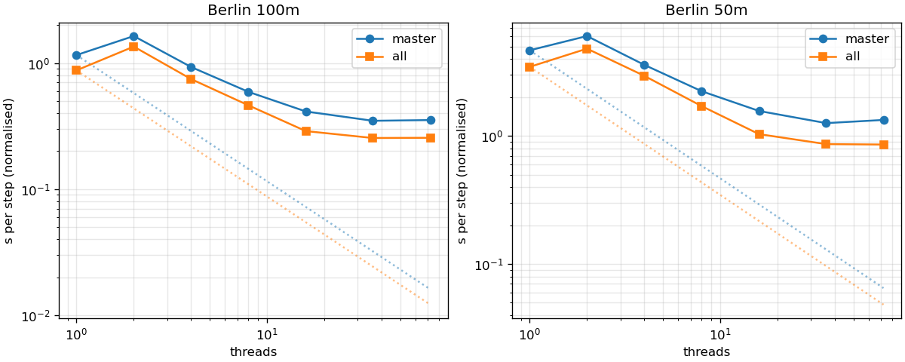
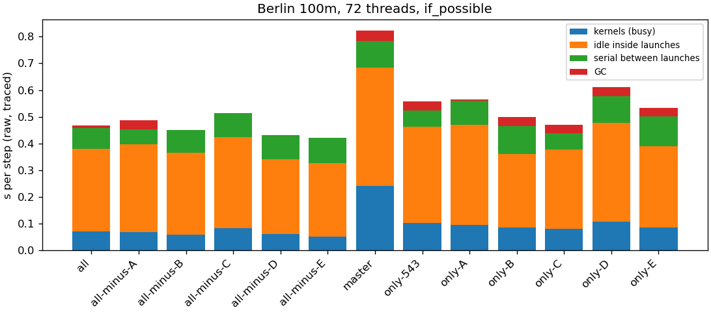
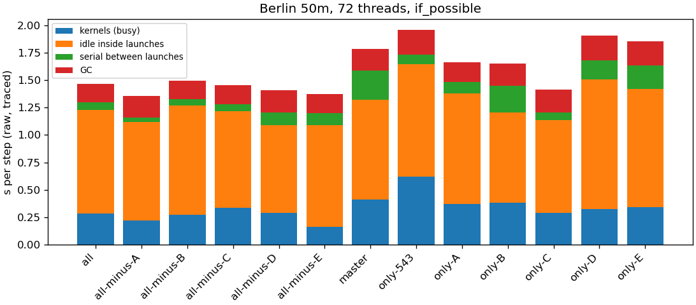

# #566 HPC benchmark, run 1: report

Fritz (NHR@FAU), 8 exclusive nodes, jobs 4459823–4459830, 2026-11-10 23:05 to 2026-11-11 00:08.
Berlin 100 m (dt 2 s) and 50 m (dt 1 s), Julia 1.13.3, one system image per build.
Every number below comes from the TOMLs in `node*/` here (one per process). The LIKWID timelines (24 MB) are not in git: they stay with the full results on Fritz, `$WORK/aeolus-bench/results/run1_20261110_2305`. `summary.md` holds the full tables;
the figures are `fig_scaling.png`, `fig_breakdown_100m.png` and `fig_breakdown_50m.png`.

## Setup

- **Nodes:** Ice Lake SP, 2 × 36 cores, 4 NUMA domains, no SMT, powersave governor, turbo off (2.4 GHz).
  Julia threads are pinned to cores 0…n−1 (`JULIA_EXCLUSIVE=1`).
- **Matrix (packed):**

  | Node | Builds | Threads |
  | :-- | :-- | :-- |
  | 1 | master | 1, 2, 4, 8 |
  | 2 | all | 1, 2, 4, 8 |
  | 3 | master and all, plus the NUMA runs | 16, 36, 72 |
  | 4–7 | the 11 add-one and leave-one-out builds | 16, 72 |
  | 17 | kernel fixes E1–E6 | 1, 16, 72 |

  Builds on one node run one after another, never at the same time.
- **Per process:** model build, then warm-up, then 4 rounds alternating `loop_fusion = never` and `if_possible`.
  Each process gets a stepping budget of 300 s. The table reports the median s/step; master has no fusion setting and reports `none`.
- **Reference:** each node also ran master on 100 m at 72 threads. The nodes measured 0.351–0.359 s/step (mean 0.354), so they agree within 2%.
  All times below are raw; normalising them to the reference changes them by at most 2%.
- **Counters:** LIKWID 5.5.1 ran at 72 threads in timeline mode with groups MEM, FLOPS_DP, L3, UPI, TMA and ENERGY, multiplexed every 2 s.
  The launch trace (the #566 hook) ran after the timed steps, in the same process.
- **Group F (#563) was dropped** (maintainer, 2026-11-10). Its slot went to `only-543`: #545 plus #543, because #550 (C) contains #543.

## Headline

bench/all against master, median s/step (`if_possible`):

| case | threads | master | all | speed-up |
| :-- | --: | --: | --: | --: |
| 100 m | 1 | 1.172 | 0.868 | 1.35× |
| 100 m | 16 | 0.413 | 0.289 | 1.43× |
| 100 m | 72 | 0.353 | 0.256 | 1.38× |
| 50 m | 1 | 4.742 | 3.449 | 1.37× |
| 50 m | 16 | 1.572 | 1.036 | 1.52× |
| 50 m | 72 | 1.338 | 0.859 | 1.56× |

- **Speed-up:** the combined PRs make a step 1.35–1.56× faster at every thread count. The gain is larger on the bigger grid and at more threads.
- **Scaling stops at about 16 threads** for both builds:
  - from 16 to 72 threads, master gains 1.17× on 100 m and all gains 1.13×;
  - on 50 m, 72 threads is no faster than 36 (master 1.26 s against 1.34 s; all 0.87 s against 0.86 s).

  On 100 m at 72 threads, a step of `all` takes 0.26 s, but parallel efficiency from 1 thread is 5%.
- **Loop fusion** (`never` → `if_possible` within bench/all): 1.04× on 100 m at 72 threads, 1.10× at 16, and 1.24× on 50 m at 72.



## Which group contributes what

From `summary.md`:
- **Alone:** the add-one build against master. For C it's only-C against only-543, because #550 contains #543.
- **Within all:** all against the leave-one-out build.

| group | 100 m t16 alone / within | 100 m t72 alone / within | 50 m t16 alone / within | 50 m t72 alone / within |
| :-- | :-- | :-- | :-- | :-- |
| A (#545, #544, #543) | 1.08 / 0.98 | 1.14 / 1.00 | 1.10 / 0.99 | 1.26 / 0.98 |
| B | 1.06 / 1.04 | 1.08 / 1.05 | 1.07 / 1.07 | 1.10 / 1.00 |
| C (#550, fusion) | 1.16 / 1.09 | 1.23 / 1.08 | 1.09 / 1.06 | 1.42 / 1.17 |
| D | 1.07 / 1.01 | 1.00 / 0.98 | 1.11 / 1.10 | 1.09 / 1.02 |
| E | 1.08 / 1.02 | 1.04 / 1.01 | 1.12 / 1.04 | 1.06 / 1.00 |
| #543 alone | 1.09 | 1.07 | 1.15 | 0.97 |
| product of the "alone" speed-ups / measured all÷master | 1.65 / 1.43 | 1.68 / 1.38 | 1.81 / 1.52 | 2.20 / 1.56 |

- **C is the largest single contribution** and the only one that still matters inside all. Removing C from all costs 1.06–1.17×, the most on 50 m at 72 threads.
  Within C, the fusion setting is what counts: all-minus-C runs `if_possible` and `never` at the same speed (1.007 against 1.003 s on 50 m at 72 threads).
- **A, D and E** each help on their own (1.04–1.26×) but add almost nothing once the rest is in (0.98–1.04× within all). Their gains overlap with the others'.
- **B** adds a small amount in both settings, up to 1.07×.
- **The gains don't multiply.** The product of the individual speed-ups (1.65–2.20×) clearly exceeds the measured combination (1.38–1.56×), so the groups speed up overlapping parts of the step.

Each configuration ran once (one process). Within a process the per-step minimum is 1–9% below the median, so differences under about 3% shouldn't be read as real.

## Where the time goes at 72 threads

### Launch trace




The trace makes steps slower: all on 50 m at 72 threads takes 1.46 s/step traced against 0.86 s timed. Read the trace as shares of the step, not as absolute times. bench/all at 72 threads, `if_possible`, per step:

| case | step (traced) | inside launches | serial between launches | busy per thread | idle per thread inside launches |
| :-- | --: | --: | --: | --: | --: |
| 100 m | 0.467 s | 0.379 s | 0.088 s | 0.072 s | 0.308 s |
| 50 m | 1.464 s | 1.227 s | 0.236 s | 0.285 s | 0.942 s |

- **Threads spend most of each launch waiting.** In about 80% of the time inside kernel launches, a thread waits instead of working. That is load imbalance or launches too small for 72 threads, not memory bandwidth (see the counters below).
- **The launches that dominate** (all, 50 m), as wall time per step with thread utilisation:

  | Launch | ms/step | Thread utilisation |
  | :-- | --: | --: |
  | `_xy_item!` | 330 | 22% |
  | `_z_item!` | 216 | 32% |
  | `_b_sweep_slab!` | 206 | 26% |
  | `_blend_body!` | 201 | 1% (effectively serial inside a launch) |
  | `_map_body!` | 77 | 1% |

  `_blend_body!` and `_xy_item!` are the obvious next targets.
- **A difference from master:** on 100 m, master spends 246 ms/step in `_column_store_body!/_tile_column!`. That launch no longer appears among the large ones in all.

### Hardware counters

These are means over the timed section, both settings together. The 50 m runs have 7–11 MEM samples each; the 100 m runs only 2–3, so the 100 m values are rough.

| | memory GB/s | % of STREAM triad (263–274 GB/s) | UPI GB/s | GFLOP/s | back-end bound |
| :-- | --: | --: | --: | --: | --: |
| master, 50 m | 49.0 | 18% | 36.4 | 16.5 | 75% |
| all, 50 m | 45.1 | 16% | 36.8 | 22.3 | 65% |
| other builds, 50 m | 41–59 | 15–22% | 28–45 | 15–24 | 71–83% |

- **Memory bandwidth isn't the limit at 72 threads.** Every build uses 15–22% of the node's STREAM triad. Together with the trace, this puts the scaling limit in idle time inside launches, i.e. synchronisation and load imbalance.
- **Cross-socket (UPI) traffic is about as large as DRAM traffic** (36 against 45–49 GB/s), so a large share of memory accesses cross sockets.
  Interleaving all pages didn't change the step time:

  | case | first touch | interleaved |
  | :-- | --: | --: |
  | 100 m | 0.256 s | 0.250 s |
  | 50 m | 0.859 s | 0.854 s |

  Placement doesn't matter at this load.
- **all does more work per second** (22.3 against 16.5 GFLOP/s) while moving no more memory than master.
- **DRAM power was 42–44 W on node 06** against 12–19 W on the other nodes, for all three builds on that node. That's a property of the node, not of the builds.

## Kernel fixes (group E, node 17)

Median ms per call. E1–E3 ran old and new in the same process. E4–E6 compare bench/all against bench/all with that fix reverted, averaging the medians of the rounds. Every variant agreed with its counterpart within the stated tolerance.

| fix | kernel | 1 thread | 16 threads | 72 threads |
| :-- | :-- | :-- | :-- | :-- |
| E1 | update | 80.7 → 30.7 (2.63×) | 23.0 → 12.8 (1.80×) | 12.5 → 9.6 (1.30×) |
| E2 | strain | 108.0 → 45.1 (2.40×) | 37.5 → 16.9 (2.22×) | 21.0 → 10.1 (2.08×) |
| E3 | pass | 138.5 → 139.6 (0.99×) | 60.1 → 60.5 (0.99×) | 62.7 → 64.7 (0.97×) |
| E4 | pass | 144.6 → 139.6 (1.04×) | 63.2 → 59.1 (1.07×) | 65.8 → 65.3 (1.01×) |
| E4 | N² loop | 10.4 → 7.8 (1.34×) | 3.7 → 3.0 (1.26×) | 3.3 → 3.4 (0.98×) |
| E5 | pass | 34.0 → 19.0 (1.78×) | 13.7 → 10.0 (1.37×) | 12.1 → 9.9 (1.21×) |
| E6 | pass | 2529 → 2218 (1.14×) | 819 → 501 (1.63×) | 683 → 215 (3.17×) |
| E6 | update | 1893 → 1575 (1.20×) | 654 → 339 (1.93×) | 565 → 113 (5.00×) |

- **E6** cuts the allocation per update call from 857 MB to 0 B at 1 thread, 26 kB at 16 and 102 kB at 72. That explains why its gain grows with the thread count.
- **E1, E2 and E5** are clear wins at every thread count.
- **E4** gives a small gain in its loop; the pass as a whole barely changes.
- **E3** gives no gain at any thread count (0.97–1.00×).
- **These fixes barely show up in Berlin steps** (E within all: 1.00–1.04×). E5 and E6 run on synthetic cases because Berlin doesn't use their kernels, and E1–E4 are a small share of a Berlin step.

## Open points

1. **2 threads is slower than 1** for both builds and both cases:

   | | 1 thread | 2 threads | 4 threads |
   | :-- | --: | --: | --: |
   | master, 50 m | 4.74 s | 6.13 s | 3.65 s |
   | all, 100 m | 0.87 s | 1.34 s | 0.74 s |

   The dry run showed the same.
   - **Threads and on-CPU time:** at 1 thread the process has 2 OS threads, and one is on-CPU for 293 s of 294 s. At 2 threads it has 41 OS threads. The two Julia threads are on-CPU for 181 s each (62%), and two more threads for 109 s and 92 s.
   - **Probable cause:** the 1-thread path runs kernels inline, while 2 threads pay the multithreaded launch path's overhead with little parallelism to win it back.

   I haven't verified this; it needs a closer look.
2. **The counters at 100 m are thin** (2–3 MEM samples per run), because the 6 multiplexed groups give each group one sample every 12 s. A rerun with only MEM and TMA, or with a longer budget at 100 m, would firm them up.
3. **The traced steps run about 1.7× slower** than the timed ones. The breakdown shows shares only.
4. **Sanity check of the results** (dry run, job 4459253, 20 steps on 100 m):
   - master at 18 and 17 threads is bit-identical;
   - B, D and E are bit-identical to master;
   - every build containing #543 differs from master by the same amount, the most for w (relative L2 6.3e-5), the least for θ (4e-9).

   So fusion, D, E and B change nothing beyond #543's intended change. `state_compare.jl`'s "10 × spread" criterion can't be used, because the spread is 0.

## Reproduce

- **Scripts as submitted:** `benchmarks/hpc` at commit 3e95f29b plus the uncommitted changes that were committed right after the run (c2e764ab and the commits before it).
- **Build commits:** `builds.txt`.
- **Regenerate `summary.md` and the figures:**

  ```
  module load python/3.13-miniforge
  python3 benchmarks/hpc/summary.py <results directory with the timelines>
  ```
