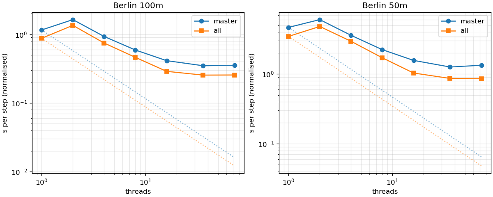
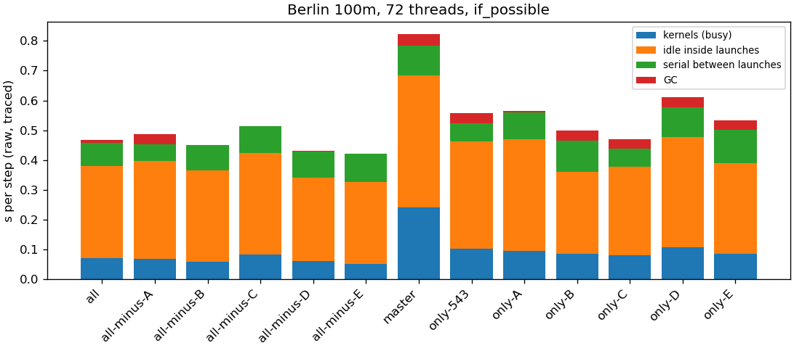
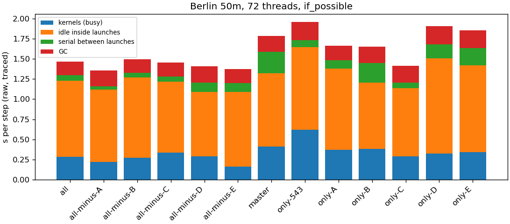

# #566 HPC benchmark: summary

Results: `/home/atuin/b337bd/b337bd10/aeolus-bench/results/run1_20261110_2305`. Reference (bench/master, 100 m, 72 threads, median s/step) per node: node01 0.359, node02 0.351, node03 0.354, node04 0.354, node05 0.352, node06 0.355, node07 0.351; mean 0.354.

## Time per step (s, median; normalised to the node reference)

| build | case | threads | if_possible / none | never | min | normalised | GC/step | node |
| :-- | :-- | --: | --: | --: | --: | --: | --: | :-- |
| all | 100m | 1 | 0.868 | 0.935 | 0.867 | 0.874 | 0.000 | node02 |
| all | 100m | 2 | 1.341 | 1.381 | 1.337 | 1.350 | 0.000 | node02 |
| all | 100m | 4 | 0.741 | 0.746 | 0.721 | 0.746 | 0.005 | node02 |
| all | 100m | 8 | 0.459 | 0.460 | 0.444 | 0.462 | 0.000 | node02 |
| all | 100m | 16 | 0.289 | 0.320 | 0.282 | 0.289 | 0.000 | node03 |
| all | 100m | 36 | 0.255 | 0.269 | 0.246 | 0.254 | 0.001 | node03 |
| all | 100m | 72 | 0.256 | 0.267 | 0.241 | 0.255 | 0.009 | node03 |
| all | 50m | 1 | 3.449 | 3.801 | 3.443 | 3.472 | 0.000 | node02 |
| all | 50m | 2 | 4.787 | 4.930 | 4.766 | 4.819 | 0.000 | node02 |
| all | 50m | 4 | 2.934 | 2.977 | 2.824 | 2.954 | 0.072 | node02 |
| all | 50m | 8 | 1.702 | 1.761 | 1.675 | 1.713 | 0.070 | node02 |
| all | 50m | 16 | 1.036 | 1.152 | 1.016 | 1.035 | 0.091 | node03 |
| all | 50m | 36 | 0.866 | 0.918 | 0.838 | 0.865 | 0.130 | node03 |
| all | 50m | 72 | 0.859 | 1.062 | 0.826 | 0.859 | 0.170 | node03 |
| all-minus-A | 100m | 16 | 0.284 | 0.313 | 0.276 | 0.283 | 0.026 | node06 |
| all-minus-A | 100m | 72 | 0.256 | 0.271 | 0.241 | 0.255 | 0.034 | node06 |
| all-minus-A | 50m | 16 | 1.029 | 1.130 | 1.008 | 1.025 | 0.114 | node06 |
| all-minus-A | 50m | 72 | 0.848 | 0.980 | 0.798 | 0.845 | 0.197 | node06 |
| all-minus-B | 100m | 16 | 0.300 | 0.346 | 0.294 | 0.299 | 0.000 | node06 |
| all-minus-B | 100m | 72 | 0.269 | 0.301 | 0.257 | 0.268 | 0.002 | node06 |
| all-minus-B | 50m | 16 | 1.113 | 1.282 | 1.048 | 1.108 | 0.081 | node06 |
| all-minus-B | 50m | 72 | 0.861 | 1.104 | 0.832 | 0.857 | 0.169 | node06 |
| all-minus-C | 100m | 16 | 0.314 | 0.320 | 0.302 | 0.313 | 0.000 | node06 |
| all-minus-C | 100m | 72 | 0.276 | 0.269 | 0.266 | 0.275 | 0.000 | node06 |
| all-minus-C | 50m | 16 | 1.102 | 1.144 | 1.073 | 1.098 | 0.100 | node06 |
| all-minus-C | 50m | 72 | 1.007 | 1.003 | 0.915 | 1.003 | 0.173 | node06 |
| all-minus-D | 100m | 16 | 0.291 | 0.321 | 0.275 | 0.293 | 0.000 | node07 |
| all-minus-D | 100m | 72 | 0.249 | 0.277 | 0.236 | 0.251 | 0.003 | node07 |
| all-minus-D | 50m | 16 | 1.132 | 1.174 | 1.046 | 1.141 | 0.080 | node07 |
| all-minus-D | 50m | 72 | 0.874 | 0.991 | 0.814 | 0.880 | 0.202 | node07 |
| all-minus-E | 100m | 16 | 0.293 | 0.324 | 0.284 | 0.295 | 0.000 | node07 |
| all-minus-E | 100m | 72 | 0.257 | 0.271 | 0.246 | 0.259 | 0.000 | node07 |
| all-minus-E | 50m | 16 | 1.069 | 1.194 | 1.002 | 1.078 | 0.097 | node07 |
| all-minus-E | 50m | 72 | 0.854 | 1.033 | 0.824 | 0.861 | 0.175 | node07 |
| master | 100m | 1 | 1.172 | – | 1.170 | 1.156 | 0.013 | node01 |
| master | 100m | 2 | 1.658 | – | 1.648 | 1.636 | 0.017 | node01 |
| master | 100m | 4 | 0.943 | – | 0.933 | 0.930 | 0.022 | node01 |
| master | 100m | 8 | 0.599 | – | 0.583 | 0.591 | 0.024 | node01 |
| master | 100m | 16 | 0.413 | – | 0.407 | 0.413 | 0.029 | node03 |
| master | 100m | 36 | 0.348 | – | 0.332 | 0.348 | 0.031 | node03 |
| master | 100m | 72 | 0.353 | – | 0.334 | 0.353 | 0.038 | node03 |
| master | 50m | 1 | 4.742 | – | 4.735 | 4.677 | 0.037 | node01 |
| master | 50m | 2 | 6.128 | – | 6.077 | 6.044 | 0.000 | node01 |
| master | 50m | 4 | 3.648 | – | 3.587 | 3.598 | 0.105 | node01 |
| master | 50m | 8 | 2.272 | – | 2.223 | 2.241 | 0.107 | node01 |
| master | 50m | 16 | 1.572 | – | 1.512 | 1.571 | 0.134 | node03 |
| master | 50m | 36 | 1.264 | – | 1.201 | 1.263 | 0.172 | node03 |
| master | 50m | 72 | 1.338 | – | 1.229 | 1.337 | 0.196 | node03 |
| only-543 | 100m | 16 | 0.378 | 0.377 | 0.372 | 0.380 | 0.027 | node05 |
| only-543 | 100m | 72 | 0.327 | 0.323 | 0.318 | 0.329 | 0.034 | node05 |
| only-543 | 50m | 16 | 1.364 | 1.367 | 1.283 | 1.372 | 0.139 | node05 |
| only-543 | 50m | 72 | 1.377 | 1.526 | 1.285 | 1.385 | 0.224 | node05 |
| only-A | 100m | 16 | 0.383 | 0.382 | 0.372 | 0.382 | 0.000 | node04 |
| only-A | 100m | 72 | 0.311 | 0.313 | 0.296 | 0.311 | 0.003 | node04 |
| only-A | 50m | 16 | 1.436 | 1.431 | 1.384 | 1.434 | 0.099 | node04 |
| only-A | 50m | 72 | 1.062 | 1.085 | 1.013 | 1.061 | 0.178 | node04 |
| only-B | 100m | 16 | 0.391 | 0.387 | 0.383 | 0.390 | 0.025 | node04 |
| only-B | 100m | 72 | 0.326 | 0.322 | 0.309 | 0.326 | 0.033 | node04 |
| only-B | 50m | 16 | 1.470 | 1.468 | 1.446 | 1.468 | 0.138 | node04 |
| only-B | 50m | 72 | 1.214 | 1.234 | 1.098 | 1.213 | 0.204 | node04 |
| only-C | 100m | 16 | 0.328 | 0.374 | 0.322 | 0.328 | 0.028 | node04 |
| only-C | 100m | 72 | 0.268 | 0.314 | 0.254 | 0.268 | 0.030 | node04 |
| only-C | 50m | 16 | 1.261 | 1.431 | 1.205 | 1.260 | 0.154 | node04 |
| only-C | 50m | 72 | 0.975 | 1.183 | 0.925 | 0.974 | 0.209 | node04 |
| only-D | 100m | 16 | 0.386 | 0.384 | 0.376 | 0.388 | 0.025 | node05 |
| only-D | 100m | 72 | 0.352 | 0.338 | 0.340 | 0.354 | 0.035 | node05 |
| only-D | 50m | 16 | 1.406 | 1.438 | 1.379 | 1.413 | 0.148 | node05 |
| only-D | 50m | 72 | 1.223 | 1.239 | 1.182 | 1.230 | 0.224 | node05 |
| only-E | 100m | 16 | 0.381 | 0.378 | 0.373 | 0.383 | 0.027 | node05 |
| only-E | 100m | 72 | 0.338 | 0.334 | 0.322 | 0.340 | 0.032 | node05 |
| only-E | 50m | 16 | 1.401 | 1.401 | 1.374 | 1.409 | 0.158 | node05 |
| only-E | 50m | 72 | 1.255 | 1.349 | 1.130 | 1.262 | 0.219 | node05 |

## Speed-ups (normalised times)

Alone: add-one build against master, except C (only-C against only-543: #550 contains #543).
Within everything: all against all-minus. Interaction: product of the alone speed-ups against all/master.

| group | case | threads | alone | within all |
| :-- | :-- | --: | --: | --: |
| A | 100m | 16 | 1.08× | 0.98× |
| B | 100m | 16 | 1.06× | 1.04× |
| C | 100m | 16 | 1.16× | 1.09× |
| D | 100m | 16 | 1.07× | 1.01× |
| E | 100m | 16 | 1.08× | 1.02× |
| #543 | 100m | 16 | 1.09× | – |
| **product of A, B, C×#543… vs all** | 100m | 16 | 1.65× | all/master 1.43× |
| A | 100m | 72 | 1.14× | 1.00× |
| B | 100m | 72 | 1.08× | 1.05× |
| C | 100m | 72 | 1.23× | 1.08× |
| D | 100m | 72 | 1.00× | 0.98× |
| E | 100m | 72 | 1.04× | 1.01× |
| #543 | 100m | 72 | 1.07× | – |
| **product of A, B, C×#543… vs all** | 100m | 72 | 1.68× | all/master 1.38× |
| A | 50m | 16 | 1.10× | 0.99× |
| B | 50m | 16 | 1.07× | 1.07× |
| C | 50m | 16 | 1.09× | 1.06× |
| D | 50m | 16 | 1.11× | 1.10× |
| E | 50m | 16 | 1.12× | 1.04× |
| #543 | 50m | 16 | 1.15× | – |
| **product of A, B, C×#543… vs all** | 50m | 16 | 1.81× | all/master 1.52× |
| A | 50m | 72 | 1.26× | 0.98× |
| B | 50m | 72 | 1.10× | 1.00× |
| C | 50m | 72 | 1.42× | 1.17× |
| D | 50m | 72 | 1.09× | 1.02× |
| E | 50m | 72 | 1.06× | 1.00× |
| #543 | 50m | 72 | 0.97× | – |
| **product of A, B, C×#543… vs all** | 50m | 72 | 2.20× | all/master 1.56× |

(The product uses C against only-543 times #543 against master, so #543 counts once.)

Dotted: ideal scaling from the smallest thread count.

Per step, from the launch trace (one process per build with the trace on, so slower than the timed runs): kernels = busy summed over threads / threads; idle = idle inside launches / threads; serial = step wall − summed launch walls, less GC (taken from the timed run).

## Hardware counters at 72 threads (LIKWID, over the timed steps)

Means over the timeline samples inside the timed section (both settings; n = MEM samples). Memory and cross-socket (UPI) traffic in GB/s, double-precision GFLOP/s, back-end bound share of pipeline slots (TMA), package and DRAM power summed over both sockets.

| build | case | memory GB/s | STREAM triad | share | UPI GB/s | GFLOP/s | back end | power W | DRAM W | n |
| :-- | :-- | --: | --: | --: | --: | --: | --: | --: | --: | --: |
| all | 100m | 44.7 | 274 | 16 % | 38.4 | 23.7 | 67 % | 201 | 14 | 2 |
| all-minus-A | 100m | 46.2 | 264 | 18 % | 11.2 | 22.0 | 56 % | 197 | 42 | 3 |
| all-minus-B | 100m | 34.3 | 264 | 13 % | 31.8 | 24.6 | 65 % | 202 | 41 | 2 |
| all-minus-C | 100m | 51.2 | 264 | 19 % | 34.4 | 22.4 | 62 % | 222 | 44 | 2 |
| all-minus-D | 100m | 42.0 | 263 | 16 % | 40.1 | 16.9 | 53 % | 203 | 18 | 2 |
| all-minus-E | 100m | 46.7 | 263 | 18 % | 34.5 | 23.7 | 61 % | 216 | 19 | 2 |
| master | 100m | 12.2 | 274 | 4 % | 36.7 | 16.4 | 61 % | 196 | 12 | 2 |
| only-543 | 100m | 48.2 | 272 | 18 % | 41.5 | 2.8 | 62 % | 218 | 19 | 2 |
| only-A | 100m | 51.2 | 267 | 19 % | 41.2 | 20.9 | 59 % | 217 | 18 | 2 |
| only-B | 100m | 41.8 | 267 | 16 % | 26.1 | 18.0 | 72 % | 174 | 14 | 3 |
| only-C | 100m | 45.3 | 267 | 17 % | 30.9 | 19.7 | 73 % | 208 | 16 | 2 |
| only-D | 100m | 40.3 | 272 | 15 % | 35.7 | 18.2 | 73 % | 155 | 14 | 3 |
| only-E | 100m | 46.9 | 272 | 17 % | 31.6 | 18.8 | 69 % | 191 | 17 | 3 |
| all | 50m | 45.1 | 274 | 16 % | 36.8 | 22.3 | 65 % | 215 | 15 | 7 |
| all-minus-A | 50m | 41.5 | 264 | 16 % | 38.1 | 21.5 | 71 % | 204 | 42 | 8 |
| all-minus-B | 50m | 43.3 | 264 | 16 % | 36.4 | 23.6 | 74 % | 222 | 43 | 7 |
| all-minus-C | 50m | 56.1 | 264 | 21 % | 38.4 | 19.7 | 78 % | 220 | 44 | 7 |
| all-minus-D | 50m | 54.2 | 263 | 21 % | 36.4 | 24.1 | 81 % | 199 | 17 | 8 |
| all-minus-E | 50m | 48.5 | 263 | 18 % | 35.2 | 23.3 | 75 % | 202 | 17 | 7 |
| master | 50m | 49.0 | 274 | 18 % | 36.4 | 16.5 | 75 % | 233 | 16 | 10 |
| only-543 | 50m | 45.3 | 272 | 17 % | 32.5 | 16.5 | 83 % | 218 | 17 | 11 |
| only-A | 50m | 59.0 | 267 | 22 % | 44.7 | 22.1 | 76 % | 226 | 19 | 8 |
| only-B | 50m | 48.7 | 267 | 18 % | 39.1 | 14.9 | 78 % | 210 | 16 | 10 |
| only-C | 50m | 44.1 | 267 | 17 % | 27.8 | 22.4 | 73 % | 211 | 16 | 9 |
| only-D | 50m | 41.2 | 272 | 15 % | 37.2 | 19.8 | 81 % | 207 | 18 | 9 |
| only-E | 50m | 56.1 | 272 | 21 % | 40.7 | 20.3 | 77 % | 195 | 16 | 9 |

## NUMA (bench/all, 72 threads)

| case | first touch | --interleave=all |
| :-- | --: | --: |
| 100m | 0.256 | 0.250 |
| 50m | 0.859 | 0.854 |

## Kernel fixes (node 17)

Median ms per call; E1-E3 old and new in one process, E4-E6 bench/all against bench/all with the fix reverted.

| fix | kernel | threads | old | new | speed-up | agree |
| :-- | :-- | --: | --: | --: | --: | :-- |
| E1 | update | 1 | 80.7 | 30.7 | 2.63× | yes |
| E1 | update | 16 | 23.0 | 12.8 | 1.80× | yes |
| E1 | update | 72 | 12.5 | 9.6 | 1.30× | yes |
| E2 | strain | 1 | 108.0 | 45.1 | 2.40× | yes |
| E2 | strain | 16 | 37.5 | 16.9 | 2.22× | yes |
| E2 | strain | 72 | 21.0 | 10.1 | 2.08× | yes |
| E3 | pass | 1 | 138.5 | 139.6 | 0.99× | yes |
| E3 | pass | 16 | 60.1 | 60.5 | 0.99× | yes |
| E3 | pass | 72 | 62.7 | 64.7 | 0.97× | yes |
| E3 | advect | 1 | 51.9 | 51.9 | 1.00× | yes |
| E3 | advect | 16 | 17.4 | 17.4 | 1.00× | yes |
| E3 | advect | 72 | 14.2 | 15.6 | 0.91× | yes |
| E4 | pass | 1 | 144.6 | 139.6 | 1.04× | yes |
| E4 | pass | 16 | 63.2 | 59.1 | 1.07× | yes |
| E4 | pass | 72 | 65.8 | 65.3 | 1.01× | yes |
| E4 | n2_loop | 1 | 10.4 | 7.8 | 1.34× | yes |
| E4 | n2_loop | 16 | 3.7 | 3.0 | 1.26× | yes |
| E4 | n2_loop | 72 | 3.3 | 3.4 | 0.98× | yes |
| E5 | pass | 1 | 34.0 | 19.0 | 1.78× | yes |
| E5 | pass | 16 | 13.7 | 10.0 | 1.37× | yes |
| E5 | pass | 72 | 12.1 | 9.9 | 1.21× | yes |
| E6 | pass | 1 | 2529.1 | 2217.5 | 1.14× | yes |
| E6 | pass | 16 | 819.4 | 501.3 | 1.63× | yes |
| E6 | pass | 72 | 682.9 | 215.3 | 3.17× | yes |
| E6 | update | 1 | 1892.8 | 1575.2 | 1.20× | yes |
| E6 | update | 16 | 653.5 | 338.6 | 1.93× | yes |
| E6 | update | 72 | 565.0 | 112.9 | 5.00× | yes |

E6 allocation per update call (bytes): 1 threads 856885760 → 0, 16 threads 856912064 → 26304, 72 threads 856987600 → 101840

## Not measured

- group F (#563) and its builds: dropped (maintainer, 2026-11-10).
