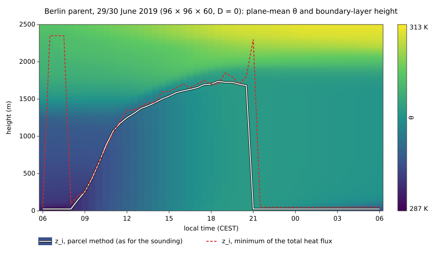
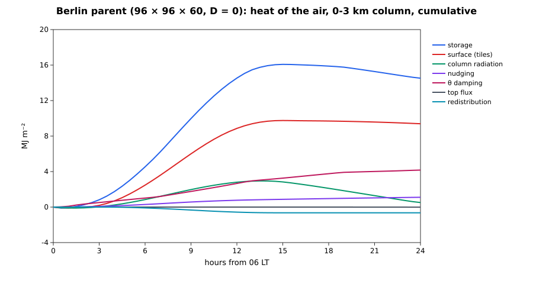

# The Berlin parent

The nesting epic (#246) puts the 1 km Alexanderplatz child inside a deep
Aeolus parent: an idealised, periodic, 6 × 6 × 3 km diurnal run that
supplies the boundary layer the 200–400 m child cannot hold (the
standalone child mixes to its lid by 10:00 and warms 25 K, #247). This
page is the parent run on its own (N-parent-e, #259): what it is built
from, how it is validated, and what it costs. The nest itself — one-way
boundary data, two-way feedback, the parent as default of the Berlin run
— is N-berlin-nest (#265).

Code: `src/urban/parent/config.jl` (`ParentConfig`),
`src/urban/parent/case.jl` (`build_parent`, `step_parent!`,
`run_parent!`), the surface `src/urban/parent/surface.jl` (#249),
the run `examples/urban/berlin_parent.toml` (the `urban_parent`
driver, `src/urban/core/parent_driver.jl`, #438; figures from its output:
`examples/urban/berlin_parent_figures.jl <run folder>`), the checks
`test/urban_checks.jl` (the smoke run, checks 1–3 and the parent surface;
`test/berlin_parent.jl`, `test/berlin_parent_smoke.jl` and
`test/berlin_parent_surface.jl` until #320, the by-hand
`examples/urban/berlin_checks.jl parent` until #438) and the 24 h check
`examples/urban/berlin_parent_lindenberg_check.jl <run folder>`, an
analysis of a run of `berlin_parent_coarse.toml`.

## Grid

| | refinement (rx, ry, rz) | cells | Δx | Δz |
| :-- | :-- | :-- | :-- | :-- |
| default | (2, 2, 4) | 192 × 192 × 53 | 31.25 m | 25 m to 500 m, then × 1.08 per level to 99.6 m at 3 km |
| fallback | (4, 4, 8) | 96 × 96 × 60 | 62.5 m | 50 m uniform |
| uniform alternative | (2, 2, 4) | 192 × 192 × 120 | 31.25 m | 25 m uniform |
| coarse (smoke test, 24 h check) | (16, 16, 8) | 24 × 24 × 38 | 250 m | 50 m to 500 m, then stretched |

The parent cell is an integer block of child cells (child: Δx =
15.625 m, Δz = 6.25 m), so the parent's faces fall on child faces. The
vertical layout is `surface_refined_faces` of #151 with the maintainer's
decision of 2026-10-05: uniform 25 m up to 500 m, so that the child,
deepened to ~400 m, lies entirely in the uniform part. The lateral
boundaries are periodic (an idealised parent), with the child's footprint
centred. `ParentConfig(child)` takes the date, clock, location, θ₀, f,
the sounding and the initial state from the child's `CaseConfig`.

**Placement (#265).** `ParentConfig.center` (default: the child's centre,
`child.offset`) places the parent box; the parent mesh is built at
`parent_origin(pc)` in the child mesh's coordinates — (−2500, −2500, 0)
m for the default, so the child covers parent cells 81–112 in x and y —
and the land use is cropped to the box (`crop_landuse`; the 1 km parent
of the smoke nest is a 32 × 32 crop of the 6 km table, coarsened to
62.5 m). `step_parent!(p, dt)` takes a given step (a nest window) in
pieces of at most the parent's own limit; `step_parent!(p)` is
`step_parent!(p, parent_dt(p))`. The geostrophic wind has one definition,
`parent_geostrophic(pc)`, which the nested child's `:geostrophic`
coupling uses too; without a sounding it is the child's `(U_g, V_g)`
options. The nest itself is the [Nesting](berlin_nesting.md#Nesting-(#265))
section of the Berlin case page.

## Physics, all from src or the child

| component | source | notes |
| :-- | :-- | :-- |
| core | `BoussinesqSimulation` on the `StretchedGrid` (#151) | moist (θ_v buoyancy), f of the child |
| time step | `step_adaptive!` with the child's `AdaptiveStep` constraints; each step `step_rk3!` | see *Time integration* |
| SGS | `PrognosticSGS.TKEClosure`, the child's default `:sgs` provider | on the stretched grid since this issue ([theory](../theory/sgs_tke.md)); l ≤ κz, Moeng's c_ε factor at the first level, surface value from the tiles' u* |
| initial θ, qv | the child's `initial_θ`, `initial_qv` | Lindenberg sounding interpolated to 04 UTC (#247) |
| reference state | `hydrostatic_pressure` (the child's `hydrostatic_check` integration) | p̄, ρ̄, Π̄ on the stretched levels, the child's ground pressure and constants |
| geostrophic wind | `GeostrophicPressureGradient` | sounding u, v at max(z, z_g), z_g = 1.2 × the largest parcel z_i of the launches (1.2 × 1356 = 1627 m); u, v start at U_g |
| nudging | `ProfileNudging` of θ and qv (#248), τ = 6 h | toward the time-interpolated sounding; weight `NudgingWeight` above 1.2 × max(1356 m, the running maximum of the diagnosed z_i), 200 m ramp |
| subsidence | `Subsidence`, form `:local` (#248) | w_s = −D z; default D = 0 (maintainer decision of 2026-10-06), D = 3 × 10⁻⁶ s⁻¹ is an option that currently diverges during the day (#312); see *Subsidence* |
| θ damping | `ReferenceDamping(:θ, …)` (#254) | toward the time-interpolated sounding over the top 25 % (2250–3000 m), α_max = 0.01 s⁻¹; the core's sponge damps u, v, w over the same layer |
| θ top | `FluxBC(Γ)` (#254) | Γ = ∂θ/∂z of the initial profile at the top face (`θ_top_gradient`) |
| surface | the tiled mosaic of #249 | `build_parent_surface` with the child's class-to-surface factory; see *Surface coupling* |
| radiation | the child's column radiation | `column_radiation!` on the parent's plane-mean column (`stitched_column` with the stretched layer thicknesses), every 600 s; the sun of the child's clock (`solar_position_at`) |
| budgets | two `StageBudget`s (#253; `Aeolus.BudgetSystem`, ONE-c #452) | heat of the air ``Σ ρ̄c_pΠ̄θΔV/A`` and water of the air ``Σ ρ̄q_vΔV/A`` (the same meter with Π̄ = c_p = 1) |

Nothing in the parent is a copy. Four pieces of the child were factored so
that both domains call one function: the column radiation
(`column_radiation_solver`, `stitched_column`, `column_radiation!`; since
ONE-e #454 the module `Aeolus.ColumnRadiation`), the
hydrostatic integration (`hydrostatic_pressure`; since ONE-e #454 in
`Aeolus.Anelastic`), the fixed-gradient top
(`θ_top_gradient(cfg; H, dz)`), and the total heat-flux profile
(`mean_heat_flux`, any core, any grid).

### Surface coupling

Every 60 s each tile of each column is stepped
(`step_parent_column!`) under the parent's own air at the tile's forcing
level (the first level above the column's mean roof height for built
tiles, the first level for park and water; #249), with the downwelling
shortwave and longwave of the last radiation call. A tile forced at level
``k_i`` releases its heat, vapour and momentum flux into the canopy levels
below it, ``1 … \max(1, k_i − 1)``, uniformly per volume over their depth
``Z_i``: ``\dot θ_k = f_i H_i/(Z_i ρ̄_k c_p Π̄_k)`` (the child's
`ref_θ_per_heat` conversion), ``\dot q_k = f_i E_i/(Z_i ρ̄_k)``, and the
stress as an implicit deceleration along the wind
(`apply_parent_drag!`, post-predictor). The held sources are delivered
exactly over the time each surface step covers (a step that crosses the
end of an interval takes the next surface step's sources for the rest),
so the air receives what the tiles gave away: the smoke test checks the
ledger's surface term against the delivered sources to 1e-10.

The tiles start at the child's `Ts0` = 285 K, 3.6 K below the 06:00 air,
so the first surface steps cool the air (as in the child).

### Time integration

The child steps the forward-Euler projection `step!` (`AdaptiveStep`,
Courant number 0.5). With the core's centred advection that step is
unconditionally unstable for advection; the child's SGS diffusion keeps
it in check, the parent's does not. Measured with Euler: at the 31.25 m
grid a cold anomaly at the second level grew to −17 K within 140 s
(max |w| 8 m/s at 06:02 LT), and both 24 h runs at 62.5 m failed after
5 h (`step_adaptive!` hit its step floor on the divergence check). The
parent therefore takes `step_rk3!` (SSP-RK3, a projection per stage,
stable for centred advection up to a Courant number of √3) under
`step_adaptive!`, at a Courant number of 0.9 (below 1 so that the
positive TKE transport keeps its guarantee). The same 31.25 m start then
has max |w| = 0.6 m/s after 420 s. The forcings are booked with the
stage weights (1/6, 1/6, 2/3) of the Shu–Osher form. `stepper = :euler`
remains an option.

## Ledgers

The heat of the air is attributed per stage: `(:surface_flux, :tiles)`,
`(:column_tendency, :column_radiation)`, and inside the dynamics
`(:dynamics, :nudging)`, `:subsidence`, `:damping`, `:top_flux` (booked
from the stage-weighted tendency sums of the accepted step) with the rest
split into `:transport` (zero over the column to round-off) and
`:redistribution` (Boussinesq transport conserves ``Σθ``, not ``Σρ̄Π̄θ``;
#253). The water ledger has the same structure. In every run and test of
this issue the closure is at round-off (≤ 1e-15 of the largest term).

## Validation (reduced resolution, measured)

Checks 1–3 are in `test/urban_checks.jl` (idealised, 6–7 simulated
hours; full tier since #438, run by hand in `examples/urban/berlin_checks.jl`
after #320 removed the Berlin test suite, before which they were
`test/berlin_parent.jl`). Check 5 never used the
parent case, only the two cores and the TKE closure: it is the module
test `test/era2_anelastic_cbl.jl`. Checks 4 and 6 need a 24 h simulation
and were moved out of the suite to
`examples/urban/berlin_parent_lindenberg_check.jl` (run by hand): the
maintainer skipped all 24 h validation runs in this issue and deferred
them to #315, after the KernelAbstractions port. Their numbers below
were measured on the coarse grid with the epic's original D = 3 × 10⁻⁶
s⁻¹, before the default became D = 0.

1. **Encroachment** (Tennekes 1973; Stull 1988, Ch. 11). 32 × 32 × 53
   (Δx = 125 m), Q(t) = 0.15 sin(πt/12 h) K m s⁻¹ into Γ = 3 K/km, no
   forcing. z_i (minimum of the total heat flux) against
   ``z_i^2 = 2(1 + 2A)\int Q\,dt/Γ`` with A = 0.2: 786 m against 751 m
   (+4.7 %) at 3 h, 1407 m against 1387 m (+1.4 %) at 6 h. Entrainment
   flux ratio (mean of 17 profiles, 2–6 h): −0.130.
2. **Heat budget.** The closure of ∫ρ̄c_pΠ̄(θ − θ_init) against the booked
   terms is 6.8e-16 of the largest term at every output; the θ damping
   below z_i is exactly zero (the damping layer starts at 2250 m).
3. **Wangara Day 33** (`examples/sbl/data/wangara_day33.csv`: the 09 LT
   sounding of Clarke et al. 1971, data p. 227; Hicks' 1981 surface
   fluxes; the forcing ``⟨wθ⟩_s = 0.216\cos(π(t_h − 13)/11)`` of Nakanishi
   & Niino 2009). The observed z_i(t) of Clarke et al. could not be
   obtained (the report is not online), so the reference is the MYNN z_i
   of Nakanishi & Niino (2009, Table 1), clearly labelled as a model
   value in the data file. z_i at 12, 14, 16 LT: 1078, 1315, 1507 m
   against 1000, 1240, 1400 m (+7.8, +6.1, +7.6 %).
4. **Lindenberg, 29/30 June 2019** (coarse grid, 24 × 24 × 38, 24 h,
   every forcing on, D = 3 × 10⁻⁶ s⁻¹; not in the suite, see above). Parcel z_i at 14 LT 1332 m against 1183 m from the 12 UTC
   sounding (+12.6 %); ⟨θ⟩ at 500 m and 1 km +0.12 K and −0.17 K from the
   sounding; at 03 LT the residual layer between 300 m and
   0.8 z_i,max = 1223 m has a bulk gradient of 0.26 K/km; the night
   (20–05 LT) nudging is 8.5 W m⁻² against 299 W m⁻² of daytime
   (10–16 LT) surface heat flux (ratio 0.028).
5. **Core sensitivity.** Boussinesq against anelastic (Lipps–Hemler, the
   isentropic-profile reference), uniform 24 × 24 × 40 grid, 5 h CBL
   (Q = 0.25 K m s⁻¹, Γ = 3 K/km) to ~2 km: z_i 2100 against 2325 m
   (Δz_i/z_i = +0.107), mixed-layer θ +0.23 K when measured in #259;
   re-measured on master on 2026-10-07 (`test/era2_anelastic_cbl.jl`):
   2175 against 2250 m (+0.034, one 75 m level), θ +0.22 K. The anelastic CBL is
   deeper and warmer because the same kinematic flux heats air whose
   density falls with height.
6. **Robustness.** The coarse 24 h run of check 4: no NaN, no retry, 11 140 steps, dt
   mean 7.8 s (≤ 10 s, the cap; the shortest steps land on output times).

The parent smoke run (`test/urban_checks.jl`;
`test/berlin_parent_smoke.jl` until #320): 12 steps with every parent forcing on,
heat and water closures at round-off, the surface term equal to the
delivered sources.

## Cost

Measured single-threaded on the shared 24-core development machine
(wall seconds per simulated hour; the dynamics is 77–95 % of it):

| grid | cells | measured over | s per simulated hour | 24 h |
| :-- | :-- | :-- | --: | --: |
| default, stretched | 192 × 192 × 53 | 06–07 LT, 1238 steps, mean dt 2.91 s | 2891 | ≈ 19 h (extrapolated) |
| uniform 25 m alternative | 192 × 192 × 120 | 06–06:30 LT, 625 steps, mean dt 2.88 s | 6899 | ≈ 46 h (extrapolated) |
| fallback, uniform 50 m | 96 × 96 × 60 | the full 24 h, D = 0, 19 299 steps, mean dt 4.48 s | 316.6 | 7598 s |

The stretched default is 2.4 × cheaper than the uniform 25 m grid at
the same Δz below 500 m. The default-grid figures are extrapolated from
the first simulated hour, when the boundary layer is shallow; the
measured full-grid 24 h run, and its threaded cost, are #315. The
full-grid cost probe and the 24 h runs on the default grid were skipped
in this issue at the maintainer's request.

## Subsidence

The epic planned a large-scale divergence D = 3 × 10⁻⁶ s⁻¹ (w_s = −D z,
−4.5 mm/s at 1.5 km). With it the 24 h run fails: `step_adaptive!`
reaches its step floor (`dt_min` = 0.01 s) on the divergence check
during the convective day (#312 records the failure at 12:00 LT, z_i ≈
1.1 km; the surviving fallback-grid log of the same configuration ran to
18:30 LT, z_i 1550 m, and failed before the 19:00 output). The parent
default is therefore D = 0 (maintainer decision, 2026-10-06), and
`divergence = 3e-6` stays a documented option that is currently
unstable. The smoke test runs 12 steps with it so that the forcing and
its ledger term stay exercised. The cause (#312) and the final choice of
D (#315) are open.

## Exceptions and limitations

* **Periodic lateral boundaries**: an idealised parent. The mesoscale
  parent (ERA5 or ICON-D2 through the pluggable boundary-data interface)
  is #58.
* **Advection** is the core's centred flux form (θ, qv, momentum); the
  WENO schemes of the child are `RegularGrid`-only. The TKE is
  transported with the flux-limited centred form.
* **Unresolved buildings**: their heat, vapour and stress enter the
  canopy levels below each tile's forcing level uniformly; the parent has
  no building energy model of its own (the tiles are the child's class
  surfaces).
* **The case sun** was `utc_offset` hours early in the child before this
  issue (local hour passed as UTC); fixed here for both domains, see the
  Berlin case page.
* **Wangara z_i** is compared with a model reference (MYNN), not with the
  observations.

## Measured 24 h run

The fallback grid (96 × 96 × 60, Δx = 62.5 m, Δz = 50 m), D = 0, every
other forcing on, 06:00 LT 29 June to 06:00 LT 30 June 2019:
`julia --project -m Aeolus run examples/urban/berlin_parent.toml --set nesting.parent.refinement=[4,4,8] --set 'nesting.parent.vertical="uniform"'`
(until #438 `examples/urban/berlin_parent_diurnal.jl fallback`).
It completed in 7598 s wall (19 299 steps, dt 0.03–10 s, no retry).
The 24 h run on the default grid, and with it the final validation of
the parent, is deferred to #315.

* **Boundary layer.** Parcel z_i 1251 m at 12 LT, 1453 m at 14 LT, 1610
  m at 16 LT, maximum 1739 m at 18:30 LT; at 14 LT this is 23 % above
  the 1183 m of the 12 UTC Lindenberg sounding (the coarse run with D =
  3 × 10⁻⁶ s⁻¹ was 12.6 % above it: subsidence caps the CBL, and without
  it the CBL grows deeper). After 21 LT the parcel z_i drops to the
  lowest level and a ≈ 50 m stable layer (minimum heat flux) forms. The
  minimum-flux z_i jumps to 2.3 km before 08 LT and at 21 LT, when the
  heat-flux profile has no convective minimum; those spikes are a
  property of the diagnostic, not of the flow.
* **Heat of the air**, 24 h means over the 0–3 km column (W m⁻²):
  storage 168.1 = surface 108.7 + radiation 5.9 + θ damping 48.3 +
  nudging 12.8 + redistribution −7.5 + top −0.09; closure 0 over the
  column and ≤ 1.4e-14 W m⁻² in every layer and window reported. At
  night (20–05 LT) the column loses 36.6 W m⁻²: radiation −68.0,
  surface −6.6, nudging +7.3, damping +31.1. The damping and the
  nudging carry the warming of the observed free troposphere (the
  soundings of the 29th and the 30th differ by 3.7–6.5 K, the warm-air
  advection of the heat wave) into the box above 1.2 z_i and above
  2250 m.

## References

* Tennekes, H. (1973). A model for the dynamics of the inversion above a
  convective boundary layer. *J. Atmos. Sci.*, 30, 558–567.
* Stull, R. B. (1988). *An Introduction to Boundary Layer Meteorology*,
  Kluwer, Ch. 11.
* Deardorff, J. W. (1974). Three-dimensional numerical study of the
  height and mean structure of a heated planetary boundary layer.
  *Boundary-Layer Meteorol.*, 7, 81–106.
* Clarke, R. H., Dyer, A. J., Brook, R. R., Reid, D. G. & Troup, A. J.
  (1971). *The Wangara Experiment: Boundary Layer Data*. CSIRO Div.
  Meteorol. Phys. Tech. Paper 19.
* Hicks, B. B. (1981). *An Analysis of Wangara Micrometeorology*. NOAA
  Tech. Memo. ERL ARL-104.
* Nakanishi, M. & Niino, H. (2009). Development of an improved
  turbulence closure model for the atmospheric boundary layer. *J.
  Meteorol. Soc. Japan*, 87, 895–912.
* Heinze, R. et al. (2017). Evaluation of large-eddy simulations forced
  with mesoscale model output for a multi-week period during a
  measurement campaign. *Atmos. Chem. Phys.*, 17, 7083–7109.
* Heus, T. et al. (2010). Formulation of the Dutch Atmospheric
  Large-Eddy Simulation (DALES). *Geosci. Model Dev.*, 3, 415–444.
* Shu, C.-W. & Osher, S. (1988). Efficient implementation of essentially
  non-oscillatory shock-capturing schemes. *J. Comput. Phys.*, 77,
  439–471.
