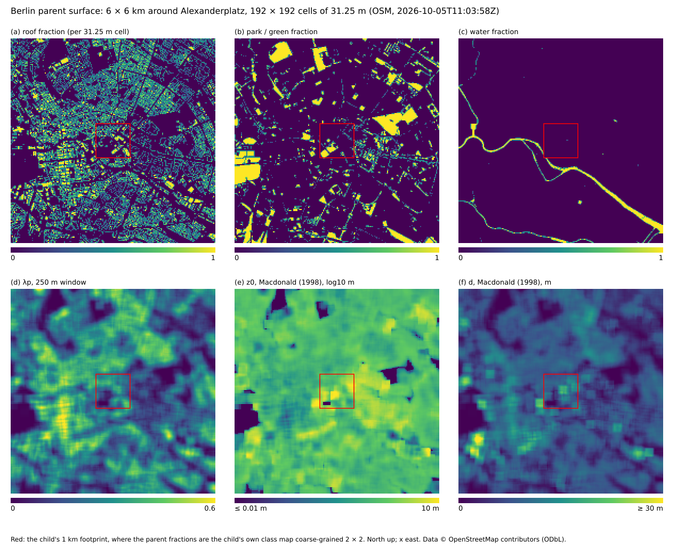

# The Berlin case: surface exchange and radiation

## Surface exchange (#129)

`couplings/surface_exchange.jl` (slot `:surface_exchange`, provider
`:most`) and `couplings/ground_soil.jl` (slot `:ground`, provider
`:soil_column`) replaced the slab scheme of #126 (`surface_slab.jl`,
`soil_urban.jl`).

* **One surface per column.** Every column with air above it has an
  `AbstractSurface`: a `SoilColumn.SoilThermalColumn` with hydrology for
  streets, building-adjacent cells and the park (from `ground_soil`'s
  factory), a `Radiation.SlabLand` for roofs, glass and water (β = 1)
  until #139 / #144 / #141 register their own. Albedo and emissivity come
  from `bus.params` (the radiosity materials), so the radiation and the
  surface balance agree.
* **Roof-aware air level.** The forcing is the first non-solid cell of
  the column (`bus.k_air`), `z_ref = Δz/2` above the surface; the air
  temperature is `θ Π̄_k` and the pressure `p̄_k` of the reference state
  (#131; roofs sit up to 190 m up). H goes into θ, E into qv of that
  cell only: the smoke check counts writes into solid cells (0 in every
  run), and `test/berlin_surface_exchange.jl` checks that the stage
  changes nothing else, and that ``Σρc_pΔzΔθ = ΣHΔt`` (2e-11).
* **Cadence.** The surfaces are stepped every `cfg.cadence[:soil]`
  seconds (30 s in the flagship, 4 s in `:smoke`; a `:surface` key
  overrides it) and their fluxes are held as tendencies until the next
  surface step, so the air receives exactly what the surface gave.
* **Momentum.** The ground is a wall of `Aeolus.WallModels` (#169):
  every surface step hands each column a `MOSTWallLaw` with its `z0m`
  and the Obukhov length of that step (`matching_obukhov_length`, the
  `L` for which the law gives back the step's ``u_*``), and every step
  `apply_wall_stress!` evaluates it at the instantaneous first-air-cell
  wind and applies the stress as an implicit drag on the first-air-cell
  velocity faces (over the `k_air` level mask, after the IBM);
  `bus.u_star` is that step's ``u_τ``. The momentum removed equals
  ``Σ τ_w(U)\,\mathbf{u}/U\,Δt`` to ``O(aΔt)`` (1e-4 in the test). With
  `L` and the wind frozen the operator reproduced the drag of #129
  (``u_*^2/U`` held between surface steps) exactly (0.0 relative
  difference). Option `wall_formulation` selects the local form
  (default), Schumann's or Moeng's plane-mean form (smoke variants). In
  `:smoke` (surfaces every 4 s) per-step evaluation changes the ground
  mean ``u_*`` after 1 h from 0.05647 to 0.05644 m s⁻¹ and the street
  wind from 0.47784 to 0.47796 m s⁻¹; the operator costs 1.2 ms per call
  on the 64 × 64 flagship plane. The `:wall` ground used to be
  free-slip. It stays a free-slip `:wall` carrying the wall-model drag,
  not a resolved `NoSlipWall` (#172): at Δx = 15.6 m a resolved no-slip
  wall would be unphysical
  ([Transition and wall-bounded flow](../theory/transition.md#The-Berlin-case)).
* **Wall-model input** (P57-b, #183). The wind the ground law is
  evaluated at is passed through the exponential time filter of Yang,
  Park & Moin (2017) (`WallModels.MatchingInput`), on by default with
  `input_T_f = 10 s` and advanced once per accepted step in
  `:surface_update`; the stress keeps the direction of the instantaneous
  first-cell wind. The matching height stays at the first air cell
  (`h_wm_cells = 1`): three cells above a street (18.75 m) lie in or
  above the canyon, where no log law holds. `h_wm_cells = 3` samples the
  third air cell of the park and water columns (`h_wm_classes`) — a
  smoke variant. The smoke checks require `bus.u_star` to be the wall
  law at the step's wind and matching height (1e-12), the matching cells
  to be air and the filter state to be finite. Measured in `:smoke` (1 h,
  last 30 min): street ``τ_w`` 7.77e-3 vs 7.61e-3 m² s⁻² without the
  filter, temporal RMS 1.054e-3 vs 1.029e-3, sub-60 s RMS 2.24e-6 vs
  2.18e-6 (the smoke flow has almost no fast fluctuation to filter);
  ground ``u_*`` 0.05260 vs 0.05225 m s⁻¹.
* **Non-equilibrium ground** (P57-c, #189). `wall_model =
  :nonequilibrium` (default `:equilibrium`) makes the ground stress that
  of a `WallModels.TBLEWallModel`: the thin-boundary-layer equations on a
  30-point column under every ground and roof column (rough, the
  surface's `z0m`), between the surface and the same filtered matching
  wind, with the resolved pressure gradient at the first air level
  (one-sided next to a building) and `tble_terms` (default
  `:pressure_gradient`). Applied by the same `apply_wall_stress!` face
  loop in `:post_predictor`, advanced once per step in
  `:surface_update`; `bus.u_star` is the columns' ``u_τ``; the surface
  heat and moisture fluxes stay MOST. Neutral (no stability correction in
  the TBLE). A smoke variant runs it, with checks that every surface
  column has a finite TBLE column with its surface's roughness and that
  `bus.u_star` is ``|τ_w|^{1/2}`` of the columns. Flagship (64 × 64 × 32,
  100 steps after 300): +15.6 ms per step in the coupling's stages (9.4 %;
  not proposed as default), and on the street columns the TBLE and
  equilibrium stresses differ in sign on 11.1 % and in sign or by > 30 %
  on 77.3 %: the canyon pressure gradient (median 3.3e-3 m s⁻²) times the
  3.1 m matching height is as large as the stress.
* **Dynamic roughness** (P57-e, #190; option `z0m = :dynamic`, a smoke
  variant, off by default). The ground law's ``z_{0m}`` becomes
  `WallModels.DynamicRoughness`, ``\sqrt{z_{0,f}^2 + α^2σ_Δ^2}``:
  ``σ_Δ`` is the RMS of the OSM building heights (`osm_height_map`,
  `dynamic_refine = 4` times finer, true heights) about the IBM
  staircase, ``z_{0,f}`` is the column's table value (still the
  roughness of the surface-layer solve), and α is solved every surface
  step from the first-air wind. The smoke checks require the law's
  ``z_0`` to equal the model's (1e-12), and it must be finite, at least
  the table value and below the matching height. Measured in `:smoke`
  over 30 min:
  * street ``z_0`` 0.0555 m against 0.05 m (range 0.05-0.37 m);
  * street ``u_*`` +1.5 %, ground ``u_*`` +5.7 %;
  * cost 1.1 ms per surface step.
* **Extra surface energy.** `bus.sensible` (window sun, glazing
  transmission, dew heat) is collected every step and delivered to the
  surfaces as `Q_extra` at their next step (`step_surface!` of `SlabLand`
  and `SoilThermalColumn` take it since #129). The ledger books the
  pending energy in ``ΔS``, so the per-class closure stays at round-off
  (≤ 3.1e-11 W m⁻² in 1 h of the flagship, wall class at noon).
* **Dew.** One vapour exchange per surface: the soil and water surfaces
  take up dew as negative evaporation (into the soil water); the
  RadiationFog dew reservoir of `fog_dew` acts only over surfaces with
  β = 0 (roofs, glass), above the roof.
* **No clamps.** H, LE and Ts are not clipped (the Kessler qv clamp
  stays for #143).
* **Maximum sustainable heat flux (P58-e, #193).** Every surface step also
  evaluates each column's MSHF (Van de Wiel et al. 2012;
  `SurfaceExchange.surface_mshf_ratio`): one maximisation of the
  Monin–Obukhov flux curve at the column's wind ``\max(U, U_{min})``,
  `z_ref`, `z0m` and ``θ_{va}``. It stores `H_max` (W m⁻², output
  `H_max_sfc`) and the ratio of the downward buoyancy flux to it
  (`mshf_ratio`, negative where unstable). The report prints the mean
  ratio over the stable street, roof and park columns and the share of
  them beyond the MSHF point (``z_{ref}/L`` past the peak of the flux
  curve, output `mshf_beyond`). The smoke check
  asserts ratio ≤ 1 + 1e-8 for every column on the MOST fluxes of the
  step's start. The fluxes a soil column returns are linearised in
  ``T_{skin}`` and may overshoot by O(ΔT²): measured ≤ 3.1 % in the smoke
  run, checked < 10 %. Over the 21 h flagship the delivered ratio reaches
  2684. This happens on calm soil columns where ``H_{max}`` is below
  0.1 W m⁻² and a linearised step turns an upward buoyancy flux into dew,
  so the excess is a few W m⁻². At 03:00 the report reads street 0.02,
  roof 0.04, park 0.00, with 100 % of the stable columns beyond the MSHF
  point. The MSHF costs 48–63 ms per surface step (every 30 s), about 2 % of
  the run's wall time. See
  [Stability functions → MSHF in the Berlin case](../theory/turbulence_stability.md#MSHF-in-the-Berlin-case).

### Measured (flagship, 64 × 64 × 32, adaptive step, 1 h)

Remeasured on master (`915bd49`, with the reference state of #131, the
halo fix of #132 and the adaptive stepper, the default since #166). Two
1 h runs, from 06:00 and from 12:00 local on 20 June
(`CaseConfig(:alexanderplatz; nsteps = 1800, start_h = 6 or 12)`,
default couplings), each run to 3600 s of simulated time: 1648 steps of
1.45–3.36 s (mean 2.18 s) from 06:00 and 2157 steps of 0.76–3.23 s
(mean 1.67 s) from 12:00. The bus fields are averaged over simulated
time, each step weighted by its dt, over each interval. "Slab H" is the same run on the #127 branch (slab scheme),
kept from the #129 measurement. Domain means over 4096 columns (the two
columns without a surface count as zero), W m⁻²; "street+wall" is the
mean over the 1690 street and 978 wall-adjacent columns, "roof" over the
873 roof columns, u\* (m/s) over street and roof columns:

| interval | slab H | MOST H | MOST LE | MOST H street+wall | MOST H roof | u* street | u* roof |
| :-- | --: | --: | --: | --: | --: | --: | --: |
| 06:00–06:05 | −24.1 | −0.4 | 0.3 | −0.5 | −0.1 | 0.011 | 0.002 |
| 06:45–07:00 | −15.9 | 16.5 | 42.9 | 25.2 | −0.0 | 0.066 | 0.0007 |
| 12:00–12:05 | −23.7 | 4.5 | 22.1 | 7.0 | −0.1 | 0.063 | 0.002 |
| 12:45–13:00 | −8.7 | 74.1 | 13.4 | 111.9 | 3.0 | 0.107 | 0.027 |

The street columns alone give H = −0.7, 35.6, 11.2 and 168.4 W m⁻² in
the same four intervals. (The scripts of the #129 measurement no longer
exist; the class averages are reconstructed from their column labels.
Before #131, with `T_air = θ − Γ_d z`, an 8 km scale-height pressure and
ρ = 1, the MOST columns read 22.7 / 46.2 / 34.5 at 06:45–07:00 and
86.5 / 15.2 / 127.9 / 10.5 at 12:45–13:00.)

Why H differs: the slab scheme exchanged at a fixed `C_h = 1e-3` and
`U = 3 m/s`, i.e. 3.0 W m⁻² K⁻¹ whatever the flow, from a slab that
starts 8 K colder than the air (Ts0 = 285 K under θ = 293 K), so its H
was about −24 W m⁻² at the start and still negative after an hour at
noon. With Monin–Obukhov and the resolved wind at the first air cell
(0.48 m/s over streets, 0.20 m/s over roofs at 07:00) the cold,
stably stratified start is almost decoupled (H ≈ 0), and the soil
columns' massless skins heat within minutes, so the streets turn
unstable: after half an hour street+wall H is 25 W m⁻² in the morning
and 112 W m⁻² at noon (street columns alone 36–168). The cold-started
roof slabs (C_s = 1.8e5 J m⁻² K⁻¹) stay colder than the air for most of
the hour, stable and decoupled.

**u\* over roofs.** The plan expected 0.2–0.6 m/s at midday. Measured:
0.038 m/s mean over roofs at 13:00 (0.0010 at 07:00); streets 0.109.
Two reasons, both in the case rather than the scheme: the wind at the
first air cell above the roofs is only 0.25 m/s (the case is driven by a
1 m/s geostrophic wind, u0 = 1 m/s), which gives a *neutral* u\* of
0.0246 m/s for z0m = 0.05 m (the mean of κ max(U, 0.1)/ln(z_ref/z0m));
and the roofs start at 285 K, so they are stably stratified for most of
the first hour (roof skin − air −5.07 K averaged over 12:15–12:30). At
13:00, with the roofs 1.1 K warmer than the air, u\* is 1.5 × its
neutral value (the convective enhancement). The expectation assumed a
few m/s of wind.

**Street β.** The street soil starts at θ = 0.10 (β = 0.44). In the
noon hour its mean β falls as the top layer dries, to 0.373 at 13:00
(hour mean 0.394, range 0.373–0.441), and the evaporation the soil can
deliver collapses: the domain-mean LE is 70.1 W m⁻² between 12:15 and
12:30 and 14.2 W m⁻² after 12:30. Averaged over the noon hour (the
ledger), the street columns have Rn 617.0, H 109.5, LE 68.9 and G 438.6
W m⁻², the roofs Rn 587.35, H 0.81 and ΔS 586.6 W m⁻² (before #131:
637 / 125 / 69 / 443 and 614 / 2.8 / 611).

**Bug found (src).** `SoilThermalColumn.step_surface!` returned the
evaporation the skin balance charged even when the soil, at its dry
potential, delivered less; the difference was only recorded as
`budget.latent_mismatch`. Coupled to the air this created water: in the
first noon run a third of the street LE (≈ 70 of 184 W m⁻²) was never
lost by the soil. It now returns the delivered E and LE and keeps the
unspent latent heat in the top soil layer (test in
`era5_soil_thermal.jl`). LandSurface's vegetated column has the same
pattern (`latent_mismatch` there); #140 should check it.

**Cost.** The surface step (4094 surfaces: 3179 soil columns with
hydrology, 915 slabs) is 16.3 ms (06:00 run, 1648 steps) and 13.6 ms
(12:00 run, 2157 steps) per dynamics step averaged at the 30 s cadence,
i.e. 26.9 and 29.2 s per simulated hour; the air-side update is
1.30 / 1.08 ms and the drag 0.26 / 0.24 ms per step (remeasured on
master `915bd49` with the adaptive step, on a 24-core machine shared
with five other runs; at #129, with the fixed 2 s step, 10–17, 0.9 and
0.15 ms, 18–31 s per simulated hour). The soil column with
hydrology costs about 56 µs per call, a slab 16 µs (measured at #129,
not remeasured).

**Known limitations.** Streets are bare loam: SoilColumn has no sealed
surface, so a street evaporates until its top layer dries (a sealed
option belongs in src). No rain reaches the soil (the microphysics books
precipitation as a domain total). The roughness lengths are per class
options (street/roof 0.05 m, park 0.1 m, water 1e-4 m, glass 0.01 m,
z0h = z0m/10), not a survey. Before the halo fix of #132 the more
vigorous noon convection made the stale-halo transport leak larger (it
created 3.4e-3 kg m⁻² of water in the noon hour, and the Kessler clamp
filled the negative qv it left aloft, +8.9e-5 kg m⁻²). On master both
are zero to round-off in both runs: transport ≤ 3e-18 kg m⁻² in
magnitude, qv clamp 0; the water ledger closes to −1.7e-14 kg m⁻².

## Parent surface (#249)

The nest (#246) puts the 1 km child inside a 6 × 6 km Aeolus parent
with Δx = 31.25 m and Δz = 25 m. At that resolution the buildings are
not resolved: the parent sees Berlin as a heterogeneous surface. Its
surface is `examples/urban/parent/surface.jl`, a tiled mosaic
(`Aeolus.SurfaceTiles`, Avissar & Pielke 1989) per parent column. The
parent case (N-parent-e, #259; [The Berlin parent](berlin_parent.md))
couples it to the 3-D parent run under the parent's own air and radiation;
the nest (N-berlin-nest, #265) makes the parent the default of the Berlin
run, and that is where `:SurfaceTiles` leaves `BERLIN_PENDING`.

*Class fractions, the 250 m morphometry λp, and Macdonald z0 and d of
the 6 km box (`examples/urban/parent/plot_parent_surface.jl`). Red: the
child's footprint.*

**Land use.** `data/fetch_berlin_landuse.jl` queries Overpass for the
6 km box around the anchor (buildings, parks and green land use, water;
ways and multipolygon relations). It classifies them with the case's own
`load_city_osm` (one classifier: `osm_class`), and rasterises them with
`surface_class_map` on the child's 15.625 m grid. It then writes, per
parent cell, the class counts of its 2 × 2 child cells, λp, λf (mean
over the four cardinal directions), and the mean and maximum building
height to `data/berlin_landuse_6km.csv`, with provenance in the header.
The raw OSM is not committed.

**Fractions.** `parent_fractions` takes the table everywhere except
under the child's footprint (`child_footprint`: parent cells 81:112 ×
81:112). There it coarse-grains the child's own class map, so the
parent sees exactly the child's surface, including the glass class the
child adds. The child's OSM file is an older, smaller extract than the
6 km table: under the footprint the table has a roof fraction of 0.292
and the child's map 0.213, and 74 % of the footprint cells agree
exactly. The parent follows the child, so the roughness map shows the
footprint's edge.

**Tiles.** Every tile is `class_surface(case, SurfaceSite(c; T_skin,
z0m, z0h))`, the same class-to-surface factory the surface exchange
builds the child's columns with (factored out of
`couplings/surface_exchange.jl`). When the park (#140) and water (#141)
couplings register their factories, the parent changes with the child.

**Unresolved buildings.** `SurfaceTiles.macdonald_roughness` (Macdonald,
Griffiths & Hall 1998; staggered arrays A = 4.43, β = 1, C_D = 1.2) gives
z0 and d from λp, λf and the roof-weighted mean height h. These are
averaged over an 8 × 8-cell (250 m) window, because one 31.25 m cell
holds only a few buildings. The built tiles (street, roof, wall, glass)
take `max(z0, z0m_class)` for momentum but keep their class's z0h. Form
drag has no heat analogue, which is why urban kB⁻¹ is large (Kanda et
al. 2007). With z0h = 0.1 z0m inherited instead, the parent's footprint H
was +8.8 % above the child's at 13:00 and +9.8 % over 06–18 h; with
the class z0h it is +2.8 % and +3.8 %. The built tiles exchange with the first parent
level above h, at z_k − d. Park and water tiles keep their own
roughness and d = 0, and exchange with the first level. Forced above
the neighbouring roofs, a water column next to 58 m buildings
decoupled (bulk Ri ≈ 1.8, LE = 0.7 W m⁻² at 13:00). With
`blending = MasonBlendingHeight(L)` etc., a column is a `BlendedMosaic`
forced once at z_k − d̄.

**Measured** (`test/berlin_parent_surface.jl`, synthetic clear-sky
forcing `parent_offline_forcing`: Bird SW and Brutsaert LW for 20 June,
T = 295 ± 6 K, q = 8 g kg⁻¹, U = 3 m s⁻¹, 24 h at dt = 300 s; as
measured by #249, with the case sun still 2 h early — the values on the
corrected UTC sun of #259 and the 2019-06-29 case date follow the table):

| quantity | value |
| :-- | :-- |
| Macdonald d/h at λp = 0.3 | 0.5521 |
| λ of the z0/h maximum, cubes (Grimmond & Oke 1999: 0.15–0.2) | 0.164 (z0/h = 0.135) |
| fractions: Σ − 1; footprint = child block counts | ≤ 1e-12; exact |
| control (no unresolved treatment, child's height) − child, 24 h | 4.1e-12 W m⁻² (H) |
| footprint-mean H − child area-mean H, 13:00 / 06–18 h | +2.8 % / +3.8 % |
| footprint-mean LE − child area-mean LE, 06–18 h (13:00) | +4.7 % (−21 %) |
| tile closure, 1825 tiles, 24 h: Rn − H − LE − G; ΔE/Δt − mean G | 1.1e-13; 6.9e-11 W m⁻² |
| mixed street/park column, 13:00: mosaic vs parameter-aggregated | H 191 vs 117, LE 211 vs 644 W m⁻² |

With the sun on UTC (#259; solar noon at 13:05 instead of 11:05 CEST,
against the synthetic air temperature that peaks at 15:00) the footprint
comparison measures H +5.97 % at 13:00 and +3.08 % over 06–18 h, LE
+11.55 % over 06–18 h (+4.4 % at 13:00). The date change to 2019-06-29
moves these by less than 0.6 points.

The issue's target for the footprint mean was 2 %. That holds only for
the control. The parent proper and the child see the same air state at
different heights (z_k − d against Δz/2), and with different momentum
roughness. Under convective conditions the transfer then differs by a
few per cent. LE also depends on when each soil reaches its dry limit:
the child's street and park soils dry about an hour earlier, so LE at
13:00 differs by 21 %.

At 13:00 in the offline run (`parent/parent_surface_diurnal.jl`):

| column | built-tile z0, d | Rn | H | LE | G |
| :-- | :-- | --: | --: | --: | --: |
| core, (109, 85), all roof, λp = 0.46 | 0.45 m, 11.6 m | 482 | 457 | 0 | 25 |
| park, (93, 94), pure park | – | 558 | −1 | 420 | 139 |
| water, Spree (79, 87), pure water | – | 741 | −5 | 7 | 738 |

The water slab is 8 K below the air at 13:00, a stable surface layer.

References: Macdonald, R. W., Griffiths, R. F. & Hall, D. J. (1998),
*Atmos. Environ.* 32, 1857-1864. Grimmond, C. S. B. & Oke, T. R. (1999),
*J. Appl. Meteorol.* 38, 1262-1292. Kanda, M. et al. (2007), *J. Appl.
Meteorol. Climatol.* 46, 1067-1079. Avissar, R. & Pielke, R. A. (1989),
*Mon. Weather Rev.* 117, 2113-2136.

## Facade wall model (#179)

The building facades are walls of `Aeolus.WallModels`
(`couplings/wall_model_facades.jl`, addon, on by default). Before #179
the facades had no wall model: the direct-forcing IBM zeroes the
velocity inside the buildings, and the facade momentum flux was the
viscous and eddy-viscosity stencils' ``(ν + ν_t)(u - 0)/Δ`` — an
unresolved no-slip at `cfg.ν` = 2 m² s⁻¹ and Δ = 15.6 m.

| | |
| :-- | :-- |
| walls | `immersed_walls` on `case.geom.sm` at `init!`: u faces across ±y, v across ±x, w across ±x/±y (the ground and roofs stay with `surface_exchange`, #169) |
| law | `RoughLogLaw(z0m)` at ``h = Δ/2``; `z0m` from `bus.z0m_class` (the surface exchange's per-class table, put on the bus in its `build`): `SURFACE_GLASS` for a glass-tagged building column, `SURFACE_WALL` otherwise (0.01 m / 0.05 m by default) |
| `:body_force` (40) | `remove_stencil_wall_flux!`: the stencil's facade flux out of the tendency (with ``ν_t`` when the step has an eddy viscosity) |
| `:post_predictor` (12) | `apply_immersed_wall_stress!`, implicit, after the `ibm` direct forcing (10) and before the ground's wall stress (15) |
| TKE production (#232) | at `init!` the walls are attached to the `:sgs` closure (`attach_immersed_walls!`): the `:tke` shear production at the facades is the wall stress times the resolved shear across the wall, ``a q^2``, not the production of the stencil flux removed at `:body_force` |
| checks | facade ``τ_w ≥ 0``; no stress written into a solid cell's face; the total facade drag and the removed stencil drag oppose the mean canopy wind |

Measured in `:smoke` after 1 h (3600 s, adaptive step), on vs off
(`physics = Dict(:wall_model_facades => false)`):

| | facades off | facades on |
| :-- | --: | --: |
| facade ``Σ τ_w ΔA`` (m⁴ s⁻²) | — | 25.7 (⟨τ_w⟩ = 8.3e-4 m² s⁻² over 30 859 m²) |
| ground + roof ``Σ u_*^2 ΔxΔy`` (m⁴ s⁻²) | | 250.5 |
| facade share of the surface drag | | 9.3 % (26.3 % after 12 steps) |
| stencil facade drag removed (m⁴ s⁻²) | | 504 (the modelled drag is 15.5: the stencil was 33× it) |
| pedestrian-level (k = 1) mean wind, 106 street columns (m s⁻¹) | 0.4780 | 0.4793 (+0.3 %) |
| k = 1 mean wind, all 187 open columns (m s⁻¹) | 0.3791 | 0.3854 (+1.7 %) |
| ground mean ``u_*`` (m s⁻¹) | 0.0564 | 0.0571 |

The coupling took 2.2 s of a 5567 s run (0.04 %; machine heavily
loaded). The cut-cell method of #179 is not wired: the case has no
cut-cell provider (CutCell is pending on #152), which picks it up.

**TKE production at the facades (#232).** Until #232 the `:tke` closure
booked the shear production of the stencil flux this coupling removes,
``ν_{t,e} q_F^2/Δ^2`` per face — energy the resolved flow never lost —
and none of the work of the modelled stress. Measured on the summer
flagship (default couplings, 1 h from 12:00, adaptive step; means of 31
samples over the second half hour; canopy = the fluid cells of levels
1–4, near-facade = the 5009 canopy cells next to a facade face):

| | stencil production (before) | wall stress × resolved shear (#232) |
| :-- | --: | --: |
| removed-stencil production booked at the facades (m⁵ s⁻³) | 227 = 27.3 % of canopy ``Σ P_s V`` (2.5 % of the domain's) | 0 |
| facade wall-stress work ``Σ a q^2 ΔV`` (m⁵ s⁻³) | 807 (not booked) | 804 (booked) |
| canopy ``Σ P_s V`` booked (m⁵ s⁻³) | 832 | 1420 |
| near-facade mean ``ν_t`` / ``e`` | 0.02464 m² s⁻¹ / 0.00996 m² s⁻² | 0.02595 (+5.3 %) / 0.01081 (+8.5 %) |
| canopy mean ``ν_t`` / ``e`` | 0.03857 / 0.01257 | 0.03946 (+2.3 %) / 0.01303 (+3.7 %) |

The production kernel takes 0.55 ms per step of the 161 ms Berlin step
(0.3 %); both runs took 611 steps for 20 min.

## Radiation (#130)

Two couplings put the Era III radiation stack into the case. Both run at
the `:radiation` cadence, around the radiosity solve.

**`column_radiation`** (slot `:column_radiation`, provider `:twostream`,
the only one; it replaced `cooling_prescribed`). Since #259 the coupling
is factored into three functions that the nesting parent calls as well
(one radiation for both domains): `column_radiation_solver(Nz, p_surf)`
builds the optics and solvers, `stitched_column(c, θ, qv, ql, dz; T_rad)`
the column of a model's mean profiles on layers of thickness `dz` (a
vector, so the parent's stretched levels fit), and
`column_radiation!(c, col, sun, ε, α)` the solve and the heating profile;
the coupling's `:radiation` stage only gathers the child's inputs and
sets the bus (bit for bit the former stage).

**The sun** of every radiation coupling is `solar_position_at(cfg, hour)`
at the local clock hour. `SolarGeometry.solar_time` takes UTC; before #259
the local hour was passed to it unconverted, so the case's sun ran
`utc_offset` hours early (2 h in summer: solar noon at 11:07 CEST instead
of 13:07 on 29 June 2019, the 07:00 sun at the elevation of 09:00). The
local clock is now converted with `cfg.utc_offset` (sun elevation 8.5° at
06:00 CEST, maximum 60.7° at 13:06, sunrise 04:50, sunset 21:30). Flagship
numbers measured before #259 (the diurnal tables of this page) carry the
early sun.

At order 5, before the radiosity:

1. the mean over the fluid cells of θ, qv and ql on every LES level
   becomes a hydrostatic column (`column_from_profiles`, surface
   pressure `surface_pressure(case)` of the reference state, #131), stitched with `stitch_columns` under
   `us_standard_column` (60 layers to 30 km, its surface temperature
   set so that it continues the LES top temperature at 6.5 K/km,
   mid-latitude-summer or sub-arctic-winter humidity by scenario);
2. the surface of the column is the whole domain: the radiative
   temperature ``(\sum ε T_s^4/\sum ε)^{1/4}``, the mean emissivity and the
   effective albedo of the last radiosity solve;
3. correlated-k gas optics plus Mie cloud optics, `solve_lw!` and
   `solve_sw!` (scaled by the Earth–Sun distance factor);
4. `bus.L_sky` is the downwelling longwave at the surface of that
   column (the fog emits into it); `bus.dni`/`bus.dhi` are the surface
   direct and diffuse shortwave of the **same column with the LES
   condensate removed**, because the 3-D cloud shadow below applies the
   resolved cloud to the direct beam, and doing both would count it
   twice; option `surface_sw = :bird` leaves the shortwave to the
   radiosity coupling's Bird clear sky;
5. the heating rate of the LES layers (LW + SW, with the condensate) is
   applied to θ on every step at `:column_tendency`, uniform over the
   fluid cells of each level, through `Radiation.apply_radiative_cooling!`
   with the solid mask (the buildings' cells are not air; heating them
   leaks back into the air next to the walls — in review, a 30 min night
   run of the `:smoke` window cooled the fluid next to buildings at
   level 1 by −0.314 K with the solid cells heated, −0.236 K without).

**`cloud_shadow`** (additive). At order 15, after the radiosity: the
per-cell cloud optical depth with the `RadiationCore` mass extinction
(the same as the column's Mie cloud optics; zero in solid cells),
delta-scaled with the visible ``ω``, ``g`` of that cloud optics
(``τ' = 0.26\,τ``), the slant-path transmittance
`cloud_shadow_transmittance!` from the top of each column's solid stack,
and `bus.sw ← bus.sw·(1 − f_dir(1 − T))` with ``f_{dir}`` the share of the
column's absorbed radiosity shortwave that arrived as direct beam. It
replaced `apply_cloud_shadow!` (vertical ql integral with an ad-hoc
700 m² kg⁻¹, 15 % of the removed light kept, no sun angle, multiplied
into `bus.sw` every step, so compounding). Limitations: the
interreflections of the shaded beam and the buildings' window sun (read
from the radiosity solution) are not attenuated, and the light the cloud
scatters sideways is not added to the diffuse.

Remeasured on master (`915bd49`: the reference-state surface pressure
of 101.325 kPa, the MOST / soil surfaces of #129, the adaptive step of
#166). 1 h runs of the flagship, 64 × 64 × 32, each run to 3600 s of
simulated time (1429 / 1648 / 2157 adaptive steps from 00:00 / 06:00 /
12:00), radiation every 600 s, default couplings; values from the last
radiation call of the hour (at 3600 s less one step; at #130 this was
step 1800). Winter on the `:smoke` window (smoke cadences, no fog
seeded; 690 adaptive steps to 1800 s), which the smoke check uses, and,
since the adaptive stepper lets it run, on the winter flagship itself
(`CaseConfig(:winter; nsteps = 1800, start_h = 12)`, 3378 adaptive steps
of mean 1.07 s to 3600 s). "Above 50 m" is the
ρΔz-weighted mean over the levels whose centre is above 50 m; the old
`0.95σT̄s⁴` uses the arithmetic mean of `bus.Ts`, as the deleted
`lw_from_walls(mean(Ts))` did.

| | 00–01 h | 06–07 h | 12–13 h | winter 12–12:30 (smoke window) | winter 12–13 h (flagship) |
| :-- | --: | --: | --: | --: | --: |
| `L_sky` (W m⁻²) | 335.3 | 337.9 | 342.6 | 238.6 | 240.9 |
| old `0.95σT̄s⁴` at the same T̄s | 360.1 (T̄s 285.94 K) | 402.2 (293.95 K) | 436.8 (300.09 K) | 310.3 (275.49 K) | 309.2 (275.25 K) |
| GHI, column (W m⁻²) | 0 | 559.0 | 830.6 | 234.2 | 200.8 |
| Bird (the radiosity's sky: PW 2 cm, O₃ 0.33), aerosol-free / AOD₅₀₀ = 0.16 | 0 / 0 | 574.5 / 542.3 | 834.1 / 797.0 | 235.1 / 211.7 | 204.0 / 181.8 |
| LES-layer heating, LW / SW (K day⁻¹) | −13.0 / 0 | −4.3 / +3.6 | +2.45 / +4.7 | −0.2 / +1.4 | −1.4 / +1.2 |
| the same above 50 m, LW / total | −5.2 / −5.2 | −3.3 / +0.4 | −1.7 / +3.1 | −1.3 / +0.1 | −1.3 / −0.1 |
| lowest level (0–6 m), LW | −158 | −24 | +77 | +9.7 | −2.7 |
| precipitable water (kg m⁻²) | 12.3 | 12.3 | 12.3 | 3.5 | 3.6 |

(Before #129 and #131, with the slab surfaces and 100.92 kPa: L_sky
331.9 / 333.5 / 335.4 / 237.9, LES-layer LW −12.9 / −9.8 / −6.7 / −4.0,
lowest level −156 / −108 / −59 / −16 K day⁻¹.)

* **Sky longwave** is 25–94 W m⁻² below the old surface-based value in
  summer; the gap grows over the day because the MOST / soil surfaces
  warm to a mean of 300 K by 13:00. `L_sky` itself is almost constant
  (335–343 W m⁻²; it depends on the air, not on the surfaces). In
  winter it is 239 W m⁻², below the 300–380 W m⁻² the issue expected —
  that range was a summer expectation, and a clear sky over 3.5 kg m⁻²
  of water at 274 K gives about 0.7 σT⁴.
* **Clear-sky GHI.** Against Bird with no aerosol and the column's own
  precipitable water and ozone (about 442 DU in summer, 367 in winter),
  the column is −0.90 % at μ₀ = 0.86 (12:00), −1.20 % at μ₀ = 0.81
  (13:00), −3.45 % at μ₀ = 0.58 (07:00) and −4.91 % at the winter noon
  sun, μ₀ = 0.27 (first step of the `:smoke` window; −5.39 % at the end
  of the window, μ₀ = 0.25; −6.31 % at 13:00 on the winter flagship,
  μ₀ = 0.22): TwoStream falls below Bird as the sun gets low. The smoke check asserts 5 % for μ₀ ≥ 0.5 (the issue's noon
  criterion) and 10 % below. Against Bird with the case's urban AOD the
  column is 4.2 % higher at 13:00 and 10.6 % at the low winter sun: the
  TwoStream column has no aerosol until the aerosol-optics coupling
  (#142).
* **Heating.** At night the lowest LES level cools at 158 K day⁻¹: the
  case starts its surfaces at 285 K under 293 K air, and the air near
  the ground radiates into the colder surface. By day the surfaces
  overtake the air (mean Ts 293.9 K at 07:00, 300.1 K at 13:00), and the
  lowest level's longwave goes from −24 K day⁻¹ at 07:00 to **+77 K
  day⁻¹** at 13:00; the winter smoke window heats it too (+9.7), while on
  the winter flagship at 13:00 it cools slightly (−2.7). Above 50 m
  the longwave cooling is −1.7 to −5.2 K day⁻¹ in summer; the noon hour
  is inside the −1…−3 K day⁻¹ the issue expected, the night and morning
  are beyond it. Both the cold surface and the humid initial profile
  (qv = 10 g kg⁻¹ at the ground) cause the excess: in the initial state
  (12:00, one column call) the mean above 50 m is −5.11 K day⁻¹; −3.18
  with the surfaces at 293 K; −1.54 with that and `qv0` halved.
* **Energy.** ``\int ρ c_p\,\dot T\,dz`` over the LES layers equals the
  net-flux convergence to round-off (a smoke check, 1e-10), and the θ
  increment is that heating times dt in every fluid cell and zero in
  every solid one (a smoke check on the field). The air therefore takes
  up the column's convergence times the fluid fraction of each level.
* **Ledger.** In the 06–07 h hour the domain Rn is 222.28 W m⁻²
  (closure 5.2e-12; GHI 559.0 against Bird's 542.3). At #130 it was
  228.59, against 244.28 in the #127 baseline; that baseline cannot be
  rerun on master, and Rn now also carries the #129 surfaces, so the
  share of the drop due to the lower sky longwave alone is no longer
  measured.
* **Cloud shadow** (`:smoke`, default couplings, the smoke test's seeded
  fog of 0.2 g kg⁻¹ in the lowest 18.75 m, noon, μ₀ = 0.860): on step 1
  the direct-beam transmittance has a mean of 0.848 (``e^{-0.2}``, the
  delta-scaled τ′ = 0.26 τ ≈ 0.17 over μ₀) and a minimum of 0.803; shaded
  non-roof columns span 0.803–0.937. The shadow takes 117.7 W m⁻²
  (domain mean) off the surface shortwave; the old formula would have
  kept 21 % of the shortwave under the same fog, and then again on every
  step. Most roofs above the fog are unshaded, but the lowest roof
  transmittance is 0.928 (not checked: probably roofs below the 18.75 m
  fog top).
* **Cost** per radiation call, measured warm (mean of 10 calls after a
  600 s run, 230 adaptive steps) on the flagship on master `915bd49`:
  column radiation 45.0 ms by day, 27.9 ms at night; cloud shadow
  13.3 ms (at #130: 38 / 23 / 13; at `2895fed`: 33.4 / 20.8 / 11.1, on a
  less loaded machine); the radiosity solve itself takes 1–3 s. At the
  600 s cadence that is about 0.1 ms per simulated second (0.2 ms per
  step of 2 s), plus
  0.36–0.59 ms per step for applying the heating (all on a shared
  24-core machine).
  The radiation cadence (`cfg.cadence[:radiation]`) is shared with the
  radiosity: the sky longwave and the beam must be the ones the
  radiosity solve uses.

**The winter flagship blows up with the fixed 2 s step, and runs with
the adaptive one** (not a radiation problem). With `timestepper =
:fixed`, `CaseConfig(:winter; start_h = 12)` on the 64 × 64 × 32 grid
had θ ∈ [270.0, 276.8] K and |u| 1.95 m s⁻¹ at step 125 on `2895fed`,
then θ ∈ [44.8, 428.4] K at step 140 and [−95, 587] K with |u| 15 m s⁻¹
at step 141, after which a saturation call stopped on a negative
temperature (`DomainError` in `saturation_vapor_pressure`); the fixed
stepper still blows up at step 141 on `a630153` (table above). At #130
it blew up earlier (θ ∈ [10, 353] K by step 118, −700 K at step 119),
and the #127 branch, without the radiation couplings, did the same (|u|
grew from 1.9 to 12 m s⁻¹ between steps 100 and 118). With the adaptive
stepper, the default since #166, the winter flagship runs. Measured on
master `915bd49`, 3 h from 12:00: 8606 steps (dt 0.70–2.69 s, mean
1.07 s in the first hour and 1.25 s over the three), θ within
[270.2, 278.4] K throughout, max |u| 2.46 m s⁻¹ at 12:10 falling to
1.17 m s⁻¹ at 15:00, Ts ∈ [262.0, 283.8] K at 15:00; the surface energy
ledger closes to −3.8e-11 W m⁻² (domain) and the water ledger to
−4.5e-15 kg m⁻². Its radiation is in the last column of the table above.

## Cost of per-facet surfaces (#138)

The flagship radiosity scene has this many facets:

| `wall_subdivisions` | facets | roof | wall | ground |
|--:|--:|--:|--:|--:|
| 1 | 5810 | 915 | 1714 | 3181 |
| 2 | 7524 | 915 | 3428 | 3181 |
| 4 | 10952 | 915 | 6856 | 3181 |

The `:smoke` window has 314 facets.

A coupling that gives each facet its own `UrbanFacetScene` column (#139)
pays two costs:

* **Once, at `init!`:** the longwave response ``J``. This is one LU,
  9 s at 5810 facets and 18 s at 7524 on one BLAS thread (3 s at 5810 on
  8 threads). ``J`` then stays resident, at 258 MB and 432 MB.
* **Per step:** `step_urban_facets!` is matrix-free (GMRES, one ``O(n^2)``
  product with ``J`` per iteration). It takes 0.31 s at 5810 facets and
  0.47 s at 7524, on one thread, with 7 iterations. The dense LU it
  replaced took 4.5 s and 9.3 s.

Pass the radiation coupling's `bus.swsol` as `sw`, so the shortwave is
not solved a second time.

The response is rebuilt whenever a facet emissivity changes, for
example under snow (#146). To avoid that, change emissivities only at
the radiation cadence.

Reproduce these numbers with `julia --project=. benchmarks/bench_urban_facets.jl [wall_subdivisions] [blas_threads]`.
