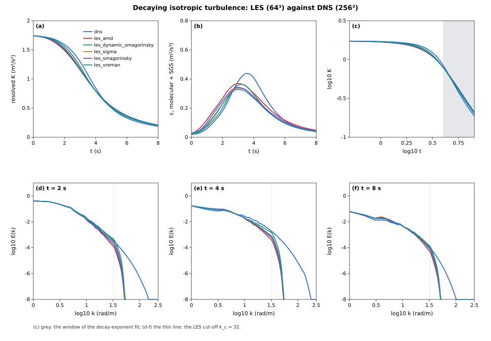

# LES filtering & subgrid closure

## Why filter?

Real turbulent flows have energy across a huge range of scales — in the
atmospheric boundary layer, from the depth of the layer (~1 km) down to
the Kolmogorov microscale (~1 mm). *Direct* numerical simulation would
need `10¹⁸` grid points to resolve them all at meteorological Reynolds
numbers. That is not going to happen.

**Large-eddy simulation** side-steps this by *filtering* the
equations. We separate every field into a resolved (large-scale) part
and a subgrid-scale (SGS) part:

```math
u_i = \bar u_i + u_i''
```

where the overbar is a spatial filter of width `Δ` (in practice, the
grid spacing). Substituting into the Boussinesq momentum equation and
filtering yields:

```math
\frac{\partial \bar u_i}{\partial t}
  + \frac{\partial}{\partial x_j}(\bar u_j \bar u_i)
  = -\frac{1}{\rho_0}\frac{\partial \bar p}{\partial x_i}
     + \bar b\,\delta_{i3}
     - \frac{\partial \tau_{ij}}{\partial x_j}
     + \nu \nabla^2 \bar u_i
```

The new term

```math
\tau_{ij} = \overline{u_i u_j} - \bar u_i \bar u_j
```

is the **subgrid stress tensor** — the effect of unresolved scales on
resolved momentum. It is not closed by the resolved variables alone;
it has to be modelled.

## The Boussinesq eddy-viscosity closure

The oldest and simplest closure, and the one Aeolus implements, is due
to Boussinesq (1877 — a different Boussinesq than the buoyancy one):

```math
\tau_{ij} - \tfrac13\,\tau_{kk}\,\delta_{ij}
    = -2\,\nu_t\,\bar S_{ij}
```

where the resolved rate-of-strain tensor is

```math
\bar S_{ij} = \tfrac12\!\left(\frac{\partial \bar u_i}{\partial x_j}
                            + \frac{\partial \bar u_j}{\partial x_i}\right).
```

The trace (`τₖₖ`) is absorbed into a modified pressure and is not
needed explicitly. The *eddy viscosity* `νₜ` must be specified.

## Smagorinsky-Lilly

The choice of `νₜ` in Aeolus is the classical Smagorinsky-Lilly form:

```math
\nu_t = (C_s\,\Delta)^2\, |\bar S|,
\qquad |\bar S| = \sqrt{2\,\bar S_{ij}\,\bar S_{ij}}.
```

  * `Cₛ` is the Smagorinsky coefficient. In free turbulence `Cₛ ≈
    0.17`. Near walls it is often reduced; wall-model refinements come
    later.
  * `Δ = (Δx·Δy·Δz)^{1/3}` is the geometric-mean filter width — the
    standard choice for anisotropic grids in this closure.

For the scalar transport equation the SGS scalar flux is closed with
an analogous **gradient-diffusion** hypothesis:

```math
\overline{u_j'\theta'} = -\frac{\nu_t}{Pr_t}\frac{\partial \bar \theta}{\partial x_j}
```

with a turbulent Prandtl number `Prₜ`. For dry ABL work `Prₜ ≈ 1/3` is a
common starting value; for engineering `Prₜ ≈ 0.7 – 1` is typical.

See the [Smagorinsky-Lilly](sgs.md) page for the discrete implementation.

## Explicit filters and spectra

The LES filter above is implicit: the grid and the discrete operators
decide what "resolved" means. Analysis, the dynamic procedure and
filtered-DNS comparisons need *explicit* filters and a spectrum, which
`Aeolus.Operators` provides (Phase 54; API in
[Operators](../api/operators.md#LES-analysis-toolbox-(Phase-54))).

**Box (top-hat) filter.** [`box_filter!`](@ref Aeolus.Operators.box_filter!)
averages over ``n`` cells per direction (``n`` odd). On a Fourier mode
``e^{ikx}`` the three-point box acts as

```math
\hat G_{\text{box}}(k) = \frac{1 + 2\cos kΔ}{3},
```

and its second moment ``(n^2-1)Δ^2/12`` is what sets the test-to-grid
width ratio of the dynamic model (``\sqrt{1 + 12 \cdot 2/3} = 3`` for
``n = 3``, see [the SGS page](sgs.md)). It is the dynamic model's test
filter: `compute_dynamic_smagorinsky_νt!` sums the same stencil, so the
two cannot drift (the refactor is bit for bit). With a solid mask the
average runs over fluid neighbours only and is renormalised by their
number, so values inside buildings never leak into the filtered field;
[`staggered_solid_mask`](@ref Aeolus.Operators.staggered_solid_mask)
builds the face masks (a face is solid if either cell is).

**Gaussian and sharp spectral filters** (periodic, FFTW). The Gaussian of
width ``Δ`` has ``\hat G = \exp(-k^2Δ^2/24)``, the same second moment as
a top hat of width ``Δ`` (Pope 2000, §13.2). The sharp cut-off keeps
``|\mathbf k| ≤ k_c`` and is a projection (idempotent).

**Energy spectrum.** [`isotropic_energy_spectrum`](@ref Aeolus.Operators.isotropic_energy_spectrum)
Fourier transforms each velocity component on its own staggered grid and
sums ``\tfrac12|\hat{\mathbf u}|^2`` over shells of unit width
``Δk = 2π/L``, normalised so that ``\sum E Δk = \tfrac12⟨u_iu_i⟩``
exactly (Parseval; shell 0 is the mean flow). The average is over the
stored face values, so the shell sum is the kinetic energy the solver
carries and conserves (`kinetic_energy(sim)` per unit volume). A
half-cell shift only changes the phase of a mode, so no interpolation is
needed. Interpolating to cell centres first, as the first version did,
damps mode ``\mathbf k`` by ``\prod_j\cos^2(k_jΔ_j/2)``, which is 1/2
along an axis at ``k_c/2`` and 0 at ``k_c``. That is a filter, not a
spectrum of the model state.

**Initial fields.** [`isotropic_random_field!`](@ref Aeolus.Operators.isotropic_random_field!)
draws random phases and projects each mode so that the *discrete* C-grid
divergence vanishes. Face amplitudes ``a_j = \hat b_j e^{-ik_jΔ_j/2}``
have divergence ``2i\sum_j \hat b_j \sin(k_jΔ_j/2)/Δ_j``, so ``\hat b``
is projected normal to ``\sin(k_jΔ_j/2)/Δ_j`` (the continuous projection
normal to ``\mathbf k`` is recovered as ``kΔ → 0``). Each shell is then
scaled to hold exactly ``E(k)Δk``: the field is divergence-free to
``10^{-15}`` of its gradients, its spectrum equals the request to
round-off, and so does its kinetic energy. The first version matched the
request in the centre-averaged spectrum and divided the face amplitudes
by ``\cos(k_jΔ_j/2)``. In the solver's energy it started the CBC case
22 % (32³) and 14 % (64³) too energetic, ×2.1 in the cut-off shell (see
[the SGS page](sgs.md#Decaying-grid-turbulence-(Comte-Bellot-and-Corrsin))).
A random-phase field has the right spectrum but no energy transfer.
[`rescale_to_spectrum!`](@ref Aeolus.Operators.rescale_to_spectrum!)
supports the usual "evolve, then rescale the shells back" preparation
(Rogallo 1981), which keeps the phases a run has built.

The benchmark built on these tools — decaying grid turbulence of
Comte-Bellot & Corrsin (1971) — is described on the
[SGS page](sgs.md#Decaying-grid-turbulence-(Comte-Bellot-and-Corrsin)).

## A-priori tests: the exact subfilter stress (Phase 56)

An *a-priori* test evaluates a closure on a resolved (DNS) field, without
running an LES with it (Clark, Ferziger & Reynolds 1979). The DNS field is
filtered explicitly, the **exact** subfilter stress
``τ_{ij} = \overline{u_iu_j} - \bar u_i\bar u_j`` is computed, and the
model stress, evaluated from ``\bar u`` alone, is compared with it point
by point. The tools live in `Aeolus.Operators` (API in
[Operators](../api/operators.md#A-priori-SGS-stress-analysis-(Phase-56))):

* [`subfilter_stress!`](@ref Aeolus.Operators.subfilter_stress!) computes
  ``τ_{ij}`` at cell centres under any of the filters above (passed as a
  callable). For a filter with a positive kernel, ``τ`` is a covariance
  under the kernel weights, so it is positive semi-definite at every point
  (Vreman, Geurts & Kuerten 1994). The sharp spectral filter has a sinc
  kernel with negative lobes and gives no such guarantee.
  ``τ`` is Galilean invariant for every filter that preserves constants.
* [`sgs_dissipation`](@ref Aeolus.Operators.sgs_dissipation) gives
  ``Π = -τ_{ij}\bar S_{ij}``, the transfer from resolved to subfilter
  scales (positive for forward scatter).
* Model stresses: [`smagorinsky_stress!`](@ref Aeolus.Operators.smagorinsky_stress!),
  [`eddy_viscosity_stress!`](@ref Aeolus.Operators.eddy_viscosity_stress!)
  for any ``ν_t``, and [`bardina_stress!`](@ref Aeolus.Operators.bardina_stress!).
  The Bardina model (Bardina et al. 1980) is the scale-similarity model
  ``\overline{\bar u_i\bar u_j} - \bar{\bar u}_i\bar{\bar u}_j``. It is a
  *reference* for comparisons only and not a closure.
* [`apriori_metrics`](@ref Aeolus.Operators.apriori_metrics) returns:
  - the per-component correlations of the deviatoric stresses;
  - the correlation of ``Π``;
  - the ratio of mean ``Π``;
  - the backscatter fraction (points with ``Π < 0``);
  - the Lumley invariants ``II = b_{ij}b_{ji}``, ``III = b_{ij}b_{jk}b_{ki}``
    of ``b = τ/τ_{kk} - I/3``, and the fraction of points inside the
    Lumley triangle.

  [`dissipation_matched_cs`](@ref Aeolus.Operators.dissipation_matched_cs)
  gives the ``C_s`` whose mean dissipation is the exact one,
  ``C_s^2 = ⟨Π⟩/(Δ^2⟨|\bar S|^3⟩)``.

**The filtered-DNS fixture.** The reference field is decaying isotropic
turbulence that Aeolus computes itself (`test/fixtures/dns_decay.jl`).
An external database would need binary I/O and a download, so the
fixture is generated in-package instead. Set-up:

- 96³ on a 2π box (48³ before the review of #208, see below);
- ``E(k) ∝ k^4 e^{-2(k/1.5)^2}``, ``u' = 1``, fixed seed;
- ``ν = 7.14·10^{-3}`` (``0.018·(48/N)^{4/3}``, which holds ``k_{max}η``
  fixed across ``N``);
- `step_rk3!` with the energy-conserving centred scheme, run to
  ``t = 2``.

It is checked as a DNS:

| Check | Measured |
| :-- | --: |
| ``k_{max}η`` (minimum over the run) | 1.61 (1.598 at the ε peak, ``t = 2.41``, run continued to ``t = 3``) |
| velocity-derivative skewness at ``t = 2`` | −0.483 |
| discrete energy budget ``\lvert \mathrm{d}K/\mathrm{d}t / (-ε) - 1 \rvert`` per step | ≤ 1.7·10⁻⁴ |
| ``Re_λ`` at ``t = 2`` | 63.6 |
| ``\mathrm{d}\ln ε/\mathrm{d}t`` over ``t = 1.75``–2 (0.70 at ``t = 1``–1.25) | 0.16 |
| CI time (227 steps, 3 threads, shared machine) | 88–138 s |

The dissipation peak moves later as ``Re_λ`` grows: at
``ν ∝ N^{-4/3}`` it is at ``t ≈ 0.99, 1.45, 1.85, 2.41`` at 32³, 48³,
64³ and 96³, because the cascade needs longer to fill a wider range of
scales. At 96³, ``t = 2`` is on the ε plateau, 1.8 % below the peak, and the
fixture is kept there so that ``Re_λ ≈ 64``. The test checks the ε plateau
rather than "past the peak", the 48³ criterion.

There is no inertial range at this ``Re_λ``, which is the price of a
fixture that runs in CI.

**Measured a-priori numbers** (Gaussian filter, `validation/era6_apriori_sgs.jl`):

| | Δ = 4h (7.8η) | Δ = 8h (15.7η) |
| :-- | --: | --: |
| Smagorinsky ``ρ(τ_{12}, τ_{13}, τ_{23})`` | 0.20, 0.15, 0.14 | 0.22, 0.13, 0.12 |
| Smagorinsky ``ρ_Π`` | 0.810 | 0.734 |
| dissipation-matched ``C_s`` | 0.094 | 0.097 |
| dynamic ``C_s`` (DNS grid) | 0.100 (+6.3 %) | 0.099 (+2.8 %) |
| Bardina ``ρ`` (all components) | 0.96–0.97 | 0.91–0.93 |
| gradient model ``ρ(τ_{12})`` | 0.980 | 0.949 |
| backscatter (points with ``Π < 0``) | 21 % | 20 % |
| min ``λ_1/τ_{kk}`` | 5.2·10⁻⁴ | 4.0·10⁻³ |

The stress correlations of the Smagorinsky model (0.12–0.22) are in the
range of Clark et al. (1979) and Liu, Meneveau & Katz (1994), and
``ρ_Π`` at 4h is inside the 0.4–0.85 band of the high-Re literature. The
Bardina model correlates much better but dissipates too little: its mean
``Π`` ratio is 0.79 at 4h and 0.60 at 8h.

Two points need care.

**The ``Π`` correlation, ``Δ/η`` and ``Re_λ``.** The fixture was 48³
(``Re_λ = 32``) until the review of #208. There ``ρ_Π`` at 4h was 0.867,
above the 0.85 of the literature band, and the test carried a widened
bound. Neither the band nor the code was wrong: at 96³ the 4h value is
inside the band. ``ρ_Π`` falls with ``Δ/η`` at every resolution. Its
dependence on ``Re_λ`` at fixed ``Δ/η`` (``k_{max}η`` is held fixed by
the choice of ``ν``) is shown here as data. It is **not asserted**:

| Δ/η | 48³, ``Re_λ = 32`` | 96³, ``Re_λ = 64`` |
| :-- | --: | --: |
| ≈ 8η (4h) | 0.867 (8.0η) | 0.810 (7.8η) |
| ≈ 16η (8h) | 0.814 (15.9η) | 0.734 (15.7η) |
| ≈ 32η (16h) | 0.669 (31.9η) | 0.669 (31.3η) |

Each column is a single seed. Earlier versions of this page and of the
test said that ``ρ_Π`` falls with ``Re_λ``, and the test asserted it at
fixed ``Δ/η``. An offline 256³ record (``Re_λ = 79``; removed with the
DNS a-priori study, below) broke that, and the
*expectation* was what was wrong, not the code. It was extrapolated from
two single-seed points (48³ → 96³), and the physical argument does not
hold at fixed ``Δ/η``. The filter sits at the same distance from the
dissipation range whatever the ``Re``, so only ``Δ/L`` changes, and no
monotone dependence is established for ``Re_λ`` between 32 and 79. The
generator runs had already shown this: from 64³ upward they agree within
about ±0.01 at 4h (below). At 16h the filter is a third of the 48³ box.
None of these comparisons is asserted; the table is data. On the maintainer's decision on #208 both trend checks were
removed: 48³, 96³ > 256³, and 48³ > 96³, which still passes but rests on
the same claim.

At ``Δ ≈ 8η`` the filter sits in the near-dissipation range. There
``τ`` is given by its Taylor expansion, the gradient model
``(Δ^2/12)∂_k\bar u_i∂_k\bar u_j``, which correlates with the exact
``τ`` at 0.97 (48³) and 0.98 (96³). Both its ``Π`` and
the Smagorinsky ``(C_sΔ)^2|\bar S|^3`` are cubic in the velocity
gradient, which is why ``ρ_Π`` is high at small ``Δ/η``. The test asserts
the literature band at 4h for the 96³ fixture.

**The dynamic coefficient depends on the filter-width ratio.** The
coefficient from `compute_dynamic_smagorinsky_νt!` is comparable to the
dissipation-matched one only when the test-to-grid width ratio describes
the filters actually applied. On the DNS grid, the 3-cell box test filter
(second moment ``2h^2/3``) acts on top of the Gaussian (``Δ^2/12``), so
``α = \sqrt{1 + 8h^2/Δ^2}``. The routine's default ``α = 3`` assumes the
grid is the filter. On the coarse LES grid of spacing ``Δ`` (field
coarse-grained by Fourier truncation) the dynamic ``C_s`` is 0.116 at 4h
(+24 %; 0.133, +33 %, at 48³), because the coarse second-order strain
underestimates ``|\bar S|``.

The former example (`examples/validation/apriori_sgs.jl`, the same 96³
fixture) wrote the full tables for 4h, 8h and 16h. The Smagorinsky ``ρ(τ_{12})`` was
0.20, 0.22 and 0.24, the dissipation-matched ``C_s`` 0.094, 0.097
and 0.111, the dynamic ``C_s`` on the DNS grid +6 %, +3 % and −14 %
from it, and on the LES grid +24 % and +47 % (4h, 8h).

**No offline DNS record.** The a-priori study beyond the 96³ fixture
(an offline 256³ filtered-DNS record, its `dns` run type and its tables)
was removed by the maintainer's decision of 2026-10-09 (ONE-g, #456): the
LES is to be validated differently, possibly externally (#461). The
a-priori unit tests of the SGS models stay (`validation/era6_apriori_sgs.jl`);
the comparison of the models in the running LES is a posteriori, below.

References: Clark, R. A., Ferziger, J. H. & Reynolds, W. C. (1979),
*J. Fluid Mech.* 91, 1; Liu, S., Meneveau, C. & Katz, J. (1994), *J. Fluid
Mech.* 275, 83; Vreman, B., Geurts, B. & Kuerten, H. (1994), *J. Fluid
Mech.* 278, 351; Bardina, J., Ferziger, J. H. & Reynolds, W. C. (1980),
AIAA 80-1357; Lumley, J. L. (1978), *Adv. Appl. Mech.* 18, 123.

## A posteriori: LES against DNS (ONE-g)

`examples/dns_vs_les/` runs decaying isotropic turbulence as model
configurations: a 256³ DNS (no SGS model) and a 64³ LES per SGS model,
all on the 2π box from the same field. The named analytic initial field
`[initial] field = {kind = "isotropic_turbulence", …}`
(`Operators.isotropic_turbulence_field!`) is defined in spectral space:
every mode's random vector depends only on the seed and the integer mode,
so the 64³ start is the 256³ start truncated to its modes, to round-off
(`test/dns_vs_les.jl`, at 32³ / 16³; each start is then projected once
onto its grid's discretely divergence-free fields). The spectrum is
Passot & Pouquet's ``E ∝ k^4 \exp(-2(k/k_p)^2)``, ``k_p = 1.5``,
``u' = 1`` m s⁻¹ (realised ``K_0 = 1.743`` m² s⁻²), ``ν = 2.0·10^{-3}``
m² s⁻¹, run to ``t = 8`` s with adaptive SSP-RK3 steps (CFL 1). The runs
write the resolved kinetic energy, the dissipation (molecular + SGS,
``⟨(ν+ν_t)|S|^2⟩``) and the energy spectrum, and `compare.jl` reads only
those:

| run | decay exponent ``n`` (``K ∝ t^{-n}``, 4–8 s) | ε peak (m² s⁻³) at t (s) | SGS share of ε at the peak | max \|ΔK\|/K vs DNS | RMS log₁₀(E/E_DNS), t = 2 / 4 / 8 s, k ≤ 16 |
| :-- | --: | :-- | --: | --: | :-- |
| DNS 256³ | 2.200 | 0.438 at 3.55 | — | — | — |
| LES dynamic Smagorinsky | 1.998 | 0.364 at 3.21 | 0.50 | 0.079 | 0.047 / 0.116 / 0.061 |
| LES σ (1.35) | 1.955 | 0.338 at 3.06 | 0.56 | 0.125 | 0.085 / 0.151 / 0.081 |
| LES Vreman (0.17) | 1.948 | 0.329 at 2.96 | 0.56 | 0.126 | 0.096 / 0.160 / 0.083 |
| LES Smagorinsky (0.17) | 1.977 | 0.343 at 3.00 | 0.60 | 0.125 | 0.120 / 0.173 / 0.084 |
| LES AMD (0.3) | 1.956 | 0.369 at 3.00 | 0.66 | 0.141 | 0.145 / 0.205 / 0.111 |

The DNS took 2047 steps and 3592 s of run wall time (1.75 s per step) on 12 threads of a shared machine
(max RSS 7.5 GB); each LES 39–140 s on one thread. Its dissipation peak,
``t = 3.55`` s, is where the former 256³ record had it (3.60 s). Every
static model drains energy early: the LES dissipation peaks 0.3–0.6 s
before the DNS and 16–25 % lower, the kinetic energy falls below the DNS
by up to 13–14 % around ``t ≈ 3`` s, and the LES decay is slower over
4–8 s (``n ≈ 1.95``–2.0 against 2.20). The dynamic model, which lowers its
coefficient while the cascade builds, follows the DNS closest in every
measure; AMD is furthest. At ``t = 4`` s the LES spectra fall below the
DNS from ``k ≈ 10`` toward the cut-off ``k_c = 32`` (figure, panel e).
One seed, one resolution: the numbers rank the models on this flow,
they are not converged statistics.



## What LES buys us — and what it doesn't

**Buys us:** the ability to run turbulence at meteorological Reynolds
numbers on machines that exist. The largest eddies (which carry most of
the energy and most of the fluxes) are resolved directly; only the
inertial-range and dissipation-range physics is modelled.

**Doesn't buy us:** correct near-wall physics without help. The
resolved velocity gradients near a solid boundary are severely
under-resolved unless we place many grid points inside the surface
layer, which for atmospheric applications is impractical. This is why
LES codes couple to *wall models* (MOST — Monin–Obukhov Similarity
Theory in the atmosphere; equilibrium wall models in engineering).
Aeolus has them in `Aeolus.WallModels` (Phase 57; see
[Wall models](wall_models.md)).

## Reading list

  * Smagorinsky, J. (1963), *General circulation experiments with the
    primitive equations*, Mon. Wea. Rev. 91, 99.
  * Lilly, D. K. (1967), *The representation of small-scale turbulence
    in numerical simulation experiments*, IBM Sci. Comp. Symp.
  * Sagaut, P. (2006), *Large Eddy Simulation for Incompressible Flows*,
    ch. 4 (SGS models).
  * Pope, S. B. (2000), *Turbulent Flows*, ch. 6 (spectra) and 13
    (filters).
  * Rogallo, R. S. (1981), *Numerical experiments in homogeneous
    turbulence*, NASA TM 81315.
