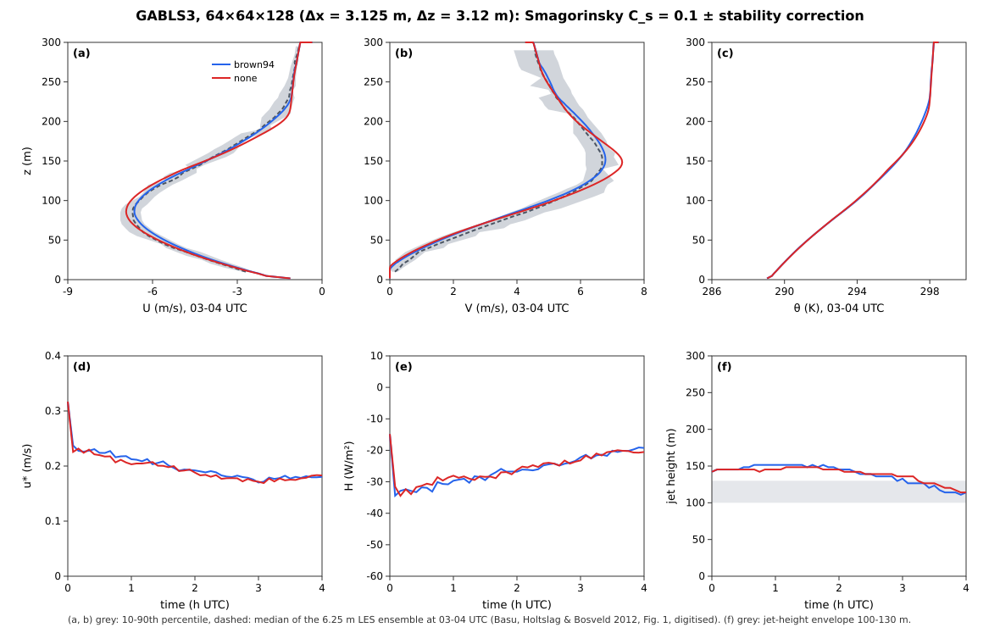
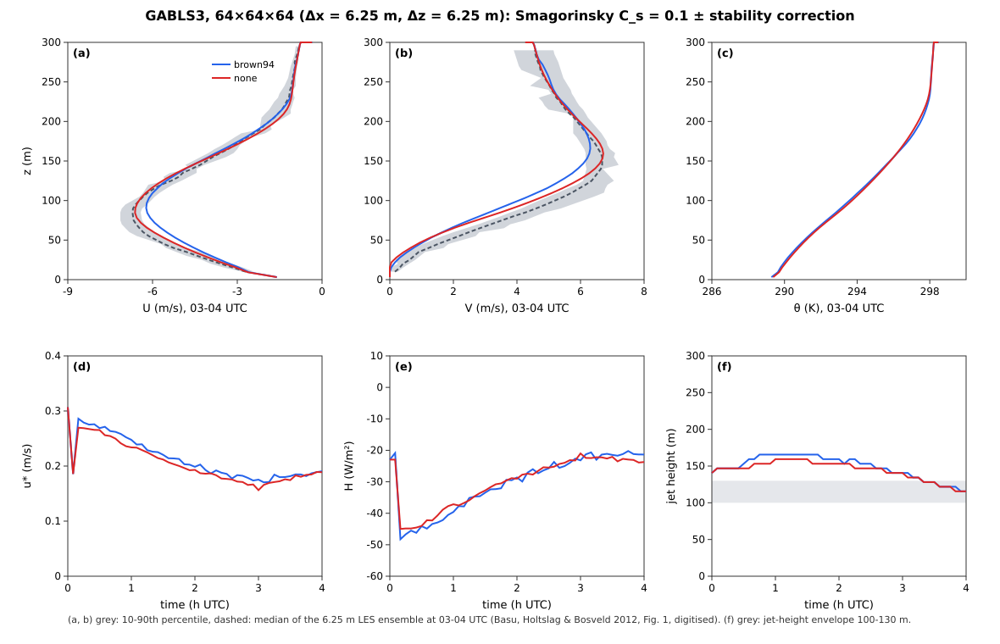
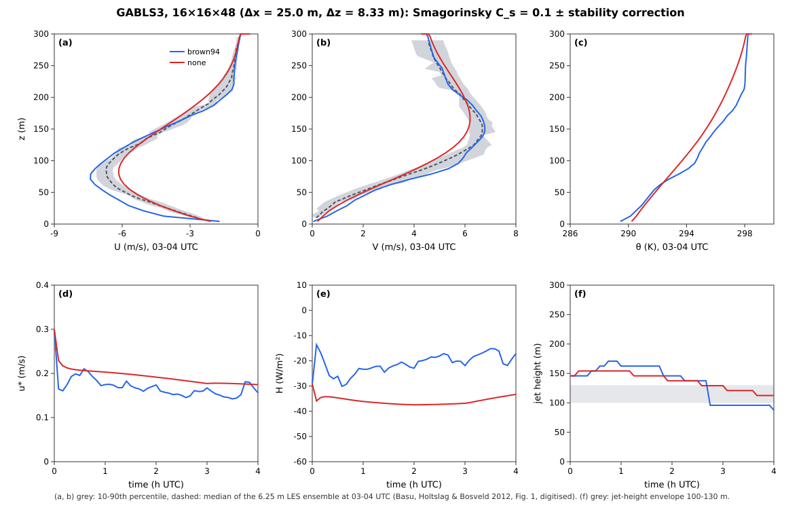
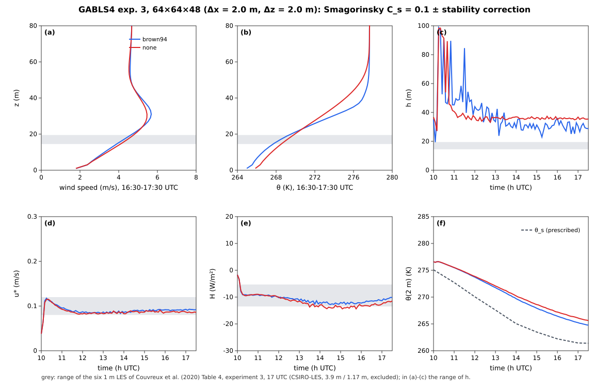
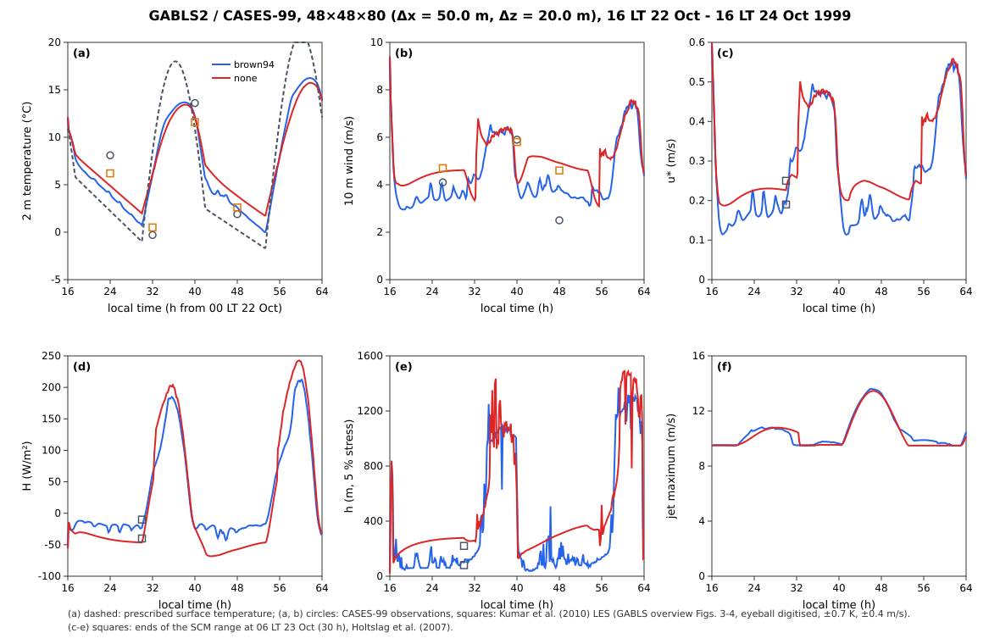
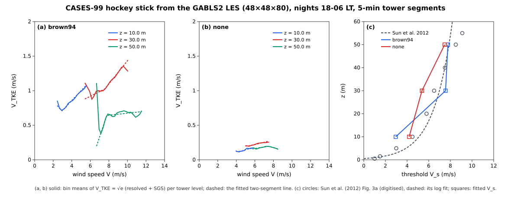

# Stable boundary layers: GABLS1-4 and CASES-99

P55-f (#191) validates the stability-corrected closure of P55-e
(`StabilityCorrected`, [Smagorinsky-Lilly SGS → Stability
correction](sgs.md#Stability-correction)) on two stably stratified,
horizontally homogeneous flows. It adds no physics to `src/`: both cases
are assembled from the Era V and Era VI modules, and only the
wall-resolved, θ-walled variant of the P54-d channel builder is new
(`channel_case(bottom_bc = :noslip, θ_walls = …)`).

## The cases on the one model

Since ONE-g (#456) every SBL case is a configuration of the model
(`examples/sbl/`, run with `julia --project -m Aeolus run`): a
periodic Boussinesq LES over a cooled surface whose every piece is a
component of the stage pipeline, a thin adapter to a physics module. (P55-f
#191 and P58-d #194 built the cases as the `sbl` run type,
`Aeolus.StableBoundaryLayer`; its closures became these components and the
run type was removed.) The scripts of `examples/sbl/` only read the run
folders and make the tables and figures.

| piece | component (section) | provided by |
| :-- | :-- | :-- |
| geostrophic pressure gradient ``(-fV_g, +fU_g)`` | `LargeScale` (`[large_scale_forcing] u_g, v_g`: numbers, or `"driver"`: the dynamic driver's `ls_u_g`, `ls_v_g`), stage 7 | `LargeScaleForcing.GeostrophicPressureGradient` (#171) with the `Coriolis` component's ``f`` |
| Coriolis term | `Coriolis` (`[coriolis] f` or `latitude`), stage 6 | `Operators.add_coriolis!`, `coriolis_parameter` |
| large-scale advection, subsidence, nudging (P58-d) | `LargeScale` (`advective_tendencies`, `subsidence`, `nudging`: the driver's `ls_*` tables, read generically) | `AdvectiveTendencies`, `Subsidence`, `ProfileNudging` |
| surface temperature | `SurfaceLayer` (`[surface] model = "most"`, `temperature`: constant, cooling rate, or the driver's `sfc_temperature`) | `SurfaceTemperatureSeries` (#171) |
| surface heat flux ``w'θ'_0 = -u_*θ_*`` | `SurfaceLayer`, solved per column in stage 3, added in stage 6 | `SurfaceExchange.solve_surface_layer`, `kinematic_heat_flux` |
| surface stress | `SurfaceLayer`, stage 8 (every RK3 substage) | `WallModels.MOSTWallLaw(sf, z0m, L)` with the ``L`` of that solve, `apply_wall_stress!` (the law returns the solver's ``u_*`` bit for bit) |
| SGS closure | `SGS` (`[sgs] closure`, `stability = "brown_et_al_1994"`, `stress = "symmetric"` so that ``ν_v`` reaches the momentum) | `Operators.StabilityCorrected` (P55-e) |
| top damping | `Sponge` (`[sponge] target = "geostrophic"`: toward ``U_g(z, t)`` level by level; `"mean"`: toward the plane mean, damping only the departures) | `Simulations.add_velocity_sponge!` with level-vector targets |
| BL diagnostics | `SurfaceLayer` outputs (`u_star`, `surface_wtheta`, `surface_heat_flux`, `obukhov_length`, `bl_height`, `jet_speed`, `jet_height`, `inversion_height`, `theta_2m`, `wind_10m`, the stress profile) and the core's `heat_flux_profile` (with the surface layer's flux at the bottom face, its `wall_theta_flux`; ONE-l #475) | `Operators.total_stress_profile`, `total_heat_flux_profile`, `stress_bl_height`, `inversion_height`; `SurfaceExchange.similarity_theta`, `similarity_wind` |
| CASES-99 towers | `Towers` (`[towers]`), output `tower_threshold` | `Transition.TowerSampler`, `hockey_stick_threshold` |

The case tables are dynamic drivers (`examples/sbl/input/`), the
initial profiles TOML tables (a `log` or `linear` tail below the lowest
height), the start time `[time] start` (the clock the driver tables are
read on), and the comparisons with the intercomparisons are
`[checks.reference]` against the reference data (`results.toml`).

The GABLS1 surface-layer functions, ``φ_m = 1 + 4.8ζ``,
``φ_h = 1 + 7.8ζ``, are the package's log-linear family
`SurfaceExchange.BusingerDyerLogLinear(β_m = 4.8, β_h = 7.8)` — the same
type the ocean warm layer uses with ``β = 5`` — so the solver and the wall
law use it unchanged and the driver defines no stability functions of its
own. The surface layer is solved once per step from the
start-of-step state at the mid-step surface temperature; the heat flux is
held over the step (the RK3 weights sum to one), so exactly
``⟨w'θ'_0⟩Δt`` enters the column.

### The comparisons as in-model checks

Each configuration compares itself with its reference data in
`[checks.reference]` (advisory: `results.toml` and the run log say
passed or FAILED, the run completes). Reduced runs on the model (ONE-g,
#456; one realisation each, the configs with `--set grid.size=…`):

| case (grid) | quantity, window | model | reference band | check |
| :-- | :-- | --: | :-- | :-- |
| GABLS1 (32³, 12.5 m) | ``u_*``, hours 8–9 | 0.303 m s⁻¹ | 0.245–0.283 | fails (0.020 above) |
| | ``w'θ'_0`` | −0.0149 K m s⁻¹ | −0.0148 to −0.0094 | fails (1.2·10⁻⁴ outside) |
| | ``H`` | −19.5 W m⁻² | −19.3 to −12.3 | fails (0.2 outside) |
| GABLS3 (32³ on 400 m, 12.5 m) | jet height, 03–04 UTC | 117.9 m | 100–130 | passes |
| | jet speed | 7.55 m s⁻¹ | 7.8–9.3 | fails (0.25 below) |
| GABLS4 exp. 3 (32³ on 128 m, 4 m) | ``u_*``, 16:30–17:30 | 0.089 m s⁻¹ | 0.08–0.12 | passes |
| | ``H`` | −10.5 W m⁻² | −13.5 to −5.3 | passes |
| | ``h`` | 36.4 m | 14.5–19.5 | fails |
| | ``L`` | 4.2 m | 6.5–9.9 | fails |
| CASES-99 (24×24×48, 100 m / 33 m) | hockey-stick ``V_s(z)``, two nights | RMS 0.69 m s⁻¹ (3 levels) | Sun et al. (2012) Fig. 3a, tolerance 1 m s⁻¹ | passes |

The coarse grids are on the strong side as before: the `sbl` run type gave
``u_* = 0.304``, ``w'θ'_0 = -0.0153``, ``H = -19.9`` at 32³ for GABLS1
(below), and at 2 m for GABLS4 ``h = 30.7`` m, ``L = 4.6`` m; the
resolution, not the port, puts them outside the bands (the GABLS1 64³ runs
of the run type were inside the heat-flux band and at the upper end of the
``u_*`` band, below). The GABLS3 jet speed checked here
is the mean of the instantaneous maxima of the plane-mean wind over the
window, a little below the maximum of the window-mean profile that the
analysis script and the reduced CI test report.

## GABLS1

The first GEWEX stable-boundary-layer LES intercomparison (Beare et al.
2006; protocol as quoted by Basu & Porté-Agel 2006): a 400 m cube,
``U_g = 8`` m s⁻¹, ``f = 1.39 × 10^{-4}`` s⁻¹ (73° N), ``z_0 = 0.1`` m,
θ = 265 K to 100 m and +0.01 K m⁻¹ above, the surface cooled from 265 K
at 0.25 K h⁻¹ for 9 h, random θ perturbations of ±0.1 K below 50 m, a
Rayleigh layer above 300 m, statistics of hours 8–9. The BL height ``h``
is the height where the mean total stress falls to 5 % of its surface
value, divided by 0.95 (Kosović & Curry 2000).

The reference ranges (`examples/sbl/data/gabls1_reference.csv`) are those
Basu & Porté-Agel (2006, §4c) quote from the intercomparison: surface
momentum flux 0.06–0.08 m² s⁻² (``u_* = 0.245``–0.283 m s⁻¹) and buoyancy
flux −3.5 to −5.5 × 10⁻⁴ m² s⁻³ (``w'θ'_0 = -0.0094`` to −0.0148 K m s⁻¹,
``H ≈ -12`` to −19 W m⁻²), ``h ≈ 200`` m; their LASD runs give
``h = 205/185`` m and ``u_* = 0.283/0.276`` m s⁻¹ at 32³/64³. No source
available to this change quotes the ensemble's low-level-jet maximum, so
it is reported without a reference.

### Results

The numbers below were measured on the `sbl` run type (P55-f). The
reduced CI case on the model (`test/era6_gabls1.jl`: 32³, 1.0–1.25 h)
reproduces them within the scatter of a realisation (another θ noise
draw and the model's adaptive step, which takes 2834 steps where the
run type took 3501):

| 32³, 1.0–1.25 h, Brown et al. (1994) | `sbl` run type | model (ONE-g) |
| :-- | --: | --: |
| ``h`` (m) | 178.0 | 174.0 |
| ``u_*`` mean (range) (m s⁻¹) | 0.275 (0.267–0.283) | 0.276 (0.262–0.288) |
| ``w'θ'_0`` (K m s⁻¹) | −0.00514 | −0.00502 |
| θ budget, max relative residual | 1.7·10⁻⁹ | 1.4·10⁻⁹ |
| ``κ_v/κ_h`` below ``h`` | 0.63 | 0.61 |
| SGS share of the heat flux (uncorrected) | 0.108 (0.153) | 0.109 (0.148) |

Reduced CI test (`test/era6_gabls1.jl`, 32³ at 12.5 m, 0–1.25 h,
statistics over 1.0–1.25 h):

| | `:brown94` | `:none` |
| :-- | :-- | :-- |
| θ budget, max over steps of ``|Δ∫⟨θ⟩dz - ∫⟨w'θ'_0⟩dt|`` / ``|∫⟨w'θ'_0⟩dt|`` | 1.7e-9 | 1.7e-9 |
| ``u_*`` (m s⁻¹), mean [min, max] | 0.272 [0.263, 0.285] | 0.270 [0.259, 0.281] |
| ``w'θ'_0`` (K m s⁻¹), mean (max) | −0.0049 (−0.0047) | −0.0050 (−0.0047) |
| ``h`` (m) | 178.7 | 178.2 |
| mean ``κ_v/κ_h`` below ``h`` | 0.63 | 1 |
| SGS share of the heat flux, lower half of the BL | 0.113 | 0.145 |
| time-stepping cost (s, loaded machine) | 74 | 52 |

Full runs (`examples/sbl/gabls1_closures.toml`, read by `examples/sbl/gabls1.jl`; hours 8–9):

| closure | grid | ``h`` (m) | ``u_*`` (m s⁻¹) | ``w'θ'_0`` (K m s⁻¹) | ``H`` (W m⁻²) | LLJ max (m s⁻¹) at z | ``L`` (m) |
| :-- | :-- | --: | --: | --: | --: | :-- | --: |
| Smagorinsky + Brown 1994 | 32³ | 222.5 | 0.304 | −0.0153 | −19.9 | 9.37 at 206 m | 119 |
| Smagorinsky + Lilly | 32³ | 213.8 | 0.300 | −0.0152 | −19.8 | 9.40 at 206 m | 115 |
| Smagorinsky, uncorrected | 32³ | 210.2 | 0.295 | −0.0155 | −20.3 | 9.29 at 194 m | 107 |
| reference range | | ≈ 200 (LASD 205) | 0.245–0.283 (LASD 0.283) | −0.0148 to −0.0094 | −19.3 to −12.3 | — | (LASD 114) |

| closure | grid | ``h`` (m) | ``u_*`` (m s⁻¹) | ``w'θ'_0`` (K m s⁻¹) | ``H`` (W m⁻²) | LLJ max (m s⁻¹) at z | ``L`` (m) | steps, wall time |
| :-- | :-- | --: | --: | --: | --: | :-- | --: | :-- |
| Smagorinsky + Brown 1994 | 64³ | 196.4 | 0.284 | −0.0134 | −17.5 | 9.49 at 191 m | 110 | 62 677, 6618 s |
| Smagorinsky + Lilly | 64³ | 195.9 | 0.283 | −0.0134 | −17.5 | 9.48 at 191 m | 109 | 62 285, 6361 s |
| Smagorinsky, uncorrected | 64³ | 191.1 | 0.281 | −0.0134 | −17.5 | 9.45 at 184 m | 106 | 61 914, 5467 s |
| reference range | | ≈ 200 (LASD 185) | 0.245–0.283 (LASD 0.276) | −0.0148 to −0.0094 | −19.3 to −12.3 | — | (LASD 114) | |

At 64³ (Δ = 6.25 m; single-thread processes, three in parallel on a
loaded machine, the corrected closure 21 % slower) every closure is
inside the ensemble's heat-flux range and within 2–5 % of ``h ≈ 200`` m;
``u_*`` is at the upper end of the range (0.281 inside; 0.283 and 0.284
on and 0.4 % above its upper limit 0.283), and the ``u_*``, ``h`` and ``L``
of the LASD reference run are matched within 3 %, 7 % and 7 %. Refining
from 32³ to 64³ lowers ``u_*`` by 5–7 %, ``|w'θ'_0|`` by 12–14 % and ``h``
by 8–12 %. The corrected and uncorrected profiles (figure
`examples/sbl/output/gabls1_N64.svg`) differ only near the BL top, where
the corrected run has a sharper capping inversion.

At 32³, by contrast, every closure is slightly outside the range on the strong side:
``u_*`` 4–7 % above its upper end and ``|w'θ'_0|`` 3–5 % above it.

**An expectation that proved wrong.** The issue expected the corrected
closure to give a lower BL than the uncorrected one. At CI resolution
the two agree within their scatter (178.7 ± 3.4 m and 178.2 ± 3.9 m over
1.0–1.25 h), and after 9 h the corrected run is *deeper* at both
resolutions (222.5 against 210.2 m at 32³, 196.4 against 191.1 m at
64³). The code does what it should — ``κ_v/κ_h = 0.63`` below ``h`` and
the SGS share of the heat flux falls from 0.145 to 0.113 — but at 12.5 m
the resolved eddies carry 85–90 % of the flux, and a weaker SGS sink
leaves them more energetic. The test asserts the correction's action
(``κ_v/κ_h < 0.8``, SGS share reduced by more than 10 %), not the ordering
of ``h``.

## Observed cases: GABLS2, GABLS3, GABLS4 and CASES-99 (P58-d)

P58-d (#194) runs three observed stable-boundary-layer cases on the same
driver. It adds no physics. Since CFG-d (#359) each case is a
configuration in `examples/sbl/` (since ONE-g #456 of the model;
before, of the `sbl` run type): the case constants are in the TOML file,
the case data the CSVs under `examples/sbl/data/` (provenance in every
header), written into the configs' dynamic drivers, and the components
above apply them:

| case | config | forcing | surface | reference |
| :-- | :-- | :-- | :-- | :-- |
| GABLS3, Cabauw, 00-09 UTC 2 July 2006 | `gabls3.toml` | ``U_g(z,t)``, ``V_g(z,t)`` `ForcingTable`s; `AdvectiveTendencies` of u, v, θ | prescribed 0.25 m θ (`SurfaceTemperatureSeries`, `z0h = 0.25`), ``z_0 = 0.15`` m, ψ = −5z/L | Basu (2008) case description; LES ensemble: Basu, Holtslag & Bosveld (2012) |
| GABLS4 stage 3, Dome C, 11 Dec 2009 | `gabls4_exp3.toml` | ``U_g = (1.25, 4.5)`` m s⁻¹, ``f < 0`` | the official case file's skin temperature, θ at 651 hPa | Couvreux et al. (2020), Tables 4-5 |
| GABLS2, CASES-99, 22-24 Oct 1999 | `gabls2.toml`, `cases99.toml` (with the towers) | ``U_g = (3, -9)`` m s⁻¹ | prescribed surface temperature formula | Svensson et al. (2011) (not accessible; see below), Holtslag et al. (2007) |

The GABLS3 surface flux is the one the case description prescribes,

```math
\overline{w'θ'}_0 = \frac{u_* κ\,(θ_{0.25} - θ_{z_1})}{\ln(z_1/0.25) - Ψ_H(z_1/L) + Ψ_H(0.25/L)} ,
```

and `solve_surface_layer` with `z0h = 0.25` and ``θ_s = θ_{0.25}``
evaluates exactly this expression, because its log term
``Φ_h = \ln(z/z_{0h}) - ψ_h(z/L) + ψ_h(z_{0h}/L)`` has the same form. The
stable functions ψ_M = ψ_H = −5z/L are `BusingerDyerLogLinear(β = 5)`.
For the unstable morning the case description prescribes nothing, so the
family's Businger–Dyer branch (γ = 16) is used.

The driver gained only generic pieces for these cases, listed in the
table above. The ``U_g`` tables enter `GeostrophicPressureGradient`
unchanged. The sponge damps only departures from the plane mean
(`sponge_target = :mean`), because in GABLS3 the mean wind above the
boundary layer is meant to evolve under the prescribed advection.

### Exceptions, stated

* **Dry.** The Boussinesq core's SSP-RK3 does not advance `qv`, and the
  SGS closures do not diffuse it, so the GABLS3 humidity is not carried.
  Over the column, q = 8.7-10 g/kg, which would change θ_v by
  ``0.61 Δq\,θ ≈ 0.23`` K. That is 3 % of the 6.5 K θ range of the
  initial sounding. GABLS2's q (2.5 g/kg) is not carried either. GABLS4
  is dry by design.
* **GABLS2 subsidence (since #248).** The case's subsidence
  (−5 mm s⁻¹ at 1 km, ``w_s ∝ z`` below) starts at 40 h local time, after
  the first night that the SCM ranges refer to. Until #248 it was not
  applied, because `LargeScaleForcing` had no state-dependent
  subsidence; `gabls2.toml` now applies it to θ with
  `LargeScaleForcing.Subsidence` (see
  [Large-scale forcing](large_scale_forcing.md#GABLS2)). The first-night
  numbers below are unaffected by it.
* **Sources that were not accessible.** Bosveld et al. (2014b) and
  Svensson et al. (2011) were behind a publisher JavaScript challenge.
  The GABLS3 envelope therefore comes from the same LES ensemble as
  published in the ECMWF workshop paper (Basu, Holtslag & Bosveld 2012,
  Fig. 1, digitised). The GABLS2 set-up comes from the CLUBB participant
  files, checked against Holtslag et al. (2007) and van Hooft's Basilisk
  set-up. The disagreements and how they were resolved are listed in the
  CSV header.
* **One published table is wrong.** Table 5 of Couvreux et al. (2020)
  omits the 15 UTC surface temperature (233.04 K) and shifts the later
  hours by one. The official case file (read with NCDatasets) is used.

### GABLS3: reduced CI test

`test/era6_gabls3.jl` runs one 16 × 16 × 48 simulation (Δx = 25 m,
Δz = 8.3 m on 400 × 400 × 400 m, sponge from 300 m) from 00 to 04 UTC.
The issue asked for 00-02 UTC. The run goes on to 04 UTC because the
only accessible LES envelope is for 03-04 UTC. Checks 1-3 use the
01-02 UTC window as specified. The test file takes 63 s at machine load 3.7 (the run itself 37 s), within the issue's 90 s. At load 11 it takes 141 s.

| check | measured | asserted |
| :-- | :-- | :-- |
| 1. mean-momentum budget below 300 m, 01-02 UTC | residual 7.5e-4 of the largest term (3.6 m s⁻¹) | < 2 % |
| 2. heat budget, every step | 1.2e-10 relative | ≤ 1e-8 |
| 3. first-cell u*, θ* against the case-description formulas (stable columns) | 3.5e-16 / 3.0e-16; implicit-wall stress vs ⟨u*²⟩: 0.13 % | < 1 % |
| 4. surface heat flux 00-04 UTC | ≤ −0.011 K m s⁻¹ at every step | < 0 |
| 4. jet at 03-04 UTC | 9.07 m s⁻¹ at 94.9 m; geostrophic speed 6.54 m s⁻¹ | supergeostrophic, below 400 m |
| 4. jet speed vs envelope 7.8-9.3 m s⁻¹ | inside | inside |
| 4. jet height vs envelope 100-130 m | **−5.1 m outside** (+0.9997 m inside in 2 of 4 runs) | reported; within one Δz |

How the momentum budget is formed: every term is evaluated in every
SSP-RK3 substage, from the same state the dynamics see, and weighted
1/6, 1/6, 2/3. The surface stress comes from the wall-model hook. The
residual is therefore not a time-discretisation error. It comes from the
diagnosed flux (resolved ``-⟨uw⟩`` plus ``ν_v ∂u/∂z``) not being exactly
the core's stress-form operator, whose plane mean also contains
``⟨ν_v ∂w/∂x⟩``. The same 7.5e-4 separates the diagnosed divergence from
the core's own advection + SGS tendency.

**An expectation that failed at this resolution.** Check 4 asked for the
jet height to lie inside the LES envelope. At Δx = 25 m, Δz = 8.3 m it
does not: two realisations give 93.4 and 94.9 m, 5-7 m below the 100 m
lower bound, which is less than one Δz. The expectation is what fails
here, not the code. With the same code the jet rises with resolution:
102.7 m at 12.5 m / 4.2 m, 126.8 m at 6.25 m and 118.9 m at 3.125 m
(table below). The strict assertion was kept as `@test_broken` until
#248, which found that marker to be the wrong expectation: the same code
gave 94.93 m when the test file ran alone and in one full suite, and
100.9997 m in two other full suites (one on master, one on the #248
branch). The run is chaotic and not reproducible bit for bit from
process to process, so the strict check was sometimes an unexpected
pass. It is now reported, not asserted. The test asserts the
resolution-aware statement that the jet lies within one Δz of the
envelope, which holds in every run.

### GABLS3: full runs

The runs are `examples/sbl/gabls3_closures.toml` (and its `--set` resolutions); `examples/sbl/gabls3.jl` reads them and uses 03-04 UTC means. "Envelope" means the
digitised 10-90 % range of the 6.25 m ensemble. Wall times were measured
on a machine shared with other jobs (load 12-18).

| Δx / Δz (domain) | closure | h (m) | u* (m s⁻¹) | H (W m⁻²) | L (m) | h/L | jet (m s⁻¹) | jet height (m) | θ(2 m) (K) | U(10 m) (m s⁻¹) | wall (s) |
| :-- | :-- | --: | --: | --: | --: | --: | --: | --: | --: | --: | --: |
| 25 / 8.3 m (400 m)³ | brown94 | 78.1 | 0.158 | −18.1 | 18.5 | 4.2 | 9.01 | 93.4 | 289.13 | 3.45 | 34 |
| | none | 255.5 | 0.177 | −35.1 | 14.2 | 18.0 | 7.76 | 119.0 | 289.61 | 2.76 | 22 |
| 12.5 / 4.2 m (400 m)³ | brown94 | 81.9 | 0.161 | −18.5 | 18.5 | 4.4 | 8.95 | 102.7 | 289.13 | 3.83 | 1014 |
| | none | 210.9 | 0.159 | −23.3 | 15.5 | 13.6 | 9.20 | 97.1 | 289.32 | 2.77 | 652 |
| 6.25 m (400 m)³ | brown94 | 209.1 | 0.181 | −21.3 | 23.1 | 9.1 | 7.70 | 126.8 | 289.11 | 2.62 | 6016 |
| | none | 155.6 | 0.177 | −22.7 | 20.5 | 7.6 | 8.17 | 125.8 | 289.18 | 2.68 | 4819 |
| 3.125 m (200 × 200 × 400 m) | brown94 | 212.2 | 0.178 | −20.8 | 22.1 | 9.6 | 8.41 | 118.9 | 289.07 | 2.48 | 17393 |
| | none | 96.4 | 0.177 | −21.0 | 21.5 | 4.5 | 8.81 | 125.6 | 289.08 | 2.53 | 15220 |
| LES ensemble, 6.25 m | | | | | | "order of 5" | 7.8 … 9.3 | 100 … 130 | | 2.41 … 2.83 | |

* U(10 m) envelope: the speed of the digitised 10-90 % U, V curves at
  10 m.
* θ(2 m) is MOST from the 0.25 m value (288.52 K over 03-04 UTC). The
  accessible sources give no reference for it.
* h is the 5 %-stress height of the 03-04 UTC mean stress profile.
* The 800 m reference cube at 6.25 m (128³) was not run. It would cost
  4 × the 400 m run, and the jet and the SBL lie below 300 m.
* The 3.125 m run uses a 200 m wide domain to stay affordable.








* **Jet height.** It converges into the envelope from 12.5 m on: 102.7 →
  126.8 → 118.9 m for brown94.
* **Jet speed.** Inside at every resolution except brown94 at 6.25 m
  (7.70 m s⁻¹, 0.1 m s⁻¹ below).
* **Profiles.** At 3.125 m the corrected U and V lie on the ensemble
  median at every height below 300 m (figure).
* **10 m wind.** Inside the ensemble range at 6.25 and 3.125 m. Too
  windy at 25 and 12.5 m with brown94 (3.45, 3.83 m s⁻¹).
* **u* and H.** 0.18 m s⁻¹ and −21 W m⁻² at 6.25 and 3.125 m, nearly
  independent of the closure.
* **h, not robust.** The weak stress above the jet decays slowly, so the
  5 % height moves between about 80 and 210 m. h/L is 4.2-4.5
  (brown94 at 25 / 12.5 m, none at 3.125 m) or 9-10 (brown94 at
  6.25 / 3.125 m), against the paper's "order of 5".
* **With and without the P55-e correction.** At 25 m the correction
  matters: without it the coarse run over-mixes, with h = 256 m,
  H = −35 W m⁻² and a laminar-looking u* series. At 6.25 and 3.125 m the
  two closures nearly coincide. This is the small sensitivity to the SGS
  model that Basu et al. (2012) report for the ensemble: the resolved
  eddies carry the flux.


### GABLS4, experiment 3

`examples/sbl/gabls4_closures.toml` (read by `examples/sbl/gabls4.jl`) uses experiment 3: it starts at 10 UTC from
the Table 5 profiles, with z0m = 1e-3 m, z0h = 1e-4 m and β_m = 4.8,
β_h = 7.8. Statistics are 16:30-17:30 UTC means. The finest affordable
grid here is 2 m, the vertical resolution of experiment 2, on
128 × 128 × 96 m (64 × 64 × 48). It took 9436 s (brown94) and 7895 s
(none) for 7.5 simulated hours on one core. 1 m on the same domain would
need 8 × the cells and about 2 × the steps, ≈ 16 × the cost (≈ 40 h).

**The reference grids** (Couvreux et al. 2020, Table 2; #237). Not all
seven experiment-3 LES ran at 1 m:

| experiment 3 | run | Δx (m) | Δz (m) | domain (m) | h at 17 UTC (m) |
| :-- | :-- | --: | --: | :-- | --: |
| MesoNH | M1E3 | 1 | 1 | 500 × 500 × 150 | 19 |
| PALM | M2E3 | 1 | 1 | 500 × 500 × 150 | 17.5 |
| UConn | M3E3 | 1 | 1 | 256 × 256 × 80 | 17.5 |
| MicroHH | M4E3 | 1 | 1 | 480 × 480 × 160 | 16.5 |
| DALES | M8E3 | 1 | 1 | 512 × 512 × 150 | 19.5 |
| MONC | M9E3 | 1 | 1 | 500 × 500 × 150 | 14.5 |
| CSIRO-LES | M10E3 | 3.9 | 1.17 | 500 × 500 × 150 | 25 |
| Aeolus (this run) | — | 2 | 2 | 128 × 128 × 96 | 30.7 (brown94) |

The six 1 m runs give h = 14.5-19.5 m (mean 17.4 m). CSIRO-LES alone sets
the 25 m top of the seven-model range. An earlier version of this page
and of `gabls4_reference.csv` called all seven "1 m" and used 14.5-25 m.
Our vertical spacing (2 m) is coarser than that of every experiment-3
run, CSIRO's 1.17 m included; horizontally we are finer than CSIRO only.

The experiment-2 column of Table 4 mixes runs. Table 2 lists E2 runs at
5 m / 2 m for MesoNH, PALM, UConn and MONC, and CSIRO's E2 run at
7.8 m / 3.9 m. MicroHH and DALES have no E2 run; their "experiment 2"
h, L and u* equal those of their experiment-1 runs in Table 3 (M4E1,
M8E1, z0m = 1e-2 m). H differs between Tables 3 and 4 for every run that
appears in both (MicroHH: −22.3 in Table 4, −11.9 for M4E1), and MONC's
Table 4 row matches none of M9E2's Table 3 values. Below, the
experiment-2 column is therefore restricted to the four E2 runs at
5 m / 2 m with z0m = 1e-3 m. The per-run provenance is in
`examples/sbl/data/gabls4_reference.csv`.

| 17 UTC | brown94 | none | exp. 3, six LES at 1 m | CSIRO-LES exp. 3 (3.9 / 1.17 m) | exp. 2, four LES at 5 / 2 m |
| :-- | --: | --: | :-- | --: | :-- |
| h (m) | 30.7 | 35.7 | 14.5 … 19.5 | 25 | 17 … 29 |
| L (m) | 4.6 | 3.4 | 6.5 … 9.9 | 7.7 | 7.9 … 15.5 |
| u* (m s⁻¹) | 0.092 | 0.086 | 0.08 … 0.12 | 0.10 | 0.08 … 0.11 |
| H (W m⁻²) | −11.0 | −12.3 | −13.5 … −5.3 | −10.5 | −8.1 … −4.7 |
| θ* (K) | 0.125 | 0.149 | 0.07 … 0.12 | 0.10 | 0.06 … 0.09 |
| jet | 5.68 m s⁻¹ at 31 m | 5.46 m s⁻¹ at 31 m | — | — | — |

* Inside the six-run 1 m range: u* and H, with both closures.
* h: 30.7 m (brown94) is 11.2 m above the top of the 1 m runs and
  1.8 × their mean; 35.7 m (none) is 16.2 m above. The 2 m run's h is
  also just above the four experiment-2 runs at the same Δz (17-29 m;
  those start from 00 UTC, not from the experiment-3 profiles).
  The earlier statement "5.7 m above the 1 m ensemble" measured against
  CSIRO's 25 m, which is not a 1 m run.
* Couvreux et al. (2020, Sect. 3.2) find the SBL thinner, with a stronger
  inversion, in the higher-resolution runs (less clearly for UConn and
  PALM), and the spread smaller in experiment 3 than in experiment 2.
  Within single models (Sect. 4.2) the MesoNH and UConn mean profiles
  converge at 0.5 m, and MesoNH's change from Δz = 1 to 0.5 m mattered
  more than from Δx = 1 to 0.5 m ("possibly" because of the strong
  vertical gradients); PALM changes little between 5 m and 1 m. No h is
  tabulated for those resolution tests, so the share of our excess that
  a finer grid would remove cannot be read off the paper.
* θ*: 0.125 K, just above the 1 m range (0.12).
* L: 4.6 m, below every range. Our larger |H| at the same u* gives the
  smaller L. Against the four experiment-2 runs at our Δz, H (−11.0) is
  also outside (−8.1 … −4.7). An earlier version of this page reported H
  inside an experiment-2 range of −22.3 … −4.7; that range came from
  MicroHH's experiment-1 run and CSIRO's 7.8 m / 3.9 m run.

The P55-e correction lowers h by 5 m and θ* by 16 %. Without it, the
layer is deeper and smoother in time (panel c).




### GABLS2 / CASES-99 and the hockey stick

`examples/sbl/cases99_closures.toml` (read by `examples/sbl/gabls2.jl`) runs 48 h from 16 LT on 22 October. The grid
is 48 × 48 × 80, i.e. Δx = 50 m and Δz = 20 m on 2.4 × 2.4 × 1.6 km
(6124 s / 4703 s wall). The convective days need the 1.6 km depth, and
that depth limits the resolution. The SCM ranges of Holtslag et al.
(2007) apply at 06 LT on 23 October (30 h):

| at 30 h | brown94 | none | SCM range |
| :-- | --: | --: | :-- |
| H (W m⁻²) | −23.0 | −46.4 | −40 … −10 |
| u* (m s⁻¹) | 0.192 | 0.226 | 0.19 … 0.25 |
| h (m, 5 % stress) | 100 | 278 | 80 … 220 |

With the correction all three values are inside. Without it, H and h are
outside: the run has a deeper, more diffusive SBL, and its u* and H series
are smooth, i.e. the resolved turbulence collapses. The screen-level values
are compared with the eyeball-digitised observations and with the Kumar
et al. (2010) LES. Their time axis may be offset by up to 2 h from the
formula's (see the CSV header).

* 2 m temperature (brown94): 4.1 °C at 00 LT on 23 October (obs 8.1,
  LES 6.2).
* The morning minimum is 0.7 °C at 06 LT, the prescribed surface
  minimum's time. At 08 LT the model has already warmed to 6.0 °C, while
  the observations and the LES reach their minimum then (−0.3 and 0.5 °C).
* 12.2 °C at 16 LT (obs 13.6, LES 11.6) and 2.6 °C at 00 LT on
  24 October (obs 1.9, LES 2.6).
* 10 m wind: 3.9 m s⁻¹ at 02 LT (obs 4.1, LES 4.7) and 3.9 m s⁻¹ at
  00 LT on 24 October (obs 2.5, LES 4.6).

At night `none` is 0.8-1.3 °C warmer at 2 m and 0.6-1.0 m s⁻¹ windier
at 10 m.

The nocturnal low-level jet (brown94, at 110 m) is 10.5-10.7 m s⁻¹ in the
first night and 13.3 m s⁻¹ at 00 LT on 24 October. That is 1.1 and
3.8 m s⁻¹ above ``|G| = 9.49`` m s⁻¹: the inertial oscillation after the
evening decoupling. The intercomparison's jet statistics were not
accessible, so these are reported without a reference.

**The CASES-99 hockey stick.** Every column is a virtual tower with
instruments at the cell centres below 60 m (10, 30, 50 m). Over both
nights (18-06 LT) each tower gives one sample per 5-min segment:
``V = |\bar{\mathbf u}|`` and ``V_{TKE} = \sqrt{e}``. Here ``e`` is the
resolved energy plus ``(ν_t/0.1Δ)^2``, from `Transition.turbulence_velocity_scale`.
That is 6.6 × 10⁵ samples per level, binned at 0.25 m s⁻¹ and fitted
with the continuous two-segment line:

| level | brown94 V_s | slopes below / above | V range | Sun et al. 2012 V_s (digitised / log fit) |
| :-- | --: | :-- | :-- | :-- |
| 10 m | (2.95) | −0.15 / 0.14, no hockey-stick shape | 2.4-5.6 | 4.5 / 5.1 |
| 30 m | **7.56** | 0.07 / 0.17, hockey stick | 5.4-10.1 | 6.5 / 7.0 |
| 50 m | (7.77) | 0.40 / 0.02, no hockey-stick shape | 6.7-11.5 | 8.5 / 7.9 |

The hockey stick is reproduced at 30 m only. There the threshold is
7.56 m s⁻¹, 0.6 m s⁻¹ above Sun's log fit and 1.1 m s⁻¹ above the
digitised point, and the regime-2 slope is 0.17 (Sun: about 0.25). The
other two levels do not have the hockey-stick shape: the slope below the
break is negative at 10 m and steeper than the slope above it at 50 m.
Their fitted break points are given in brackets and should not be read
as thresholds.

Sun's curves come from 25 nights of different synoptic forcing. A
horizontally homogeneous LES of one case samples only a 3-5 m s⁻¹ window
of V at each level, so it cannot span both regimes. With 20 m levels, the
10 m instrument also sits in the first cell, where V_TKE is mostly the
wall-model-driven SGS energy.

`none` gives V_TKE = 0.12-0.27 m s⁻¹ at all levels, i.e. a laminarised
night with no regime 2. The fitted break points (4.2 / 5.4 / 7.5 m s⁻¹)
have no physical meaning there.






## The stably stratified channel (removed)

The wall-resolved stratified channel of García-Villalba & del Álamo
(2011), and the relaminarising and collapsing channels of P58-e and P59-e,
ran on the `sbl` run type. They were removed with it (ONE-g #456;
maintainer decision of 2026-10-09: no channel cases, no pressure-gradient
forcing component). Their physics stays in `WallModels`
(`MOSTFluxWallLaw`), the channel harness of the tests
(`test/fixtures/channel_cases.jl`: `channel_case` with θ walls,
`stratified_channel_walls`) and
`SurfaceExchange` (the maximum sustainable heat flux), tested at module
level (`test/era6_walls.jl`, `era6_collapse.jl`); the measured channel
results are in the history of this page before #456.

## Berlin

No new physics, so no new coupling: this validates the P55-e closure that
every Berlin `:sgs` provider runs by default (`sgs_stability = :brown94`).
For comparison with GABLS1: the mean ``κ_v/κ_h`` (over cells with ``κ_h > 0``, the
same statistic as the Berlin `:sgs` report) is 0.63 below ``h`` in the
reduced GABLS1 run (32³, 1.0–1.25 h). In the Alexanderplatz flagship
(06:00 → 03:00, measured by P55-e on its branch) the night mean is
0.016, with 91.3 % of the fluid cells at ``Ri ≥ Ri_c`` at 03:00: the
urban night is far more strongly corrected than the GABLS1 SBL, whose
turbulence the 0.25 K h⁻¹ cooling keeps continuous. A cold start at
18:00 on this branch (`CaseConfig(:alexanderplatz; start_h = 18)`, the
default `:brown94`) gives 0.72, 0.77, 0.97 and 1.02 at 21:00, 21:30,
22:00 and 22:30 with 31–37 % supercritical cells: the evening-initialised column has not
built the stable night layer, and its convectively enhanced cells
(``κ_v > κ_h`` where ``Ri < 0``) enter the same mean, so the spun-up
flagship value is the comparable one.

### The Berlin night next to GABLS3 (P58-d)

P58-d adds no physics and therefore no coupling. Its Berlin part is
validation only: an exception the issue itself states. The Berlin run
already uses every module that the GABLS cases test (the `:geostrophic`
pressure gradient of #171, the `:surface_exchange` MOST solve, the `:sgs`
closure with `:brown94`). `examples/sbl/berlin_night.jl` reads the NetCDF
of a 24 h flagship run (06:00 → 06:00, 20 June, default couplings,
measured on this branch at 53283f6, 10 925 s wall). For every record with
the sun below the horizon (20:00-02:30, 14 records), it takes fluid-cell
plane means:

| | Berlin, 22:30-02:30 | GABLS3 03-04 UTC (6.25 m, brown94) |
| :-- | :-- | :-- |
| geostrophic wind | 1 m s⁻¹ (`U_g`, f U_g = 1e-4 m s⁻²) | 6.5 m s⁻¹ |
| low-level jet | **none**: the mean speed grows monotonically to 0.80 m s⁻¹ at the sponge (147 m) in every record | 7.70 m s⁻¹ at 127 m |
| stratification, first level above the roofs → 100 m | Δθ = +0.74 … +0.92 K | +4.3 K (3 → 100 m) |
| stable-layer depth | the θ-inversion criterion finds 156-175 m, i.e. the stable layer fills the 200 m domain up to the sponge from 22:30 on | h = 209 m (5 % stress); jet at 127 m |
| u* | 0.001-0.002 m s⁻¹ (domain mean) | 0.181 m s⁻¹ |
| turbulent fraction γ | ≥ 0.80 at every level (the relative vorticity indicator does not separate weak from strong turbulence here) | — |

The two mid-latitude summer nights are in opposite regimes. GABLS3 is
forced by a 6.5 m s⁻¹ geostrophic wind and stays continuously turbulent,
with u* ≈ 0.18 m s⁻¹ and a jet at the top of a 130-210 m stable layer.
The Berlin case is forced at 1 m s⁻¹. Its urban surface stays warm
(θ ≈ 315 K at the first level), and u* falls to 1-2 mm s⁻¹: the
weak-wind, very stable regime 1 of the hockey stick, where no inertial
oscillation can build a jet in a 200 m domain under a sponge. A
GABLS3-like jet in the Berlin run would need GABLS3-like forcing (the
`:geostrophic` coupling's `U_g` option) and a deeper domain. This issue
changes no Berlin configuration. The smoke test is unchanged (no
coupling added).

## References

  * Ahmed, M. A., Bae, H. J., Thompson, A. F. & McKeon, B. J. (2021).
    Resolvent analysis of stratification effects on wall-bounded shear
    flows. *Phys. Rev. Fluids*, 6, 084804 (arXiv:2101.11771).
  * Basu, S. & Porté-Agel, F. (2006). Large-eddy simulation of stably
    stratified atmospheric boundary layer turbulence: a scale-dependent
    dynamic modeling approach. *J. Atmos. Sci.*, 63, 2074-2091.
  * Basu, S. (2008). GABLS3 LES intercomparison: case description
    (revised 6 October 2008). Distributed with JAX-ALFA,
    https://github.com/Sukantabasu/jax-alfa, examples/SBL_GABLS3.
  * Basu, S., Holtslag, A. A. M. & Bosveld, F. C. (2012). GABLS3-LES
    intercomparison study. *Proc. ECMWF GABLS Workshop on Diurnal Cycles
    and the Stable Boundary Layer*, 7-10 Nov 2011, 75-82.
  * Beare, R. J. et al. (2006). An intercomparison of large-eddy
    simulations of the stable boundary layer. *Boundary-Layer Meteorol.*,
    118, 247-272.
  * Bosveld, F. C. et al. (2014a,b). The third GABLS intercomparison case
    for evaluation studies of boundary-layer models. Part A: case selection
    and set-up; Part B: results and process understanding.
    *Boundary-Layer Meteorol.*, 152, 133-156 and 157-187.
  * Brown, A. R., Derbyshire, S. H. & Mason, P. J. (1994). Large-eddy
    simulation of stable atmospheric boundary layers with a revised
    stochastic subgrid model. *Q. J. R. Meteorol. Soc.*, 120, 1485-1512.
  * Couvreux, F. et al. (2020). Intercomparison of large-eddy simulations
    of the Antarctic boundary layer for very stable stratification.
    *Boundary-Layer Meteorol.*, 176, 369-400.
  * Deardorff, J. W. (1980). Stratocumulus-capped mixed layers derived from
    a three-dimensional model. *Boundary-Layer Meteorol.*, 18, 495-527.
  * García-Villalba, M. & del Álamo, J. C. (2011). Turbulence modification
    by stable stratification in channel flow. *Phys. Fluids*, 23, 045104.
  * Germano, M., Piomelli, U., Moin, P. & Cabot, W. H. (1991). A dynamic
    subgrid-scale eddy viscosity model. *Phys. Fluids A*, 3, 1760-1765.
  * Holtslag, A. A. M., Steeneveld, G. J. & van de Wiel, B. J. H. (2007).
    Role of land-surface temperature feedback on model performance for the
    stable boundary layer. *Boundary-Layer Meteorol.*, 125, 361-376.
  * Holtslag, A. A. M., Svensson, G., Basu, S., Beare, B., Bosveld, F. C. &
    Cuxart, J. (2012). Overview of the GEWEX Atmospheric Boundary Layer
    Study (GABLS). *Proc. ECMWF GABLS Workshop 2011*, 11-23.
  * Kosović, B. & Curry, J. A. (2000). A large eddy simulation study of a
    quasi-steady, stably stratified atmospheric boundary layer. *J. Atmos.
    Sci.*, 57, 1052-1068.
  * Kumar, V., Svensson, G., Holtslag, A. A. M., Meneveau, C. & Parlange,
    M. B. (2010). Impact of surface flux formulations and geostrophic
    forcing on large-eddy simulations of diurnal atmospheric boundary layer
    flow. *J. Appl. Meteor. Climatol.*, 49, 1496-1516.
  * Poulos, G. S. et al. (2002). CASES-99: a comprehensive investigation of
    the stable nocturnal boundary layer. *Bull. Amer. Meteor. Soc.*, 83,
    555-581.
  * Sun, J., Mahrt, L., Banta, R. M. & Pichugina, Y. L. (2012). Turbulence
    regimes and turbulence intermittency in the stable boundary layer
    during CASES-99. *J. Atmos. Sci.*, 69, 338-351.
  * Svensson, G. et al. (2011). Evaluation of the diurnal cycle in the
    atmospheric boundary layer over land as represented by a variety of
    single-column models: the second GABLS experiment.
    *Boundary-Layer Meteorol.*, 140, 177-206.
