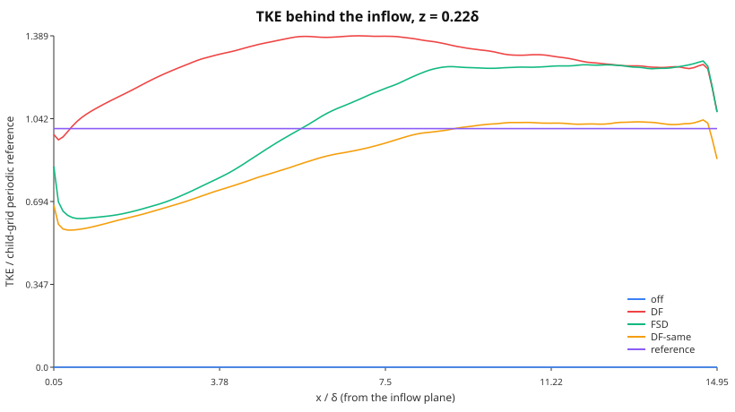
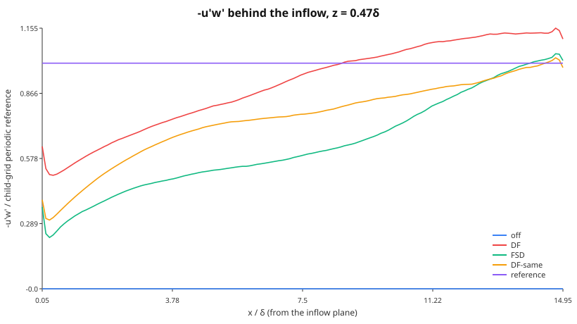

# Transition and wall-bounded flow

Era VI resolves the near-wall layer instead of modelling it wherever a
case is small enough to afford it: laminar and transitional channels,
the wall-resolved stratified channel, and the laminar checks of the
turbulence closures. This page collects the wall treatment those runs
share and the laminar–turbulent transition diagnostics
(`Aeolus.Transition`). Wall-*modelled* runs (the Berlin case among them) keep the
free-slip wall and add the wall-model stress on top.

## Walls

### The no-slip / moving-wall condition

[`NoSlipWall(u_wall, v_wall)`](@ref Aeolus.BoundaryConditions.NoSlipWall)
is the single no-slip wall type. On the staggered grid the horizontal
velocities `u @ FaceX`, `v @ FaceY` are cell-centred in ``z``, so the wall
lies half a cell below the first interior value ``u_1``. The halo is the
odd reflection about the wall velocity,

```math
u_{1-h} = 2u_\mathrm{wall} - u_h, \qquad h = 1,\dots,H_z,
```

so the face average ``\tfrac12(u_0 + u_1)`` seen by every stencil is
exactly ``u_\mathrm{wall}`` and a linear profile through the wall is
extended exactly. The viscous operator in the wall cell becomes

```math
\nu\,\frac{u_2 - u_1}{\Delta z^2} - \nu\,\frac{2(u_1 - u_\mathrm{wall})}{\Delta z^2},
```

the standard second-order ghost-cell treatment (Ferziger & Perić 2002,
§8.10). The vertical velocity and every cell-centred field (``p, θ, ν_t``)
are treated exactly as by the free-slip `ImpermeableWall`: ``w = 0`` on the
wall face with an antisymmetric halo, mirror (Neumann) for scalars. The
pressure problem therefore does not change, and the cosine-FFT solve
stays exact.

A no-slip wall can face a free-slip one, which gives an open channel:

```julia
FieldBoundaryConditions(:periodic, :periodic; bottom = :noslip, top = :wall)
FieldBoundaryConditions(:periodic, :periodic; bottom = :noslip, top = NoSlipWall(U, 0))  # Couette lid
```

A time-dependent wall (Stokes' second problem) reassigns `sim.bcs` with
the new wall velocity before each step.

### Wall stress

`wall_shear_stress(sim; side = :bottom, component = :u)` is a method of
the cut-cell generic [`wall_shear_stress`](@ref Aeolus.CutCell.wall_shear_stress),
not a new name. It returns the plane mean of ``ν\,∂u/∂z`` across the wall
face, formed from the same halo the viscous operator uses:
``ν\,2(u_1 - u_\mathrm{wall})/Δz`` on a no-slip wall and exactly zero on a
free-slip one. With periodic ``x, y`` and ``w = 0`` on the walls, advection
and the pressure gradient drop out of the plane-integrated momentum
budget, which is

```math
\frac{d}{dt}\int_0^{L_z} \bar u\,dz = τ(\mathrm{top}) - τ(\mathrm{bottom}) + G L_z .
```

### Implicit diffusion with a moving wall

A moving wall makes the discrete diffusion operator affine,
``∇·(ν∇φ) = L_0 φ + g``, where ``g`` is the wall term. The CG solve of
[`solve_implicit_diffusion!`](@ref Aeolus.TimeIntegration.solve_implicit_diffusion!)
iterates with the stationary wall (``L_0``, symmetric positive definite),
using [`homogeneous_bcs`](@ref Aeolus.BoundaryConditions.homogeneous_bcs),
and adds ``Δt\,g`` to the right-hand side. ARK2 stages solve for the state,
so the wall term is kept. Rosenbrock stages solve for increments, whose
wall value is zero, so it is dropped. `:wall` runs have no wall term and
take the same code path as before (`homogeneous_bcs(bcs) === bcs`).

The places that special-case a wall were all audited. A missed one would
silently fall back to free slip:

| Site | Treatment of `NoSlipWall` |
| :--- | :--- |
| `fill_halos!` (`_fill_z!`) | new wall-pair methods; the `ImpermeableWall` pair keeps its own |
| `FieldBoundaryConditions`, `nest_bcs` | `:noslip` symbol, `bottom`/`top` keywords; a mixed z pair must be two walls, anything else is an `ArgumentError` |
| pressure solver choice (`_default_solver`) | non-periodic → `CosineFFTPoissonSolver`, unchanged |
| IMEX implicit diffusion | affine wall term (`homogeneous_bcs`) |
| IMEX pinned `w` row (`_constraint_index`) | **behaviour change:** was "`bottom` or `top` is an `ImpermeableWall`", now `is_wall(bcs.bottom)`. The pinned row is the bottom wall face `Hz + 1`; the top wall face sits in the halo, so only the bottom decides. The old symbol constructor could not build a case where the two differ |
| `apply_cutcell_velocity_bc!` | acts on apertures only; the wall comes through `fill_halos!` |
| anelastic / pseudo-incompressible cores | through `fill_halos!`; only z-periodic is rejected |

### Verification

All runs below are on `(4, 4, Nz)` grids with the full 3-D
fractional-step driver (`step!`, ``Δt = 0.3\,Δz^2/ν``), in
`test/walls.jl` (removed).

| Flow | Reference | Measured |
| :--- | :--- | :--- |
| Couette, Re = 100, Nz = 16, from rest | ``u = Uz/h``, ``τ = νU/h`` | ``‖u - Uz/h‖_∞ = 2.7\times10^{-15}U``; ``τ = νU/h`` to ``10^{-15}`` |
| Plane Poiseuille, Nz = 16/32/64 | ``u = \frac{G}{2ν} z(h-z)``, ``u_b = Gh^2/(12ν)`` | L2 order 2.0000 / 2.0000; ``u_b`` off by ``4.9\times10^{-4}`` at Nz = 64; ``τ_b = Gh/2`` to ``10^{-10}`` |
| Stokes I, Nz = 128, ``t = 0.1h^2/ν`` | ``U\,\mathrm{erfc}(z/2\sqrt{νt})`` | ``L_∞`` error ``2.3\times10^{-5}U``; wall stress ``-1.7839`` vs ``-ν U/\sqrt{πνt} = -1.7841`` |
| Stokes II, ``ω = 2π``, 6th period | decay length ``δ = \sqrt{2ν/ω}`` | ``δ`` fitted to ``2.8\times10^{-4}``; phase lag ``z/δ`` to 2 % |
| 3-D random flow, lid moving in ``x`` and ``y`` | plane momentum budget | residual ``8.7\times10^{-18}`` per step |
| IMEX Couette (ARK2, Rosenbrock2, ``Δt ≈ 13×`` explicit limit) | explicit steady state | ``1.1\times10^{-14}U``, ``2.6\times10^{-15}U`` |

``\mathrm{erfc}`` is `GasOptics.erfc_series` (one source of truth). The
Stokes I domain is ``2h`` deep, so the semi-infinite solution is the exact
reference: the top's image term is ``\mathrm{erfc}(2h/\sqrt{4νt}) ≈ 8\times10^{-6}``.
In a domain only ``h`` deep, the top wall reflects ``2.5\,\%\,U`` by
``t = 0.1h^2/ν``. That 2.5 % is a finite-domain effect of the reference,
not a solver error. A `:wall` run (explicit, ARK2 and Rosenbrock2, SGS on)
is bitwise identical to the code before the change. That comparison
against the previous `master` was made by hand. The suite does not
automate it. It checks only that `:wall` keeps the original `fill_halos!`
methods and that `_constraint_index` and `homogeneous_bcs` leave it
unchanged.

### The Berlin case

The Berlin ground is not a `NoSlipWall`. It is a rough, wall-modelled
surface: the `MOSTWallLaw` stress of `Aeolus.WallModels` (#169) is
applied as an implicit drag over a free-slip `:wall`, see [The Berlin case](../design/berlin_surface_radiation.md#Surface-exchange-(#129)). A
resolved no-slip wall at ``Δx = 15.6`` m would put the first velocity
point ``Δz/2 ≈ 3`` m from the wall, with a viscous sublayer of
``ν/u_* ∼ 10^{-4}`` m.

## Laminar–turbulent transition

Era VI (Phase 59, #180) gives the repository one owner for the
laminar/turbulent and intermittency diagnostics, the module
`Aeolus.Transition`. The stable-boundary-layer collapse (P58-e), the
CASES-99 "hockey stick" (P58-d) and relaminarisation (P59-e) use these
functions and do not redefine them. Transition defines no Richardson
number: ``N^2`` and ``Ri_g`` come from the
[stability contract](turbulence_stability.md) and its pointwise fields
(`buoyancy_frequency_squared!`, `gradient_richardson!`).

### Shear instability and intermittency

#### The tanh shear layer

The parallel shear layer ``U(z) = U\tanh(z/δ)`` is inviscidly unstable to
waves ``e^{iα(x - ct)}``. Its most unstable wavenumber is ``αδ = 0.4446``,
with growth rate ``σ = αc_i = 0.1897\,U/δ`` (Michalke 1964). With a
stable stratification ``N^2(z) = J (U/δ)^2 \operatorname{sech}^2(z/δ)``,
the local gradient Richardson number is
``Ri_g(z) = J\cosh^2(z/δ)``. Its minimum, at the centre, is the bulk
parameter ``J``. For this profile the neutral curve is
``J_c(α) = α^2 (1 - α^2)`` (Drazin 1958), with maximum ``J_c = 1/4`` at
``αδ = 1/\sqrt 2``. This agrees with the Miles–Howard theorem: a
parallel flow with ``Ri_g ≥ 1/4`` everywhere is linearly stable (Miles
1961; Howard 1961).

`validation/transition_kh.jl` checks these results with the Boussinesq
core in 2-D (``N_y = 1``), with free-slip walls at ``z = ±L_z/2``
(``≥ 8.9δ``) and ``Re = Uδ/ν = 1000``. The seed is
``w' = 10^{-4} U \sin(αx)\,e^{-z^2/δ^2}``. The base state is held against
its own viscous diffusion by the body force ``-ν∇^2(\text{base})``, which
is the frozen parallel flow that the linear theory assumes. The time
stepping is projected SSP-RK3 (`step_rk3!` with `body_force!`) at CFL 0.6.

| case | grid | measured | reference |
| :-- | :-- | :-- | :-- |
| ``J = 0``, ``αδ = 0.4446`` | 128 × 1 × 256 | ``σ = 0.1864\,U/δ`` (``R^2 = 0.99995``) | 0.1897 inviscid (Michalke 1964): 1.76 % below |
| ``J = 0``, ``αδ = 0.7071`` | 128 × 1 × 256 | ``σ = 0.1396\,U/δ`` | — (sets the e-folding time ``τ_0 = 7.2\,δ/U``) |
| ``J = 0.15``, ``αδ = 0.7071`` | 128 × 1 × 256 | ``σ = 0.0391\,U/δ`` | unstable: ``J < J_c = 1/4`` |
| ``J = 0.30``, ``αδ = 0.7071`` | 128 × 1 × 256 | ``A(5τ_0)/A(τ_0) = 0.223``, fitted ``σ = -0.054`` | stable: ``Ri_g > 1/4`` everywhere |
| ``J = 0``, ``αδ = 0.4446``, no SGS | 64 × 1 × 128 | ``σ = 0.1820`` | quoted |
| the same, Smagorinsky ``C_s = 0.1`` | 64 × 1 × 128 | ``σ = 0.1769`` (−2.8 %) | quoted |
| the same, σ-model ``C_σ = 1.35`` (P59-b, #184) | 64 × 1 × 128 | ``σ = 0.1820`` (``ν_t ≡ 0``) | within 3 % of no SGS |

The 1.76 % shortfall at ``J = 0`` is the sum of the viscous reduction at
``Re = 1000`` and the discretisation error of the second-order operators
at ``Δx = 0.11δ``. At ``64 × 128`` (``Δx = 0.22δ``) the shortfall grows
to 4.1 %, so most of it is numerical. The Smagorinsky closure removes
another 2.8 %, because its ``ν_t`` acts on the laminar shear of the base
flow. The [σ-model](sgs.md#σ-model) (P59-b, #184) does not. Its
``ν_t`` is zero for any 2-D flow (``σ_3 = 0``), so the layer grows at
exactly the no-SGS rate. The same property keeps the molecular wall
stress of a laminar Couette flow ([Walls](#Walls), above) unchanged with
the SGS on: σ gives ``νU/h`` to 2.8e-14, while Smagorinsky adds
``(C_sΔ)^2(U/h)/ν`` = 4.5 % at ``Re = 100``, ``N_z = 32``.

#### The turbulent fraction γ(z)

A cell is turbulent when the vorticity fluctuation exceeds a fraction of
the mean vorticity magnitude of its level,

```math
\frac{|ω'|}{⟨|ω|⟩} > \text{threshold}, \qquad ω' = ω - ⟨ω⟩,
```

and ``γ(z)`` is the fraction of the level's fluid cells that are
turbulent (`turbulent_fraction`). This is the plane-averaged indicator
of Brandt, Schlatter & Henningson (2004). ``ω`` is computed at the cell
centre with the same velocity-gradient stencil as the Smagorinsky
strain rate. A laminar parallel shear flow has a uniform ``ω`` in each
plane, so ``γ = 0`` exactly. The default threshold 0.2 marks almost all
of a developed isotropic field: if ``ω'`` were a Gaussian vector, only
about 1 % of cells would fall below ``0.2⟨|ω|⟩ = 0.32σ``. Measured on a
decaying 32³ random solenoidal field, ``γ ≥ 0.984`` on every level. On a
synthetic field that is random in one half of the domain and at rest in
the other, ``γ`` = 0.513–0.515. The excess over 0.5 is the vortex sheet
at the two cuts, about 1.8 cell columns each. `laminar_mask!` is the
complement within the fluid, and solid cells are never turbulent.
`normalization = :volume` divides by the domain-mean ``|ω|`` instead.
Use it when the levels of interest have very different vorticity levels.

In the Kelvin–Helmholtz billow of `examples/kelvin_helmholtz/kelvin_helmholtz.toml`
(the `shear_layer` run type; the config reproduces the script it replaced
bit for bit, figures included)
(``J = 0.05``, ``Re = 1000``, free base state), ``γ`` of the layer
``|z| ≤ 4δ`` stays exactly 0 through the linear stage. It rises once the
billow rolls up (0.78 at ``t = 60\,δ/U``, when ``A = 0.075U``) and peaks
at 0.92 at saturation (``t = 75``):


#### Time-series intermittency

The intermittency factor is the fraction of time a signal spends above a
threshold (Townsend 1976): `intermittency_factor(series; threshold)`
counts samples, and `intermittency_factor(t, series; threshold)` weights
each sample by the interval it starts. An on/off signal with duty cycle
0.3 gives 0.3 exactly.

#### Flux Richardson number, buoyancy Reynolds number, V_TKE

```math
Ri_f = -\frac{B}{P}, \qquad B = \frac{g}{θ_0}⟨w'θ'⟩, \qquad
P = -⟨u'w'⟩\partial_z U - ⟨v'w'⟩\partial_z V
```

(Ellison 1957). Its irreversible part is the mixing efficiency (Ivey &
Imberger 1991). `flux_richardson` uses the resolved plus the SGS fluxes
(``τ_{i3} = -2ν_t S_{i3}``, ``⟨w'θ'⟩_{\rm sgs} = -(ν_t/Pr_t)\partial_zθ``)
and matches the hand values of an analytic field to ``10^{-10}``. On a
vertically stretched grid (`StretchedGrid`) its vertical differences, and
those of the vorticity behind `turbulent_fraction` and the `vorticity_y`
output, span the local spacings (the per-level metrics of the Smagorinsky
kernel, ``∂U/∂z`` over the centre heights): on a surface-refined grid
(Δz = 10–60 m) ``P`` and ``B`` of the analytic field match to
``7\times10^{-14}`` (#505). In the
billow example, the cumulative ``-∫B\,dt/∫P\,dt`` of the layer is about
0.15 through the linear stage, 0.345 at saturation and 0.394 at
``t = 160\,δ/U``:


The buoyancy Reynolds number is ``Re_b = ε/(νN^2)`` (Gibson 1980; Smyth &
Moum 2000). The turbulence velocity scale of Sun et al. (2012) is
``V_{TKE} = \sqrt{(σ_u^2 + σ_v^2 + σ_w^2)/2}``. The grid Reynolds number
``UΔ/(ν + ν_t)`` and the fraction of cells with ``Ri_g > 1/4``
(`supercritical_fraction`, which counts cells of a `gradient_richardson!`
field) are the transition diagnostics of the Berlin
[`turbulence_diag` addon](../design/berlin_turbulence.md#Turbulence-diagnostics-(#170)).

#### Growth-rate fit

`growth_rate(t, A)` fits ``\ln A = σt + c`` by least squares. Without an
explicit window it picks the longest run of samples that meets two
conditions: ``R^2 ≥ 0.999``, and the rates of the run's three thirds
agree to 1 %. ``R^2`` alone is not enough, because it grows with the span
of ``\ln A``. A window that includes the seed adjustment and the onset of
saturation still passes 0.999, but its rate is biased: 0.1859 instead of
0.1864 in the KH test, and 2.8 % low on a synthetic saturating series,
where the thirds criterion is 0.3 % low.

## Flat-plate transition

P59-d (#185) adds the spatially developing zero-pressure-gradient
flat-plate boundary layer: the Blasius solution, the fringe region that
makes such a layer possible on the `x`-periodic FFT grid, a free-stream
top boundary, free-stream turbulence, and the integral diagnostics that
locate transition. Everything lives in `Aeolus.Transition`, except the
damping profile (`Operators`) and the top boundary (`BoundaryConditions`).

### The Blasius layer

[`blasius_solution`](@ref Aeolus.Transition.blasius_solution) integrates
``f''' + \tfrac12 f f'' = 0``, ``f(0) = f'(0) = 0``, ``f'(∞) = 1`` with
classical RK4 (12 000 steps on ``0 ≤ η ≤ 12``) and finds ``s = f''(0)``
by a secant iteration on ``f'(η_{\max}; s) - 1``. Five iterations give
``f''(0) = 0.3320573362`` (Howarth 1938: 0.332057), the displacement
constant ``∫(1 - f')dη = 1.7207876575``, ``θ`` constant ``0.6641146724
= 2f''(0)`` to 1e-10 (the momentum-integral identity, checked by an
independent Simpson quadrature), ``η_{99} = 4.90999`` and
``H = 2.59110``. [`blasius_profile`](@ref Aeolus.Transition.blasius_profile)
is the cubic Hermite interpolant of the table (``f'``, ``f''`` and
``f''' = -\tfrac12 f f''`` are all tabulated, so each interpolant is C¹),
and [`blasius_velocity`](@ref Aeolus.Transition.blasius_velocity) returns
``u = U f'``, ``w = \tfrac12\sqrt{νU/x}\,(ηf' - f)``.

### The fringe region

A spatially developing layer grows downstream, so a periodic domain needs
a region that returns the outflow to the inflow. The fringe of
Nordström, Nordin & Henningson (1999) adds
``-λ(x)(\mathbf u - \mathbf u_{\rm target})`` with

```math
λ(x) = λ_{\max}\Big[S\Big(\frac{x - x_{\rm start}}{Δ_{\rm rise}}\Big)
                    - S\Big(\frac{x - x_{\rm end}}{Δ_{\rm fall}} + 1\Big)\Big],
\qquad
S(x) = \frac{1}{1 + \exp\big(\frac{1}{x - 1} + \frac{1}{x}\big)}\ (0 < x < 1),
```

``S = 0`` below and ``1`` above (their eq. 2.3). The rate comes from the
`Operators.DampingProfile` with a `NordstromRamp`, the same type, rate
function and kernel (`_add_damping!`) that the Rayleigh sponge
[`add_sponge!`](@ref Aeolus.Operators.add_sponge!) uses with its
`SinSquaredRamp`: one damping-profile implementation for every
relaxation term. `add_sponge!` is bit for bit unchanged on all three mesh
types (asserted against the verbatim Phase-7 kernel; the Berlin smoke run
gives an identical state with either kernel).

The target is the Blasius layer at the
[`fringe_distance`](@ref Aeolus.Transition.fringe_distance) — the
distance from the leading edge of the upstream periodic image inside the
fringe — so the profile the fringe releases is already developing at the
right rate and its ``w`` satisfies continuity. A target frozen at the
inflow ``x_{in}`` released a layer with ``H = 2.37`` instead of 2.59 at
the inflow, and ``c_f`` stayed 4–5 % low for half the plate.

### The free-stream boundary

A closed lid cannot hold a growing layer: the free stream must
accelerate by ``Δδ^*/H`` and the layer feels a favourable pressure
gradient. On the 2-D test grid (``H = 16δ^*_0``) a free-slip lid gave
``c_f`` 16–28 % above Blasius, even normalised by the local edge
velocity. [`FreeStreamBoundary`](@ref Aeolus.BoundaryConditions.FreeStreamBoundary)
is the far-field condition of the spatial DNS of Spalart (1988) and
Brandt et al. (2004): zero shear for ``u, v`` and a prescribed
transpiration ``w = W(x)`` on the top face. The pressure problem stays a
Neumann problem (the face value enters the divergence of the top cell),
so the cosine FFT solver remains exact, provided the net transpiration
vanishes. [`blasius_freestream`](@ref Aeolus.Transition.blasius_freestream)
prescribes the displacement velocity
``W_∞ = U\,dδ^*/dx = 0.8604\,U/\sqrt{Re_x}`` and returns the plate's
outflow through a bump confined to the fringe rise, upstream of the
plateau where the velocity is pinned.

The momentum budget of one explicit step closes exactly:
``\frac{d}{dt}∫u\,dV = ∫F_{\rm fringe}dV - τ_w A - ∮u\,w_{\rm top}dA``,
residual 5e-12 (2e-13 relative) with the lid and with the free-stream
top.

### Laminar plate

[`flat_plate_setup`](@ref Aeolus.Transition.flat_plate_setup) assembles
the case in units of the inflow ``δ^*_0`` and ``U_∞``. In 2-D at
``Re_{δ^*_0} = 200`` (256 × 64 cells on 512 × 16 ``δ^*_0``, plate
``Re_x`` = 1.35e4 to 1.0e5), started from a uniform stream and run for
1200 RK3 steps (12 s), the layer develops from the fringe inflow to
``c_f/c_{f,\rm Blasius} ∈ [0.9982, 1.0001]`` and ``H ∈ [2.574, 2.583]``
over the middle 60 % of the plate; the target is recovered at the fringe
exit to 5.2e-4 ``U``. The issue's σ-model variant of this check is not
run separately: P59-b (#184) merged after this section was written, and
in this 2-D flow (``N_y = 1``, ``v = 0``) the velocity gradient has rank
≤ 2, so ``σ_3 = 0`` and the [σ-model](sgs.md#σ-model)'s ``ν_t`` vanishes
identically; the variant would reproduce the run above.

### Free-stream turbulence and bypass transition

[`FreeStreamDisturbance`](@ref Aeolus.Transition.FreeStreamDisturbance)
represents isotropic turbulence by random Fourier modes
(Jacobs & Durbin 2001; Brandt et al. 2004) with the von Kármán spectrum
``E(κ) = \tfrac23 a (κL)^4/(b + (κL)^2)^{17/6}\,Lq``. The velocity is the
grid curl of a vector potential sampled on the cell edges, so its
discrete divergence is zero to round-off (3.9e-16 measured); the energy
is scaled to ``q = \tfrac32 (Tu\,U)^2`` and the spectrum length
calibrated so the discrete mode set has the requested ``L_{11}``
(measured on a 512 × 32 × 32 box with 400 modes: Tu 0.0497 for 0.05,
``L_{11}`` 1.042 for 1.0 with seed 1; one realisation scatters with the
seed — 0.82–1.43 over seeds 1–16, standard deviation 0.14 — and the
ensemble mean over those 16 seeds is 1.027, which is what the test
asserts). The disturbances enter through the fringe
target as Taylor's frozen turbulence
([`disturbance_fringe_update`](@ref Aeolus.Transition.disturbance_fringe_update)),
kept out of the inflow layer by a damping of the vector potential.

The onset is located by
[`transition_onset`](@ref Aeolus.Transition.transition_onset): the
minimum of ``c_f`` upstream of the point from which ``c_f`` stays 10 %
above laminar. In the coarse 3-D sanity test (96 × 24 × 48,
``Re_{δ^*_0} = 300``, plate ``Re_x`` = 3.0e4 to 1.26e5, ``c_f`` averaged
over the last 200 of 700 steps) Tu = 6 % raises the outlet ``c_f``
(``Re_x`` 1.03e5–1.17e5) to 3.47 times Blasius. Two laminar controls
run beside it:

* **Tu = 0 in 2-D** (``N_y = 1``), the cheap exact check: without a seed
  the 3-D run stays exactly 2-D. Outlet ``c_f`` 1.015 times Blasius
  (2 s).
* **Tu = 0.1 % in 3-D** on the same grid, seeded by the same
  `FreeStreamDisturbance` generator at 1/60 of the amplitude (55 s on
  3 threads). This checks that the laminar layer survives small 3-D
  disturbances. It does not transition:

| quantity (seeded 3-D control) | measured | asserted |
| :-- | :-- | :-- |
| ``c_f / c_f(\text{2-D}, Tu = 0)``, pointwise, ``Re_x`` 3.5e4–1.17e5 | 0.9981–0.9995 | within 1 % |
| ``[1\,2\,1]``-filtered ``c_f`` / Blasius, ``Re_x`` 3.5e4–1.12e5 | 0.9805–1.0074 | within 5 % |
| the same at 0.9 of the plate (``Re_x`` 1.17e5) | 1.052 | — |
| ``v_{\rm rms}`` in the layer, sampled every 50 steps | rises to 1.97e-3 by step 500, then falls to 1.34e-3 | < 5e-3 throughout |
| mean layer ``v_{\rm rms}``, steps 550–700 over steps 400–550 | 0.795 | < 1.2 |
| free-stream ``v_{\rm rms}`` | 0.90e-3 | 0.5e-3–1.5e-3 |
| layer ``v_{\rm rms}`` at Tu = 6 % (for scale) | 8.2e-2 | > 10× the control |

The disturbances need about one flow-through (≈ 270 steps) to fill the
plate. After that, the spanwise velocity in the layer stays at about
twice the free-stream value and decays over the last 300 steps. It does
not grow. ``Re_{δ^*}`` reaches 589 at 0.9 of the plate, which is above
the Tollmien–Schlichting critical value of 520 (``Re_x ≈ 9.1\times10^4``).
The unstable stretch is too short for TS waves to grow anywhere near
transition amplitudes, and the measured ``c_f`` shows no sign of them.
The 5 % tolerance matches the 2-D laminar plate. Blasius is a
parallel-flow similarity solution, the two ends of the plate feel the
inflow (−2 %) and the fringe, and transition would add 50 % or more. At
0.9 of the plate the fringe alone raises ``c_f`` by 5 %: a 2-D Tu = 0 run
at ``Δx = 2.1`` gives 1.053 at the same point. That is why the Blasius
window stops 48 ``δ^*_0`` before the fringe. A first version ran to 0.9
of the plate and failed there; the expectation was wrong, not the code.

**Finding: a grid-scale wiggle on the coarse grid.** At
``Δx = 4.2\,δ^*_0`` both laminar runs, with and without the seed, carry
the same stationary ``2Δx`` (odd–even) oscillation in ``c_f``. It is
±0.6 % near the inflow and grows to ±17 % just upstream of the fringe,
so the unfiltered ``c_f``/Blasius is 0.88–1.22 over the plate. The
outlet-window average used for the Tu = 0 number (1.015) hides it. It is
a resolution artefact: the 2-D control at ``Δx = 2.1\,δ^*_0`` has it at
±0.03 % and stays within 1.6 % of Blasius up to ``x ≈ 265\,δ^*_0``. The
``[1\,2\,1]/4`` filter removes exactly this mode, which is why the
Blasius comparison uses filtered ``c_f``. The grids of the 2-D laminar
plate (``Δx = 2``) and of the T3A-like example (``Δx = 1.04``) are fine
enough not to need it.

The T3A-like example (`examples/flat_plate_t3a/flat_plate_t3a.toml`, the
`flat_plate` run type, bitwise the former script on a small grid; Tu = 3.3 %
as in Roach & Brierley 1992) runs 576 × 64 × 96 cells on
600 × 36 × 24 ``δ^*_0`` (``Re_x`` = 3.0e4 to 1.9e5; ``Δx = 1.04``,
``Δy = 0.56``, ``Δz = 0.25\,δ^*_0``, i.e. ``Δx^+ ≈ 17``, ``Δy^+ ≈ 9``,
``Δz^+ ≈ 4`` with the downstream ``u_τ``) without an SGS model —
a Smagorinsky ``ν_t`` from the laminar wall shear alone would be several
times ``ν`` and keep the layer laminar.

Measured (1500 RK3 steps at ``Δt = 1\,δ^*_0/U``, statistics over the
last 600; 8034 s, 5.4 s per step on 8 threads of a shared machine):

| quantity | result | reference |
| :-- | :-- | :-- |
| free-stream Tu (streamwise) | 3.23 % at the inflow, 2.77 % at ``Re_x = 10^5``, 2.60 % at the plate end | 3.3 % requested |
| onset (minimum of ``c_f``) | ``x = 48\,δ^*_0``, ``Re_x = 4.48\times10^4`` | — |
| ``Re_θ`` at onset, measured ``θ`` | 198 | Mayle (1991) 190 (+5 %), Abu-Ghannam & Shaw (1980) 200 (−1 %) |
| ``Re_θ`` at onset, Blasius ``θ`` at that ``Re_x`` | 141 | −26 % / −30 % |
| downstream ``c_f/(0.0576\,Re_x^{-1/5})``, ``Re_x`` 1.2e5–1.8e5 | 1.057–1.135 (mean 1.084) | issue target: within 20 % — met |
| downstream ``H`` | 1.45–1.50 | ≈ 1.4 |

The onset is within the ±30 % band of both correlations whichever ``θ`` is
used (the free-stream turbulence thickens the pre-transitional layer, so
the measured ``θ`` at onset is 40 % above Blasius). Against the ``Re_θ``
form ``0.024\,Re_θ^{-1/4}`` (Kays & Crawford) at the measured
``Re_θ`` = 443–552 the ratio is 1.12–1.17.

The turbulent ``c_f`` of this model-free calculation is
resolution-limited. Refining ``z`` alone saturates near 1.2 at the
coarse ``Δx, Δy``; the streamwise and spanwise spacing has to come down
with it. Same case, same seed, same 1500-step protocol:

| grid ``N_x × N_y × N_z`` | ``Δx, Δy, Δz`` (``δ^*_0``) | ``c_f/(0.0576\,Re_x^{-1/5})``, ``Re_x`` 1.2e5–1.8e5 | onset ``Re_θ`` |
| :-- | :-- | :-- | :-- |
| 288 × 32 × 48 | 2.08, 1.13, 0.50 | 1.260–1.387 (mean 1.297) | 190 |
| 288 × 32 × 96 | 2.08, 1.13, 0.25 | 1.180–1.248 (mean 1.211) | 191 |
| 288 × 32 × 128 | 2.08, 1.13, 0.19 | 1.156–1.258 (mean 1.204) | 191 |
| 432 × 48 × 96 | 1.39, 0.75, 0.25 | 1.122–1.200 (mean 1.173) | 232 |
| 576 × 64 × 64 | 1.04, 0.56, 0.38 | 1.135–1.197 (mean 1.162) | 199 |
| **576 × 64 × 96** (the example) | 1.04, 0.56, 0.25 | **1.057–1.135 (mean 1.084)** | 198 |

The first row is what the example ran before; it missed the 20 % target.
The local edge velocity is within 0.7 % of ``U_∞`` downstream on every
grid, so normalising by it changes none of these ratios by more than 0.012.


The boundary-layer integrals of a disturbed layer are taken to its
[`boundary_layer_edge`](@ref Aeolus.Transition.boundary_layer_edge): the
fringe-fed free stream carries a ≈ 0.5 % mean deficit, and integrating
to the top inflated ``θ`` by 50 % at the inflow.

### The Berlin case

Stated exception (#185): the Berlin domain is laterally periodic with
geostrophic forcing and has no inflow direction, so a fringe, a
free-stream top and an inflow generator have no place in it; inflow
boundaries arrived with nesting (#265), and the inflow generator is coupled
there (N-inflow-e, #268, below). Transition stays coupled through the
`turbulence_diag` addon (P59-c), and the
Rayleigh sponge of every Berlin step now takes its rate from the shared
damping profile (state bit-identical to the Phase-7 kernel in the smoke
run). No Berlin list changed.

## Relaminarisation in strongly stable stratification

P59-e (#195) validates laminar–turbulent coexistence and collapse with
the closures that exist — the σ-model (P59-b), the stability correction
(P55-e) on the TurbulenceStability functions (P58-a) — and adds no
closure and no stability function. Transition gains the three numbers
the collapse studies use, all from existing definitions:

* `friction_reynolds(sim)` — ``Re_τ = u_τ h/ν``, ``u_τ`` from the
  molecular wall stress of the no-slip bottom (`wall_shear_stress`,
  P59-a) or the nominal value;
* `relaminarisation_criteria(sim; heat_flux)` — ``h/L`` with the Obukhov
  length of the surface flux (`SurfaceExchange.obukhov_length`, there is
  no second one), ``L^+ = L u_τ/ν = Re_τ/(h/L)``, and the bulk
  Richardson number of the top and bottom cell layers and the bulk
  velocity (`SurfaceExchange.bulk_richardson`);
* `relaminarised_fraction(laminar, Ri, νt, ν)` — the share of the
  ``Ri_g > 1/4`` cells that are γ-laminar with ``ν_t/ν < 10^{-2}``.

`Operators.laminar_consistent(closure)` marks the closures whose
``ν_t`` vanishes identically in laminar flow (σ, and the wrappers around
it). The cases are the P54-d builder with `bottom_bc = :noslip` (P55-f)
and the new `channel_case(surface_heat_flux = Q)` hook: the flux-cooled
open channel of Nieuwstadt (2005), no-slip bottom, free-slip insulated
top, the prescribed bottom θ flux of the core, molecular ``Pr = 0.71``.

### Laminar stratified Poiseuille flow (exact)

`validation/relaminarisation.jl`, test 1. At ``Re_τ = 10`` the steady
closed-channel Poiseuille flow with the stable conduction profile
(``Ri_τ = 50``) gives ``ν_t ≡ 0`` (exactly, ``ν_h``, ``ν_v`` and
``κ_v``) with σ, σ + correction (isotropic and anisotropic length
scales); the velocity equals the closure-free run and the unstratified
(``g = 0``) run to < 1e-10 (measured 0: buoyancy is balanced by the
hydrostatic pressure). The wall stress is ``u_τ^2`` to 1.4e-7.
Smagorinsky 0.17 keeps max ``ν_t = 0.53 ν`` and lowers the molecular
wall stress to 0.659 ``u_τ^2``. The flux-cooled open channel (``Q = -0.05``)
reproduces the long-time conduction solution under a constant flux and
an insulated top, ``θ = \bar θ(t) + Q(z - h)^2/(2κh)``,
``d\bar θ/dt = Q/h``, to 1.6e-11 of ``|Q|h/κ``; θ is conserved to the
prescribed flux to 1.5e-10 (round-off at θ ≈ 10³); u is unchanged by
the buoyancy (measured 0). The criteria match their closed forms to
1e-12 (``h/L = κg|Q|h/(θ_0 u_τ^3)``, ``L^+ = Re_τ/(h/L)``, ``Ri_b`` of a
linear θ).

### Decaying stratified turbulence

Test 2: a laminar shear ``S`` held fixed (the plane mean of ``u`` is
reset to ``S(z - H/2)`` after each step — a function of ``z`` only, so
``∇·u`` is untouched) under a random-phase perturbation
(``E ∝ k^4 e^{-2(k/k_p)^2}``, ``k_p = 8π/H``, ``u_{rms} = 0.05 SH``),
free-slip walls, 32³, ``ν = 3 × 10^{-4} SH^2``, σ + correction
(isotropic). The homogeneous stratified shear flow decays above a
stationary Richardson number ``Ri_s ≈ 0.1–0.2`` and grows below it
(Holt, Koseff & Ferziger 1992; Jacobitz, Sarkar & Van Atta 1997).
Measured at ``Ri = N^2/S^2 = 1`` against the neutral control:

| | ``Ri = 1`` | neutral |
| :-- | --: | --: |
| resolved ``⟨w'θ'⟩``, peak down-gradient | ``-7.5 × 10^{-4}`` | — |
| reversed (counter-gradient) peak, at ``tN`` | ``+9.5 × 10^{-5}``, 2.5 | — |
| γ (volume-normalised) < 0.1 at ``tN`` | 11.1 | never (min 0.959) |
| resolved TKE at ``tS = 12`` | ``3.5 × 10^{-5}`` | ``2.4 × 10^{-3}`` |
| collapsed max ``ν_v/ν``, σ + correction | 0 | |
| collapsed max ``ν_h/ν``, σ + correction | 0.017 | |
| collapsed max ``ν_t/ν``, Smagorinsky 0.17 (same field) | 0.118 | |

The issue expected γ < 0.1 "within about 10 ``N^{-1}``": measured 11.1,
asserted ≤ 12. The time is set by the viscous decay of the residual
wave field rather than by ``N``: at ``Ri`` = 2 and 4 (``ν = 3 × 10^{-4}``)
γ falls below 0.1 at ``tS ≈ 11`` in both, i.e. 16 and 22 ``N^{-1}``
(scan, not in CI). The issue expected max ``ν_t/ν < 10^{-2}`` for σ +
correction in the collapsed state; that holds for the corrected
(vertical) viscosity, not for the horizontal one (0.017), which the
correction does not touch and which σ keeps on the three-dimensional
residual waves. Smagorinsky stays at 0.12 ν, ``10^2``–``10^3`` times the
corrected value (at this ``ν``; it scales as ``1/ν``).

### The cooled open channel (example)

Test 3 of the issue — the 32³ open channel at ``Re_τ = 180``, collapse at
``h/L = 2.0`` and survival at ``h/L = 0.3`` after 20 ``h/u_τ`` — costs
4.5–9 min per 20 ``h/u_τ`` run (6 200–9 900 SSP-RK3 steps; 267–521 s wall
time on the shared machine), plus a 2-min neutral spin-up,, over the 2-min CI budget, so it is
`configs/relaminarisation_sweep.toml` (with
the former `examples/sbl/relaminarisation_channel.jl` ((removed by ONE-g, #456)) reading the runs against the
references) and is not in the suite. Set-up: ``2πh × πh × h``, ``Re_τ``
by the forcing ``u_τ^2/h``, σ + correction (isotropic length scales),
stress form, ``Pr = 0.71``, ``g/θ_0 = 1``. A neutral spin-up of 10
``h/u_τ`` from the law of the wall plus a smooth random perturbation
(white grid-scale noise does not trip the 32³ channel: from
`noise = 3` the σ and the dynamic-Smagorinsky runs relaminarise,
``⟨τ_w⟩ → 0.44 u_τ^2``) reaches TKE 2.24 ``u_τ^2``,
``⟨τ_w⟩ = 0.94 u_τ^2``, ``U_b = 15.5 u_τ``; the neutral restart keeps
TKE at 0.76–1.04 of its switch-on value over 5 ``h/u_τ``. Each ``h/L``
then runs 20 ``h/u_τ``; *collapsed* means the volume-mean resolved TKE
ends below 10 % of the switch-on value, *survived* above 50 %.

| ``Re_τ``, grid | ``h/L`` survived (TKE(20)/TKE(0)) | ``h/L`` collapsed | critical ``h/L`` | ``L^+_c`` |
| :-- | :-- | :-- | --: | --: |
| 180, 32³ (``Δx^+ = 35``, ``Δz^+ = 5.6``) | 0.05 (0.94), 0.10 (0.87) | 0.15, 0.2, 0.3, 0.6, 1, 1.5, 2 (all ≤ 0.002) | 0.12 | 1470 |
| 180, 48³ | — | 0.15 (0.001), 0.3 (0.000) | < 0.15 | > 1200 |
| 360, 48³ (``Δx^+ = 47``, ``Δz^+ = 7.5``) | 0.10 (0.96), 0.30 (1.12), 0.40 (1.28), 0.45 (1.46) | 0.5, 0.7, 1.0 (all 0.001) | 0.47 | 760 |
| 360, 96³ (``Δx^+ = 24``, ``Δz^+ = 3.8``) | — | 0.5 (0.001) | < 0.5 | > 720 |
| Nieuwstadt (2005), DNS, ``L`` without ``κ`` | | | 1.23 at ``Re_τ = 360`` | 293 |
| the same, this page's ``L`` (with ``κ``) | | | ``1.23 κ`` = 0.49 at ``Re_τ = 360`` | 730 |
| Flores & Riley (2011), DNS | | | | ≈ 100 |

The critical ``h/L`` is the geometric mean of the largest surviving and
the smallest collapsed value. Every ``L`` on this page is the Obukhov
length of `SurfaceExchange.obukhov_length`, ``L = u_τ^3 θ_0/(κ g |Q|)``,
which **includes** ``κ`` (as does `relam_heat_flux` of the example
driver). Nieuwstadt (2005) defines ``L`` without ``κ``, so his
``h/L = 1.23`` is ``h/L = 1.23 κ = 0.49`` (``κ = 0.40``) here — the
comparison value that Donda's thesis (TU/e) states for this
convention. Before #236 this page compared the 48³ critical value
(then 0.39, from the bracket 0.30–0.50) against 1.23 directly and
reported a factor-3 miss that was a convention error.

The runs at ``h/L = 0.40`` and 0.45 (#236) survive through a transient
collapse: the TKE ratio falls to a minimum of 0.28 at ``t = 5.0 h/u_τ``
(0.40) and 0.21 at 5.5 (0.45), the wall stress to 0.46 and 0.43
``u_τ^2``, and both recover by ``t ≈ 10`` to end at 1.28 and 1.46 with
``⟨τ_w⟩`` = 1.09 and 1.15 ``u_τ^2`` (the stratified flow has a higher
TKE than the neutral switch-on state). At 0.50 the same descent does not
turn: TKE 0.05 at ``t = 6``, 0.001 at 20, ``⟨τ_w⟩`` 0.37. A transient
collapse followed by recovery just below the threshold is what Donda et
al. (2015) describe for this channel. Each run took 1 380–1 430 s
(18 070 steps).

**96³ at the collapsed edge (#236).** One run at ``h/L = 0.50`` on 96³
(``Δx^+ = 24``, ``Δy^+ = 12``, ``Δz^+ = 3.8``, twice the 48³
resolution in each direction), from its own 10 ``h/u_τ`` neutral
spin-up (TKE 1.80 ``u_τ^2``, ``⟨τ_w⟩ = 1.02 u_τ^2``, ``U_b = 16.7 u_τ``;
10 750 s), also collapses: TKE ratio 0.001 and γ 0.000 at
``T = 20 h/u_τ``, ``⟨τ_w⟩ = 0.37 u_τ^2`` (48³: 0.001, 0.000, 0.37);
22 855 steps, 12 909 s. The finer grid delays the collapse slightly
(γ of the lower half falls below 0.1 at ``t ≈ 9`` instead of ≈ 7; TKE
0.13 against 0.08 at ``t = 5``) but does not stop it. Doubling the
resolution does not move the collapsed edge of the bracket.

Collapse is complete in every collapsed run: γ of the lower half is
0.000 at ``T`` and the wall stress falls to 0.51–0.53 ``u_τ^2``
(``Re_τ = 180``) and 0.37 ``u_τ^2`` (360, both grids) while the flow
accelerates. In the surviving runs γ stays at 0.96–0.97. The neutral
spin-ups reach TKE 2.24 / 1.46 / 1.68 / 1.80 ``u_τ^2`` and ``⟨τ_w⟩`` =
0.94 / 0.86 / 0.94 / 1.02 ``u_τ^2`` (180 at 32³ and 48³, 360 at 48³ and
96³).


**Against the references.** The issue's targets were ±30 % on the
critical ``h/L`` and a factor 1.5 on ``L^+``. At ``Re_τ = 360``, in one
convention (``L`` with ``κ``), the measured 0.47 is 0.96 of Nieuwstadt's
``1.23 κ = 0.49`` (−4 %, inside the ±30 %). The reference lies inside
the measured bracket (survived 0.45, collapsed 0.50) but at its top
edge, 2 % below the smallest collapsed value. There is residual
tension: Donda's runs at ``h/L = 0.49`` (this convention) survive, ours
collapse at 0.50 on 48³ and on 96³, so either the threshold here lies in
0.45–0.49, slightly below the DNS one, or the two agree to within the
2 % between 0.49 and 0.50 that the bracket does not resolve. The 96³ run
rules out the 48³ grid spacing as the cause of the collapse at 0.50
(96³ is still coarser than the DNS); whether 0.45 still survives on 96³
was not run.
``L^+_c`` = 760 (360) and 1470 (180) are 7.6 and 15 times the ≈ 100 of
Flores & Riley. That ``L^+`` target is **not consistent** with
Nieuwstadt's at ``Re_τ = 360`` either: his threshold is
``L^+ = 360/0.49 ≈ 730`` with ``κ`` in ``L`` (293 without). ``L^+ = 100``
in this convention would need ``h/L = 3.6``; read as a ``κ``-free
``L^+`` (250 here) it would need ``h/L = 1.44`` — either way 3–7 times
Nieuwstadt's 0.49, so the two DNS thresholds cannot both be met at this
``Re_τ``. This page does not resolve the
inconsistency; the ``h/L`` comparison with Nieuwstadt, at the same
``Re_τ`` and in the same set-up, is the one used here.
Test 3 of the issue — collapse at ``h/L = 2.0``, survival at
``h/L = 0.3`` at ``Re_τ = 180`` — holds for the collapse and fails for
the survival: ``h/L = 0.3`` collapses on 32³ and on 48³. The trend is
right — the threshold rises with ``Re_τ`` (0.12 → 0.47 for a doubling;
a constant ``L^+_c`` would give a factor 2) — and the collapse itself is
the physical one (the near-wall shear production cannot keep up with
the buoyancy sink, the wall stress drops and the flow accelerates
laminar-like; Donda et al. 2015).

At ``Re_τ = 180`` test 3's survival at ``h/L = 0.3`` still fails, and
there is no Nieuwstadt threshold at that ``Re_τ`` to set against the
0.12. The flux boundary condition, the
molecular ``Pr`` and the buoyancy are verified exactly by test 1 (θ
budget 1.5e-10, the conduction profile 1.6e-11, u blind to the
hydrostatic buoyancy); ``L`` is that of the surface flux and the nominal
``u_τ``, with ``κ`` (Nieuwstadt's is without), and
``L^+ = Re_τ/(h/L)``. The remaining candidate is resolution: the DNS
thresholds are for a resolved near-wall cycle, and these grids are
coarse wall-resolved LES (``Δx^+`` = 35–47). The collapse at ``h/L = 0.3``, ``Re_τ = 180``, is
insensitive to the closure, ``Pr`` and ``Pr_t``: σ + correction, σ with
``Pr_t = 1`` (instead of the core's 1/3) and no SGS model at all end at
TKE ratios 0.001, 0.001 and 0.001 after 20 ``h/u_τ`` (without a model
the decay is slower: 0.46 at 5 ``h/u_τ``, against 0.06); plain σ,
Smagorinsky 0.1 and ``Pr = 1`` are at 0.06, 0.10 and 0.05 after
5 ``h/u_τ``, on the same path. Refining 32³ → 48³ did not move
``h/L = 0.15`` or 0.3 to survival. At ``Re_τ = 360`` the coarse LES
agrees with Nieuwstadt's threshold (−4 %, collapse at 0.50 unchanged
from 48³ to 96³); at ``Re_τ = 180`` the example documents the
coarse-LES threshold (0.12) only, with no DNS value at that ``Re_τ``
to validate it against.

The command lines are in the header of the example. Every run writes its
own run folder (`run.toml`, `output/`); an interrupted run continues with
`aeolus run <run-folder> --resume`, and the analysis script re-reads the finished
folders to reprint the table and redraw the figures.

### The Berlin case

`turbulence_diag` reports the relaminarised fraction of the stable layer
(see [The Berlin case](../design/berlin_turbulence.md#Relaminarisation-of-the-stable-layer-(#195))):
in `:winter` at 06:00, 4.0 % of the 49 056 stable cells (Smagorinsky;
4.1 % with σ), 0.1 % of 15 392 with ``ν`` reduced from 2 to 0.2 m² s⁻¹.

## Synthetic inflow turbulence

An open inflow face fed by an interpolated coarse parent (the Berlin nest,
epic #246) carries no energy below about two parent cells; without
perturbations the child's inflow stays quasi-laminar over a long fetch.
`Transition` owns the generator contract and two providers (N-inflow-a,
#252); the inflow statistics (N-inflow-b, #258) and the coupling to an open face
(N-inflow-e) build on them.

### The contract and the Lund transform

An [`AbstractInflowGenerator`](@ref Aeolus.Transition.AbstractInflowGenerator)
works on an ``n_s × n_z`` plane and returns, each step,
[`unit_fluctuations!`](@ref Aeolus.Transition.unit_fluctuations!)``(ũ, ṽ, w̃, gen, Δt)``:
zero-mean, unit-variance, mutually uncorrelated planes. A Reynolds-stress
tensor is imposed afterwards by the Lund, Wu & Squires (1998) transform
``u_i = a_{ij}ũ_j`` with ``a`` the Cholesky factor of ``R``
([`lund_coefficients`](@ref Aeolus.Transition.lund_coefficients),
Lund Eq. 13; [`apply_lund!`](@ref Aeolus.Transition.apply_lund!), uniform
or per height). The radicands are ratios of leading principal minors, so
the factorisation exists exactly when ``R`` is positive semi-definite,
Schumann's (1977) realizability; a non-realizable ``R`` throws. This is
the one Cholesky in the code base; its accept/reject agrees with the
minors test `PrognosticSGS.is_realizable` on 2000 random tensors. For
the Panofsky & Dutton (1984) neutral tensor (``σ_{u,v,w} = 2.39, 1.92,
1.25\,u_*``, ``\overline{u'w'} = -u_*^2``) ``aa^{\rm T} = R`` to 1e-12.
[`generator_state`](@ref Aeolus.Transition.generator_state) /
[`restore_generator_state!`](@ref Aeolus.Transition.restore_generator_state!)
follow the `sgs_state` pattern: a restored generator continues bit for bit.

### The digital filter

[`DigitalFilterGenerator`](@ref Aeolus.Transition.DigitalFilterGenerator)
is the Xie & Castro (2008) filter used by PALM (Kadasch et al. 2021). A
fresh plane of Gaussian white noise is filtered with the separable kernel
``b_k ∝ \exp(-π|k|/(2n))``, ``\sum b_k^2 = 1``, whose coefficients belong
to the output level, so ``L_s``, ``L_z`` and ``T`` may vary with height and
component. In time the planes are blended as
``ψ(t) = ρψ(t-Δt) + \sqrt{1-ρ^2}\,ψ_{\rm new}``, ``ρ = e^{-Δt/T}``, which keeps
unit variance and gives ``R(τ) = e^{-τ/T}`` for any sequence of adaptive
steps.

**The length convention (an expectation that was wrong).** Xie & Castro
set ``n = L/Δ`` and state ``R(r) = \exp(-πr/(2nΔ))``. The autocorrelation
of their exponential filter is instead ``(1 + ar)e^{-ar}``,
``a = π/(2nΔ)``, with integral ``4nΔ/π``: the nominal width gives an
integral length of 1.112, 1.159 and 1.170 L for ``L/Δ`` = 2, 4 and 8 with
their truncation ``N = 2n`` (1.27 L untruncated). The same applies to
time: their ``T_{XC}`` has integral ``2T_{XC}/π``. The code therefore
calibrates ``n`` so the discrete ``∫_0^∞R\,dr`` is ``L`` to 1e-10
([`digital_filter_kernel`](@ref Aeolus.Transition.digital_filter_kernel);
``n`` = 1.791, 3.370, 6.594 for ``L/Δ`` = 2, 4, 8, i.e. 1.14, 1.07,
1.05 × ``πL/(4Δ)``) and uses ``T`` itself as the integral time. The
documented shape is ``R(r) ≈ (1 + 2r/L)e^{-2r/L}`` (kernel RMS difference
0.012 to 0.017 for ``r ≤ 2L``).

Measured (`test/synthetic_inflow.jl`):

| quantity | measured | asserted |
| :-- | :-- | :-- |
| P&D stresses, ``u_* = 0.3``, 64 × 48, 2000 steps, ``L = 2Δ``, ``T = 5Δt`` | ``σ/u_*`` = 2.390, 1.923, 1.248; ``\overline{u'w'}/u_*^2 = -1.0053`` | 5 % diag, 7 % ``u'w'`` |
| expected sampling error (Bartlett ``N_{\rm eff}`` = 1.98e5 for variances) | 0.32 % diag, 0.71 % ``u'w'`` | tolerances ≥ 3× |
| means of the unit planes | 0.0044, −0.0034, 0.0020 | ``< 3/\sqrt{N_{\rm eff}}`` = 0.0153 |
| cross-correlations before the transform | ≤ 0.0010 | < 0.03 |
| ``∫R\,ds / L_s`` for ``L/Δ`` = 2, 4, 8 | 0.999, 1.013, 1.018 | 10 % |
| ``∫R\,dz / L_z`` for ``L/Δ`` = 2, 4, 8 | 1.010, 0.976, 0.989 | 10 % |
| shape RMS vs ``(1 + 2r/L)e^{-2r/L}``, ``r ≤ 2L`` | 0.017, 0.015, 0.015 | 0.05 |
| ``∫R\,dτ / T`` for ``T/Δt`` = 2, 4, 8 | 1.022, 1.007, 1.027 | 10 % |
| ``L_z`` = 2 and 8 m in two regions of one plane | 2.007, 8.020 | 15 % |
| cost of one step, 64 × 40 face, ``L = 4Δ`` | 0.10 ms | — |

### Free-stream turbulence as a second provider

[`FreeStreamInflow`](@ref Aeolus.Transition.FreeStreamInflow) wraps a
[`FreeStreamDisturbance`](@ref Aeolus.Transition.FreeStreamDisturbance)
(its constructor and the flat-plate path are unchanged): the frozen mode
field is swept through the plane at ``U_∞`` and evaluated as the
continuous mode sum
([`disturbance_velocity`](@ref Aeolus.Transition.disturbance_velocity),
which the staggered grid curl approximates to ``O((κΔ)^2)``), then
whitened with the Cholesky factor of the exact mode-set covariance
([`disturbance_covariance`](@ref Aeolus.Transition.disturbance_covariance)).
The whitening removes the ``O(n_{\rm modes}^{-1/2})`` anisotropy of a finite
mode set; ``a`` is lower triangular, so ``ũ`` keeps the ``L_{11}`` of
``u'``. With 400 modes, 32 × 32 points and 2000 steps the P&D tensor is
reproduced within 1.0, 0.6, 0.07 % (diagonal) and 0.9 % (``u'w'``), batch
standard errors 1.1, 0.7, 0.6 and 1.4 %. ``L_{11}`` from the plane time
series (``r = U_∞τ``) is 1.011 ± 0.015 L. That figure needs an ensemble:
one realisation scatters (0.66 to 1.35 L over 80 seeds), and the
correlation of the ``κ``-band-limited von Kármán set first crosses zero
only near ``r ≈ 8.5L``, so short records or per-seed zero crossings are
dominated by noise (a first 24-seed, 60 L-record version gave
1.083 ± 0.043, which could not resolve 5 %; the test, not the code, was
changed: 80 seeds × 2000 modes, 1600 L records). The digital filter
remains the general provider: the mode field is isotropic with one
intensity, one length and one advection speed.

### Inflow statistics (N-inflow-b)

The generator needs, at every child face, ``R_{ij}(z)``, ``L_s(z)``,
``L_z(z)`` and ``T(z)``. An
[`InflowStatistics`](@ref Aeolus.Transition.InflowStatistics) source
supplies them through
[`inflow_stresses`](@ref Aeolus.Transition.inflow_stresses)`(src, z, t)` and
[`inflow_lengths`](@ref Aeolus.Transition.inflow_lengths)`(src, z, t)`, in
the generator's face frame (normal, along the face, vertical), whatever
the parent is. Every tensor returned has passed
[`lund_coefficients`](@ref Aeolus.Transition.lund_coefficients); one that
did not is replaced by its nearest positive-semidefinite tensor
([`realizable_stress`](@ref Aeolus.Transition.realizable_stress),
eigenvalues clipped) and the correction is booked in
[`inflow_projection_log`](@ref Aeolus.Transition.inflow_projection_log).
The resolved part is always realizable. The SGS part is not when
``ν_t|S|`` exceeds ``e`` (a strongly sheared, weakly turbulent cell), and
the test exercises that case.

**An Aeolus parent:
[`ParentResolvedStatistics`](@ref Aeolus.Transition.ParentResolvedStatistics).**
After each parent step,
[`update_inflow_statistics!`](@ref Aeolus.Transition.update_inflow_statistics!)`(src, Δt)`
folds the state into a running exponential mean,
``S ← ρS + τ(1-ρ)x``, ``W ← ρW + τ(1-ρ)``, ``ρ = e^{-Δt/τ_{\rm avg}}``,
statistic ``S/W``. The weight is the exact integral of the kernel over
the step, so the memory e-folds in exactly ``τ_{\rm avg}`` (600 s by
default) for any sequence of adaptive steps, and the first sample is not
biased towards zero.

* *Resolved part.* ``R^{\rm res}_{ij} = ⟨u_i'u_j'⟩`` is averaged over the
  whole plane (`region = :plane`) or over the parent columns within
  `ring_width` cells of the edge of the child footprint (`region = :ring`).
  The variances are taken at each staggered component's own points, as
  `Operators.resolved_tke_profile` does: ``u`` on the x-faces, ``v`` on
  the y-faces, ``w`` the mean of the variances on the level's two
  z-faces. Interpolating to the cell centre first would multiply a mode's
  variance by ``\cos^2(k_iΔ_i/2)`` along the component's own direction.
  That is ¼ at ``λ = 3Δ``, inside the scale gap, and over an isotropic
  gap annulus it keeps 50 % (flat spectrum) to 58 % (``k^{-11/3}``) of
  the ``u`` band variance. A cross term needs both components at one
  point. It is the correlation coefficient of the cell-centred fields
  times ``\sqrt{R_{ii}R_{jj}}``. That is exact for one Fourier mode and
  realizable by construction (a correlation matrix scaled by a positive
  diagonal). For a broadband field the centre correlation weights each
  mode by the product of the two components' transfer functions.
  On the plane the column sum of ``\tfrac12\operatorname{tr}R^{\rm res}``
  equals that of `resolved_tke_profile` to 1e-12, and level by level for
  ``u`` and ``v``. The statistic is computed in one pass over the planes
  that also feed the spectra, the band-pass and the vertical lags (six
  components, a ring region), so the `Operators` profiles are matched
  in convention and checked, not called.
* *SGS part.* ``R^{\rm SGS}_{ij} = \tfrac23 e\,δ_{ij} - 2ν_t\bar S_{ij}``,
  with ``\bar S`` the deviatoric cell-centred strain (`Operators._strain_at`),
  so ``\operatorname{tr}R^{\rm SGS} = 2e`` exactly. ``e`` comes from the
  new closure generic [`sgs_tke!`](@ref Aeolus.Operators.sgs_tke!): the
  TKE closure's ``e``, the Reynolds-stress closure's ``\tfrac12τ_{ii}``,
  or, for any eddy-viscosity closure, the closure's own estimate. That
  estimate is the Deardorff (1980) relation ``ν_t = c_kΔ\sqrt e`` inverted
  (``c_k = 0.1``, Moeng 1984).
* *Scale gap* (the default). The interpolated boundary values already
  carry the parent's well-resolved eddies, so the generator adds only
  what is missing:

  ```math
  R^{\rm gen} = R^{\rm SGS} + R^{\rm res}(k_c < |k_h| ≤ r\,k_c),
  \qquad k_c = \frac{2π}{c_{\rm gap}Δ_p}.
  ```

  The band runs from the parent's effective resolution (wavelength
  ``c_{\rm gap}Δ_p``, with ``c_{\rm gap} = 4``, the upper end of the 2–4
  ``Δ_p`` in the issue) to the child's, ``c_{\rm gap}Δ_p/r``. It is cut
  out of each native plane by an FFT band-pass of the laterally periodic
  parent.
  At ``r = 1`` the band is empty, so ``R^{\rm gen} = R^{\rm SGS}``; at the
  Berlin ``r = 2`` it covers everything shorter than ``4Δ_p``. The lengths
  are those of the band-passed field, capped at ``c_{\rm len}Δ_p``
  (``c_{\rm len} = c_{\rm gap}/2``, half the cutoff wavelength).
  `mode = :full` gives ``R^{\rm SGS} + R^{\rm res}``.
* *Lengths and time.* The horizontal autocovariances come from the
  spectra of the native planes (Wiener–Khinchin). The vertical ones are the plane covariances
  with the `lag_z = 16` levels above. Each length is the integral of the
  correlation coefficient up to its first zero crossing. The time is
  ``T = L_n/\max(|U_n|, 0.1\ {\rm m\,s^{-1}})``, with ``L_n`` the length
  along the face normal (Taylor).

**A parent without resolved turbulence:
[`ParametrizedStatistics`](@ref Aeolus.Transition.ParametrizedStatistics).**
This is for #58. The scales are ``u_*``, ``w_*``, ``z_i`` and ``L``.
``w_*`` is derived from ``L`` (``w_*^3 = -z_iu_*^3/(κL)``, with
`SurfaceExchange`'s κ) unless given, and ``L`` may come from the surface
fluxes through `SurfaceExchange.obukhov_length`. The shear and convective
variances are added, as in Rotach, Gryning & Tassone (1996) and PALM's
generator. With ``x = \min(z/z_i, 1)``:
``σ_u^2 = (2.39u_*)^2(1 - 0.8x) + 0.35w_*^2``,
``σ_v^2 = (1.92u_*)^2(1 - 0.8x) + 0.35w_*^2``,
``σ_w^2 = (1.25u_*)^2(1 - x/1.7) + 1.8x^{2/3}(1-0.8x)^2w_*^2``,
``\overline{u'w'} = -u_*^2(1 - x)``. The coefficients have these sources:

* the surface values of the shear part are the neutral ratios of
  Panofsky & Dutton (1984);
* the decay of the shear part is Rotach's (``5 - 4x`` and ``1.7 - x``,
  normalised);
* the convective ``σ_w^2`` is Lenschow et al. (1980).

The tensor is rotated by the mean-wind angle and decays by a factor 10
per `length_scale` above ``z_i``. The lengths follow PALM (Kadasch et al.
2021): a single `length_scale`, ``L_z ≤ z_i``, and ``T = ℓ/|U_n|``. This
is a numerical choice, not a similarity law. The blend has no
stable-stratification correction.

Measured (`test/inflow_statistics.jl` (removed)):

| test | measured | asserted |
| :-- | :-- | :-- |
| ``u = U + A\sin(ky)\cos(ωt)``, 3 periods × 16 samples: ``σ_u^2/(A^2/4) - 1`` | 2.4e-15 | 1e-10 |
| same, ``\overline{u'w'}`` with ``w = B\sin(ky)\sin(ωt)`` | 7.9e-18 | 1e-12 ``AB`` |
| same, ``L_s`` of the sine to its zero crossing / ``(λ/2π)``, ``λ = 32Δ`` | 0.9968 | 0.5 % |
| e-folding of the running mean / ``τ_{\rm avg}`` (fixed and random steps) | 1.0000000000 | 2 % (and 1e-9) |
| ``\operatorname{tr}R^{\rm SGS} - 2e`` (random field, TKE closure) | round-off | 1e-14 ``e`` |
| ``S = 0``: ``R^{\rm SGS} - \tfrac23 e δ_{ij}`` | 0 | 1e-15 |
| band ``R_{11}`` of ``\sin`` at ``λ = 3Δ`` (in the gap) + ``λ = 8Δ`` (not) / ``A^2/2`` | 1 to 1e-12 | 1e-12 |
| ``r = 1``: ``R^{\rm gen} - R^{\rm SGS}`` | 0 | 1e-12 |
| laminar parent, ``e = e_0``: ``R - \tfrac23e_0δ_{ij}`` | 0 | 1e-15 |
| band ``R_{11}`` of a ``u``-sine of ``λ = 3Δ`` varying in **x** / ``A^2/2`` (``v`` in y likewise; centre value 0.25) | 1 to 1e-12 | 1e-12 |
| band ``R_{33}``, ``w`` with ``λ = 3Δz`` in z, level mean / ``B^2/4`` (centre value 0.25) | 1 to 1e-12 | 1e-12 |
| one-mode band ``\overline{u'w'}`` / ``AB/2`` (centre value 0.5) | 1 to 1e-12 | 1e-12 |
| column sum ``\tfrac12\operatorname{tr}R^{\rm res}`` / that of `Operators.resolved_tke_profile` (random field) | 1 to 1e-12 | 1e-12 |
| generator-filled parent (240 × 64 × 40, 30 fills): ``R_{11,22,33}`` / imposed, ``\overline{u'w'}`` / ``R_{13}\sqrt{f_xf_z}`` | 0.987, 0.990, 0.980, 0.982 | 3 % |
| same: ``L_s`` / 4 Δ (u, v, w) | 0.938, 0.949, 0.936 | 10 % |
| same: ``L_z`` / 4 Δ | 1.008, 0.999, 1.056 | 10 % |
| same: ``T`` / 6 Δt | 0.945, 0.941, 0.938 | 10 % |
| Lenschow ``σ_w/w_*`` at ``z/z_i = 0.3125`` (``u_* = 0``) | 0.6828325099 (analytic to 1e-10; the maximum) | 0.683 ± 5e-4 |
| neutral ``σ_{u,v,w}/u_*`` at the surface | 2.39, 1.92, 1.25 | 1e-12 |
| realizable for ``-z_i/L`` ∈ {0, 1, 10, 100}, 301 heights, two wind angles | no projection | — |

**The generator-filled parent (an expectation that was wrong).** The
parent's x-slices are successive generator planes (``Δt`` = 1 s,
``U`` = 1 m/s), with the Panofsky & Dutton tensor imposed. A first
version took the statistics at the cell centres. Each staggered
component was then the two-point mean along its own direction, which
attenuated the variances by ``(1 + ρ_1)/2`` (``ρ_1`` the lag-1
correlation: ``e^{-1/6}`` in x, the filter's discrete ``R_1`` in y and
z), 8–14 % here. The test asserted that attenuated target as if it were
a property of the measurement. It was the same smoothing that removed ¾
of a ``λ = 3Δ`` mode from the scale gap, so the code was wrong. The
variances now match the imposed tensor directly. The cross term
``\overline{u'w'}`` keeps one stated factor. The generator puts ``u`` and
``w`` at the same index, which on the C-grid is half a cell apart in x
and z, so their centre correlation is ``ρ\sqrt{f_xf_z}``, with
``f = (1 + ρ_1)/2`` (0.923 and 0.950). The lengths now come from the
native spectra: ``v``'s ``L_s`` (0.949) agrees with ``u``'s and ``w``'s
(0.938, 0.936); the centre smoothing had lengthened it to 1.006.

The remaining 1–2 % deficit, the same sign for every component, is
consistent with two sources:

* the plane-mean removal bias, about ``1/N_{\rm eff} ≈ 0.6`` % per plane;
* the sampling error, about 0.8 %.

**Cost.** One update on a 64 × 64 plane with 20 levels and `lag_z = 16`
takes 5.0 ms (7.2 ms inside the CBL run below). On 192 × 192, the Berlin
parent, it takes 65 ms on one core (57 ms before the native-point
variances, which add one second-moment pass per level). With ``τ_{\rm avg}`` = 600 s, a
cadence of tens of seconds of parent time is enough.

**A convective Aeolus parent** (`examples/cbl_inflow_statistics/cbl_inflow_statistics.toml`,
the model with `[sgs] model = "tke"` and the `[inflow_statistics]` component, ONE-l #475;
`examples/cbl_inflow_statistics/report_cbl_inflow_statistics.jl` prints the table from the last
record of its `output.nc`).
The parent is the 64³ CBL of `examples/cbl_tke/cbl_tke.toml`: ``Δx = 50`` m,
``Δz = 25`` m, ``Q = 0.1`` K m/s, Deardorff–Moeng TKE, 2 h, ``z_i = 1175`` m,
``w_* = 1.57`` m/s. The last 30 min are folded into the running mean
(τ_avg = 600 s, refine (2, 2, 4), so the band is 100–200 m). Values at
the west face:

| z (m) | ``σ_u`` resolved | ``σ_u`` missing (band + SGS variance) | ``σ_w`` resolved | ``σ_w`` missing | ``\overline{u'w'}`` resolved / missing | ``e_{\rm SGS}`` | ``L_z`` full / band | ``L_s`` band |
| --: | --: | --: | --: | --: | --: | --: | --: | --: |
| 38 | 0.911 | 0.455 (0.067 + 0.139) | 0.540 | 0.511 | 0.0034 / −0.0004 | 0.209 | 188 / 91 | 22.7 |
| 88 | 0.783 | 0.428 (0.058 + 0.125) | 0.751 | 0.510 | 0.0067 / 0.0013 | 0.187 | 179 / 89 | 22.9 |
| 188 | 0.632 | 0.394 (0.047 + 0.109) | 0.942 | 0.463 | 0.0061 / 0.0012 | 0.163 | 176 / 86 | 22.7 |
| 288 | 0.598 | 0.382 (0.042 + 0.104) | 1.019 | 0.453 | −0.0012 / −0.0002 | 0.157 | 167 / 79 | 22.7 |
| 388 | 0.590 | 0.376 (0.040 + 0.101) | 1.043 | 0.444 | −0.0020 / −0.0013 | 0.152 | 157 / 75 | 23.2 |

(σ in m s⁻¹, variances in m² s⁻², ``e_{\rm SGS}`` in m² s⁻², lengths of
``u`` in m.) The SGS part dominates what is missing: ``R^{\rm SGS}_{11}``
is two to two and a half times the band variance. The band column is
1.46 times what the cell-centred statistic gave (0.046 at 38 m), the
``\cos^2`` loss described above. Near the ground the missing
``σ_w^2`` (0.26 m² s⁻²) is nearly as large as the resolved one (0.29 m² s⁻²).
Higher up the parent resolves most of ``σ_w`` (1.04 against 0.44 m/s
missing at 388 m). There is no mean wind, so ``\overline{u'w'}`` is
noise at the 1e-3 level. The band lengths are well inside the cap
(``2Δ_p`` = 100 m) and above the child's ``Δ/2``.

### Applying the perturbations on the inflow faces (N-inflow-c)

[`InflowTurbulence`](@ref Aeolus.Transition.InflowTurbulence) puts the
generator and the statistics on the lateral open faces of a nest child
(N-inflow-c, #264). It wraps the boundary data of the open faces (the
`NestBoundaryData` of N-nest-d, or any `AbstractBoundaryData`) and is
installed as that data, so the superposition

```math
u_{b,i} = u_{{\rm data},i} + a_{ij}\,ũ_j
```

happens inside `update_open_boundaries!`, after the data fill and before
the single mass-flux correction of N-open-b, at every stage time of every
core. One digital-filter generator runs per face (normal, along-face and
vertical components; ``(u, v, w)`` on an x-face, ``(v, u, w)`` on a
y-face); the top face is excluded, as in PALM (Kadasch et al. 2021).

**Inflow detection.** Per face and level, ``U_n(z)`` is the face mean of
the data's outward normal velocity over the fluid faces. The perturbation
is multiplied by ``r = \min(1, \max(0, -U_n/u_{\min}))`` (``u_{\min}`` =
0.5 m s⁻¹ by default): nothing on outflow levels, full amplitude where
the inflow exceeds ``u_{\min}``, linear in between, so a veering wind
switches a face on and off continuously. The integral time follows
Taylor, ``T = L_n/\max(|U_n|, u_{\min})``, with ``L_n`` the normal integral
length of the statistics (`inflow_normal_length`).

**Zero added mass flux.** The area-weighted mean of the normal
perturbation is removed per face and level over the receiving faces.
This is exact for any constraint weight that depends on height only
(``ρ̄(z)``, ``ρ̄θ̄(z)``), so the N-open-b correction sees exactly the data's
imbalance. The removal costs the normal component the variance of the
face mean,

```math
f = \frac{1}{n^2}\sum_{i,j=1}^{n} R(|i-j|Δ_s)
  \;\le\; \frac{1}{n}\sum_{r=-∞}^{∞} R(rΔ_s) = \frac{2L_s}{L_{\rm face}},
```

(``R ≥ 0`` for the exponential filter; ``L_s`` is the one-sided integral
length, so the two-sided integral is ``2L_s``), and ``\overline{u_n'w'}``
loses the same fraction (``u_n = a_{11}ũ_1`` is the only component
whose mean is removed). The bound is reached for ``L_{\rm face} ≫ L_s``.
The issue stated the bound as ``(L_s/L_{\rm face})σ_n^2``; that is
half the measured reduction (the one-sided integral where the variance
of a mean needs the two-sided one), so the expectation was wrong, not
the code.

**Corners.** The cell next to two open faces belongs to the x-face at
levels where that face carries turbulence and to the y-face otherwise;
the other face neither perturbs it nor counts it in its mean. The
along-face (staggered) component of an x-face is not applied at the slot
of the adjacent y-face's normal velocity, and the vertical component not
at the ground face.

**Time.** The applied perturbation is piecewise linear in time between
*knots*; a knot is a complete perturbation (generator advanced, Lund
transform, ramp, receiving faces, mean removal), so every blend of two
knots carries zero added flux. For nest data the knots are the ends of
the parent step, exactly like the data's own linear blend; otherwise
every refresh at a new time is a knot. This matters for the divergence.
SSP-RK3 combines the step-start state and its stages,
``u^{n+1} = \tfrac13u^n + \tfrac23u^{(2)}``, and the boundary buffers
with them. Boundary values that are linear in time make the combined
buffers equal to a fresh refresh at the step's end. A `NestedRun`
refreshes the buffers at the start of every parent step, so anything
else leaves a divergence on the child's faces that the combination only
damps by 1/3 per substep. Three variants were tried first, and each left
``\max|∇·u| = O(10^{-3})`` s⁻¹ on a refine-3 nest: planes held constant
over a step, a ramp re-evaluated at every stage, and perturbations
switched on at the installation time. With the knots, the divergence is
2.9e-16.

**Ledgers.** `added_mass_flux(it)` reports, per face, the net added
volume flux, the largest per-level flux, and their ratio to the face's
mean-flow flux. `injected_ke_flux(it)` is the flux of perturbation
kinetic energy carried in by the mean inflow,
``ρ_{\rm ref}⟨\tfrac12|u'|^2\max(-U_n, 0)⟩`` (W m⁻²), per face and as an
area-weighted total. `generator_state(it)` / `restore_generator_state!`
snapshot the generators, the knots and the running sums of the
statistics, so a restart continues bit for bit.

**Measured** (`test/inflow_turbulence.jl`):

| test | result |
| :-- | :-- |
| U = (3, 1, 0), 500 RK3 steps, 24 × 16 × 12 | added flux / mean-flow flux ≤ 3.6e-17 (W, S), 0 on the outflow faces; per level ≤ 2.6e-16; max\|∇·u\| 2.0e-16 s⁻¹; KE flux 0.465 W m⁻² |
| plane stresses, 128 × 16 west face, L_s = 2Δ, 1500 planes | R22, R33 within 0.45 %, 0.32 %; R11 / (R11(1−f)) = 1.0015, u'w' / (R13(1−f)) = 1.0064; f = 0.0309 against 2L_s/L_face = 0.0312 |
| wind through 360° in 8 steps | variance only on faces with U_n < 0, exactly 0 elsewhere; ramp at U_n = −u_min/2 is exactly ½ (to 1e-14); corner owned by the west face |
| refine-3 nest, ParentResolvedStatistics (folded every 10 s), wind veering 87° in 60 s | max\|∇·u\| child 2.4e-16 s⁻¹, added flux ≤ 2.6e-17, KE flux 0.265 W m⁻²; west-face R11, R22, R33 = 0.175, 0.205, 0.191 m² s⁻² (target at the end, level mean, 0.148, 0.155, 0.155: the statistics drift while the run is averaged) |
| restart | velocity and perturbations bit-identical after 20 RK3 steps |

**Cost.** On a 64 × 64 × 64 child (four faces, ``L_s = 4Δ``), a refresh
that makes a new knot costs 0.92 ms and a refresh within the window
costs 0.22 ms. The data fill alone costs 0.08 ms.

**Two-way.** Feedback should skip a frame of
`feedback_exclude_width(it)` = ``2\max L_s`` next to the inflow faces
(N-nest-e's `exclude_width`, set by `exclude_inflow_feedback!`). Without
that frame, the feedback restricts the synthetic eddies into the parent,
and the parent returns them through the next prolongation; on the
refine-3 test nest over 200 s (before N-nest-e) the child's kinetic
energy grew ×5.5 and the parent's ×3.2. The frame was not enough
(N-inflow-e, #268): the interface flux correction copied the synthetic
eddies into the parent's interface faces as well; since #418 it leaves
them out. See [Two-way with the generator](#Two-way-with-the-generator-(N-inflow-e)) below.

### Development length behind the inflow (N-inflow-d)

How far into the child is the inflow turbulence still out of
equilibrium? N-inflow-d (#266) measures it on the canonical case of the
inflow-generator literature (Xie & Castro 2008; Kim, Castro & Xie 2013):
a periodic precursor supplies the statistics and the mean inflow profile,
and an inflow–outflow copy of the same flow is compared with it.

**The flow.** The neutral, wall-modelled half channel of P54-d
(`half_channel_case`, ``δ = u_* = 1``, ``z_0 = 10^{-4}δ``,
`StaticSmagorinsky(0.1)`, forcing ``G = u_*^2/δ``). The **precursor**
(the parent) is periodic on ``5δ × 2.5δ × δ`` at ``Δx_p = 0.208δ``,
``Δz = δ/16`` (24 × 12 × 16), spun up for ``20δ/u_*`` and averaged over
``10δ/u_*``; its `ParentResolvedStatistics` (mode `:full`, uniform time
average) is the generator's statistics source, and its plane- and
time-mean ``u(z)`` is the inflow profile. The **child** is the same
channel opened in x (`half_channel_case(; extent, inflow)`: the profile
as Dirichlet data on the west face, the convective outflow of N-open-c
on the east face) at refine 2 horizontally (``Δx = 0.104δ``), with
**open lateral faces** in the CI case (`lateral = :open`, maintainer
decision on #314): south and north take the precursor's mean profile as
Dirichlet data, the one-way nest default (PALM's child), so the side
layers carry no turbulence of their own. The fetch statistics, the
pressure and the total stress are therefore averaged over the span
centre, ``0.5δ`` (5 cells) from each side (`FetchStatistics(sim;
jrange)`, `total_stress_profile(…; jrange)`); the bulk velocity is the
volume flux of the whole face. A radiation condition on the lateral
faces (`lateral_outflow = :convective`) was tried first and rejected:
the turbulent ``v'`` radiates out where it points outward and is held
at zero where it points inward, a rectified net outflow through the
sides, so the bulk velocity fell by 0.5–1 % along the child and the
1–4δ drive bias became −58 % (DF) and −66 % (FSD), a measure of the
leak, not of the fetch (one realisation). The example keeps the
spanwise-periodic set-up of Kim et al. (2013, §3.1) by default
(`lateral = periodic`), which is where the quoted 6.6δ and 12.3δ come
from; in the Berlin child (#268) the lateral faces receive the running
parent's turbulent fields, which is a different problem.
The **reference** is the periodic channel on the child's grid, the
equilibrium the child relaxes to. Generators: none (`off`), the digital
filter (DF), and the random-mode `FreeStreamInflow` (FSD, one length:
the face-mean streamwise ``L_s``, swept at the bulk velocity).

**Diagnostics.** `FetchStatistics` averages the resolved moments over
``y`` and time per column; the variances are taken at the native
staggered points and ``\overline{u'w'}`` at the cell centres, exactly as
for the precursor (whose x average is the target), so no definition
difference enters. `development_length((x, f), T; frac)` is the distance
from the inflow plane beyond which ``f`` stays within
``[\text{frac}\,T, T/\text{frac}]``; the last ``0.5δ`` (the convective
outflow layer, where the variances drop) is excluded. The total stress
at ``x ≈ 4δ`` is `total_stress_profile(…; irange)` over three columns.
The pressure-gradient bias is the least-squares slope of the time- and
plane-mean pressure over ``1δ ≤ x ≤ 4δ``, divided by ``G``: the extra
drive the developing flow needs.

**Measured.** Validation case (`validation/inflow_fetch.jl`, 5δ child with open
lateral faces, averaged ``5δ/u_*``, about 2 min for the precursor and
the three children), ratios to the precursor over the span centre, one
realisation (precursor seed 1):

| run | TKE at 0.22δ, x = 0.5, 1, 2, 3, 4.5δ | TKE at 0.47δ | −u'w' at 0.47δ | dp/dx bias |
| :-- | :-- | :-- | :-- | --: |
| off | 0 everywhere (the mean profile stays laminar) | 0 | 0 | +71 % |
| DF  | 0.99, 1.06, 1.17, 1.26, 1.35 | 0.77, 0.78, 0.81, 0.84, 0.88 | 0.53, 0.57, 0.67, 0.73, 0.78 | −2.6 % |
| FSD | 0.59, 0.59, 0.63, 0.68, 0.84 | 0.57, 0.56, 0.56, 0.56, 0.56 | 0.26, 0.32, 0.40, 0.46, 0.53 | +29 % |

The bulk velocity is the precursor's at every x to ``1.9×10^{-4}`` (the
uniform N-open-b correction δ of the radiated east outflow); the
generator's added flux is ``4×10^{-18}`` of the mean-flow flux;
``\max|∇·u| < 10^{-13}``. RMS error of the total stress at
``x = 3.9δ`` over ``0.1δ < z < 0.8δ``: DF 0.39, FSD 0.53, off 1.32
``u_*^2`` (the precursor's total stress is within 0.05 ``u_*^2`` of
``u_*^2(1 - z/δ)``, Porté-Agel et al. 2000). With the span centre as
the average, these are within the realisation spread of the earlier
spanwise-periodic CI case (DF TKE at 0.22δ 0.97 → 1.36, bias −0.55 %,
stress RMS DF 0.32, FSD 0.47).

**Realisations.** The run is not bitwise reproducible until #245 puts
the suite on `FFTW.ESTIMATE`: the FFT pressure solvers plan with
`FFTW.MEASURE`, the plan depends on timing, and the turbulence amplifies
the round-off. Every run is therefore a new realisation of a precursor
averaged only ``10δ/u_*`` on 24 × 12 columns. Over five realisations
with open lateral faces (precursor seeds 1–4, plus a repeat of seed 1):

| quantity | range over 5 realisations |
| :-- | :-- |
| DF TKE/pre, 0.22δ, x = 0.5δ → 4.5δ | 0.90–0.99 → 1.33–1.36 |
| DF −u'w'/pre, 0.47δ, x = 0.5δ → 4.5δ | 0.40–0.54 → 0.70–0.78 |
| DF dp/dx bias | −0.8 % to −8.6 % |
| FSD dp/dx bias | +27 % to +31 % |
| off dp/dx bias | +66 % to +71 % |
| total-stress RMS error at 3.9δ, DF / FSD / off | 0.33–0.46 / 0.51–0.55 / 1.23–1.32 ``u_*^2`` |
| bulk velocity, max deviation | ``1.9×10^{-4}`` |

(The spanwise-periodic CI case, over seven realisations: DF TKE/pre
0.72–1.39 and −u'w'/pre 0.44–1.53 at both heights, DF bias −0.6 to
−9.0 %, FSD +19 to +31 %, stress RMS DF 0.30–0.35, FSD 0.40–0.53.)
The orderings DF < FSD in both moments and in the total stress, and
|bias| DF < FSD < off, held in every realisation, and they are what the
CI case asserts.

The former example (the `inflow_fetch` run type, dropped with the channel
cases in ONE-l #475: it ran on the periodic, pressure-driven half channel;
its harness is the fixture `validation/fixtures/inflow_fetch.jl` of
`validation/inflow_fetch.jl`; 15δ child, spanwise periodic, averaged
``10δ/u_*``, about 11 min) gave these ratios to the child-grid reference
and development lengths (δ) to 10 % / 20 %:

| run | TKE 0.22δ at x = 1, 3, 5, 10, 14δ | TKE 0.47δ | L₁₀ TKE 0.22δ / 0.47δ | L₁₀ −u'w' 0.22δ / 0.47δ |
| :-- | :-- | :-- | :-- | :-- |
| off | 0 | 0 | ∞ / ∞ | ∞ / ∞ |
| DF (parent statistics and mean) | 1.08, 1.26, 1.36, 1.32, 1.26 | 0.85, 0.92, 0.98, 1.12, 1.15 | ∞ / ∞ (∞ / 5.1 against the parent) | ∞ / ∞ |
| FSD (parent) | 0.63, 0.72, 0.93, 1.25, 1.26 | 0.62, 0.62, 0.62, 0.73, 0.95 | ∞ / 13.0 | ∞ / 12.5 |
| DF-same (reference statistics and mean) | 0.59, 0.69, 0.81, 1.02, 1.02 | 0.58, 0.63, 0.69, 0.83, 0.96 | 6.6 / 12.3 | 6.0 / 11.9 |

(Measured for #266. Re-run on 2026-10-09 (EX-d, #441), the config and the
old script give the same bits on today's code, but not the bits of the
table: the code has changed in its last bits since #266, and this flow is
chaotic. The ratios
move by at most 0.03 and the development lengths by at most 0.6δ: DF
1.09, 1.27, 1.37, 1.32, 1.26 / 0.84, 0.90, 0.96, 1.11, 1.13, ∞ / ∞ (5.11
against the parent); FSD 0.63, 0.72, 0.93, 1.26, 1.26 / 0.61, 0.61, 0.61,
0.72, 0.94, ∞ / 13.25, ∞ / 12.89; DF-same 0.59, 0.70, 0.83, 1.00, 1.03 /
0.59, 0.65, 0.72, 0.83, 0.93, 6.13 / 12.86, 6.03 / 11.73. The
conclusions below hold for both.)




**What sets the fetch.** With statistics and mean from the child's own
grid (DF-same, the set-up of the papers), the turbulence recovers to
10 % in ``6.6δ`` at 0.22δ and ``12.3δ`` at 0.47δ. Both are about 1.2
local eddy-turnover distances ``U(z)\,k/ε``, with ``k`` the reference
TKE and ``ε`` set equal to the local shear production
``P = τ(z)\,∂U/∂z`` (local equilibrium), ``τ`` the total stress. The
half channel is not a constant-stress layer: ``τ ≈ u_*^2(1 - z/δ)``, so
the log-layer value ``ε ≈ u_*^3/(κz)`` overestimates the dissipation by
``1/(1 - z/δ)``, a factor 1.9 at 0.47δ. Measured on the reference
(``τ`` and ``∂U/∂z`` from its mean profile, whose shear is 10–30 %
above ``u_*/(κz)``, the usual LES log-layer mismatch):

| z/δ | U | k | τ | ∂U/∂z | P | ``U k/P`` | with ``P ≈ u_*^3(1 - z/δ)/(κz)`` | measured L₁₀ (DF-same) |
| :-- | :-- | :-- | :-- | :-- | :-- | :-- | :-- | :-- |
| 0.22 | 18.8 | 2.90 | 0.78 | 12.6 | 9.8 | 5.6δ | 6.1δ | 6.6δ (1.2 turnovers) |
| 0.47 | 21.0 | 1.79 | 0.53 | 7.0 | 3.7 | 10.2δ | 13.3δ | 12.3δ (1.2 turnovers) |

(Units ``δ = u_* = 1``; ``P = ε`` neglects turbulent transport, so the
turnover distances are estimates, good to a few tens of per cent.) A
synthetic field with the right one-point statistics and exponential
correlations is not yet turbulence: the projection removes its
divergent part within one cell (the inflow-face ``\overline{u'^2}`` is
82 % of the target, one cell in 68 %), its ``u'w'`` starts at 40–75 % of
the target, and the energy-containing eddies have to be rebuilt by the
mean shear, which takes about one turnover. In a rough-wall ABL,
``U/u_* ≈ 20``, so the distance is long.

**The coarse parent.** With the refine-2 parent as the statistics source
(the issue's set-up, and the Berlin child's), two things differ from the
child grid's equilibrium. The parent's mean profile is 11 % faster at
0.22δ (the log-layer mismatch depends on the horizontal resolution),
and its ``R_{11}`` (resolved + SGS) is 57 % above the child grid's at
0.16δ. The
child keeps the parent's mean momentum for more than 15δ, and its
near-wall TKE settles 26 % above the child-grid equilibrium; the FSD
run converges to the same level by 10δ, so the level is set by the mean
profile, not by the generator. The digital filter starts at the
precursor's level (0.97 at 0.5δ, 0.22δ) and is within 10 % of its own
source at 0.47δ from 5.1δ on; the FSD, isotropic with one length and no
``u'w'`` structure, starts at 60 % and rises only after 5δ. Without a
generator the inflow stays laminar.

**The literature number.** Kim, Castro & Xie (2013) ran the XC digital
filter (with and without a mass-flux correction) and their
divergence-free variant XCDF at the inlet of a plane channel:
``Re_τ = 395``, ``60δ × 2δ × 3.5δ``, spanwise periodic, ``U_b/u_τ =
18.3``. The input statistics came from DNS and from the periodic LES on
the same grid. The wall shear stress and ``-\overline{u'v'}`` recovered
by ``x/δ ≈ 10`` for XC and XCMC, "similar to those in Deck et al." for
another synthetic method (§3.3). The XCDF wall stress was within 5 % at
``x = 15δ``, a 14δ development distance counted from its plane at
``x_0 = δ``. Its ``-\overline{u'v'}`` at ``(10δ, 0.1δ)`` was within
about 5 %, and its pressure variance matched the periodic case from
``10δ`` on. Xie & Castro (2008) could not be retrieved (closed access,
with no repository copy in OpenAlex or Semantic Scholar). The
Kim et al. accepted manuscript was read from the Southampton e-print
(eprints.soton.ac.uk/341146). **The literature development distance is
therefore ≈ 10δ (10–14δ), not the 3δ placeholder**, and that number is
adopted here. It agrees with the turnover estimate: at
``U_b/u_τ ≈ 18–20``, one turnover near ``0.1–0.5δ`` is 5–10δ.

**Validation: the physical fetch** (`validation/inflow_fetch.jl`, testset
"DF-same against the child-grid reference"). The reference periodic
channel on the child grid (48 × 24 × 16, ``30δ/u_*``) is the statistics
source, the inflow profile and the target. The child is 10δ long at
``Δx = 0.104δ``, averaged ``5δ/u_*``, with open lateral faces as in the
validation case (statistics over the span centre). The testset takes about
120–165 s (reference 68–93 s, child 50–70 s). Measured over five
realisations (reference seeds 2–5, plus a repeat of seed 2):

| z/δ | ``U k/P`` | L₁₀ TKE | L₁₀ −u'w' | L₂₀ TKE / −u'w' | TKE/ref at x ≈ 1δ → 9δ |
| :-- | :-- | :-- | :-- | :-- | :-- |
| 0.22 | 5.4–5.6δ | 5.6–6.6δ (1.03–1.20 turnovers) | 5.6–7.9δ (1.03–1.46) | 4.1–4.4δ / 4.2–5.1δ | 0.59–0.62 → 0.98–1.01 |
| 0.47 | 9.7–10.4δ | ∞ within 9.5δ | ∞ within 9.5δ | 5.9–9.2δ / 5.1–7.2δ (∞ in one) | 0.60–0.63 → 0.79–0.87 |

With periodic y (six realisations, before #314 decision 3): L₁₀ at
0.22δ 5.6–6.5δ (TKE) and 6.2–6.8δ (−u'w'), the same within the spread.

Asserted (maintainer decision 1 on #314: the fetch target is about 10δ,
Kim et al. 2013): at 0.22δ both moments are within 10 % by
``x ≤ 10δ``, with L₁₀ between 0.6 and 1.6 local turnovers. At 0.47δ
the turnover distance is more than 1.5 times that at 0.22δ; both
moments stay below 90 % over the first half turnover, are still rising
across the child (by more than 0.1 from 1δ to 9δ; measured 0.17–0.47),
and are within 30 % of the reference over 8–9.5δ. The 10δ figure of
Kim et al. was measured at the wall and at 0.1δ. In this rough-wall
flow at 0.47δ, the spanwise-periodic 15δ example gives 12.3δ for TKE
and 11.9δ for −u'w', i.e. 1.2 turnovers, slightly beyond it; this is
the "about 10δ" of the decision, and the 10 % fetch at 0.47δ is not
asserted inside the 10δ child.

**Expectations that proved wrong** (the expectations, not the code):

* "TKE and −u'w' at 0.2δ and 0.5δ within 10 % of the precursor by
  x ≤ 3δ" (the issue's placeholder). Not met in any configuration
  (tables above). Kim et al. (2013) give ≈ 10δ (10–14δ) for the same
  generator in a channel, and the turnover estimate gives 5.6δ at 0.22δ
  and 10δ at 0.47δ. The placeholder is too short by a factor of 2–4,
  whatever the generator. The literature number (≈ 10δ, maintainer
  decision on #314) is adopted and asserted in the DF-same testset
  (0.22δ within 10 % by 10δ). At 0.47δ it is exceeded slightly (12.3δ,
  example). Against the coarse parent, no
  10 % fetch exists at 0.22δ for any generator: the DF ratio moves away
  from 1 with ``x`` (TKE 0.97 → 1.36, ``-u'w'`` 0.85 → 1.37 over
  0.5–4.5δ) as the child relaxes to the equilibrium of the parent's
  faster mean profile (the coarse-parent bias, left to #268 by the same
  decision). The CI case asserts only that the DF is closer to
  the precursor than the FSD, in TKE and in −u'w'. An earlier absolute
  band, [0.7, 1.5], was a regression bound calibrated on two runs. It
  came within 0.02 of its floor over the seven realisations and was
  removed.
* "Total stress at 4δ within 10 % for 0.1δ < z < 0.8δ". Not met (RMS
  0.33–0.46 ``u_*^2`` with open lateral faces, 0.30–0.35 periodic), for
  the same reason; asserted: DF < FSD < off.
* "Driving pressure-gradient bias < 2 %". Not met reliably, and the
  expectation is wrong for a developing flow. Over 1–4δ, the extra drive
  balances the streamwise change of the momentum flux
  ``\overline{u^2}`` and of the wall stress. It is therefore a property
  of the fetch, not zero: off +66 to +72 %, FSD +19 to +31 %, DF-same
  +18 to +19 % (CI, open lateral faces) and +23 % (example), DF with the
  coarse parent −0.8 to −8.6 % (open) and −0.6 to −9.0 % (periodic). Locally it is
  +6 % over 1–3δ and −5 % over 2–4δ in one realisation, so the 1–4δ
  value of the coarse-parent DF is a cancellation. The cancellation is
  between the parent's faster mean flow and its larger stresses; it is
  not equilibrium. The CI case asserts the ordering |DF| < |FSD| < |off|.
* The null comparison (off < 50 %) and the bulk velocity (0.5 %) hold as
  issued.
* "Open lateral boundaries" (the issue's set-up, required by the
  maintainer on #314) hold in the CI case: the lateral faces carry the
  mean profile (Dirichlet) and the fetch is measured over the span
  centre. Not an expectation that proved wrong, but a set-up the first
  attempt had replaced by periodic y.

### The Berlin case (N-inflow-e)

The nested Berlin child runs `InflowTurbulence` on its four lateral
faces by default, the addon `:inflow_turbulence` (#268; design, options
and ledger on the [nesting page](../design/berlin_nesting.md#Synthetic-inflow-turbulence-(#268))):
the digital filter with `ParentResolvedStatistics` of the Aeolus parent,
which runs on a `StretchedGrid` — the statistics take that grid's level
heights and thicknesses (bit-identical to a `RegularGrid` on a uniform
one, `test/inflow_turbulence.jl`; the child lies in the parent's
uniform layers, where the vertical differences and lags are exact). The
statistics are folded with `fold_inflow_statistics!` from the nest's
window hook, while the parent is at rest: one-way, the parent's next step
runs ahead on another task (SC-c, #403). The FSD provider is
`free_stream_generator`; `ParametrizedStatistics` is the option for a
parent without resolved turbulence. One digital-filter step on a
64 × 40 face costs 0.10 ms; one update of `ParentResolvedStatistics`
on the 192 × 192 Berlin parent (20 levels) 65 ms, hence the 60 s
cadence.

**Effect, idealised.** On the 2 h sheared-CBL nest
(`validation/inflow_nest_longrun.jl`: the two-way CBL of Hellsten et al.
2021 with a (3, 1) m s⁻¹ wind, parent 100 m, child r = 3) the resolved
TKE within 200 m of the upwind face, 50–150 m up, is 3.165 m² s⁻² with
the generator against 2.278 without (+39 %); KE flux 0.79 W m⁻²
(run mean), added flux ≤ 3.7e-17 of the mean-flow flux.

**The Berlin fetch** (day and night, to 90 % of the canopy-top TKE
plateau and at 100 m) needs hours of model time on the nested flagship
and is measured with the 24 h validation (#270). Until then the
analysis buffer of the observation diagnostics is the estimate from
the rule measured above, ``L = 1.2\,Uk/ε`` at the mean roof height
(140 m), not a measurement.

#### Two-way with the generator (N-inflow-e)

The maintainer's requirement for #268: 2 h, two-way, generator on: no
NaN, child and parent mean KE within 1.5× of one-way, parent overlap θ
drift < 0.2 K. Measured on the sheared-CBL nest before #418 (two
realisations, the FFTW planner differs between them):

| run | child KE (m² s⁻²) | parent KE | overlap θ − one-way |
| :-- | --: | --: | --: |
| one-way, generator | 6.665 | 5.943 | 0 |
| one-way, none | 6.428 | 5.943 | 0 |
| two-way, none | 6.714 | 5.915 | −0.002 K |
| two-way, generator (band 1 parent cell) | 82.8 (×12.4; ×11.8) | 15.4 (×2.6; ×2.4) | +0.26 K (+0.23 K) |

Before #418 the KE and θ criteria failed (kept as `@test_broken`), and
the measurements of #268 put the cause in the feedback, not the
generator: one-way, the generator moves the child's KE by 4 %; two-way
without it, by 4 %. On the decaying refine-3 nest of the tests above,
run for 2 h: two-way with the generator ×2.4 (child) and ×1.3 (parent),
+0.31 K; the same with the parent statistics frozen at their first
sample, ×1.3 and ×0.97, +0.23 K; with the band widened from 3 to 6
parent cells, ×2.1 and ×1.2, +0.30 K.

**The loop (#418).** The band and the statistics were not the path. The
child's normal velocity on an inflow face is its boundary data plus the
generator's perturbation, ``u_b = B + P`` (``P`` has zero mean per level
and face, not per parent face). After the child substeps, the interface
flux correction sets every parent interface face to the child's flux
through it: ``u_p ← ⟨B + P⟩ = u_p + ⟨P⟩``, ``⟨·⟩`` the mean over the
``r^2`` child faces of a parent face. The next window's boundary data
interpolate that face, so ``B`` now carries ``⟨P⟩``, and the generator
adds its next perturbation on top: the parent face integrates ``⟨P⟩``
over the parent steps, and the parent-resolved statistics then measure
the grown eddies and raise the amplitude. On the refine-3 test nest the
parent-face mean of ``P`` reaches 0.97 m s⁻¹. The parent's interface
faces now get the child's flux **minus** the synthetic part, which the
boundary data declare (`synthetic_normal_velocity`, the contract of
`AbstractBoundaryData`; `InflowTurbulence` returns its normal
perturbation on the knot curve): the feedback subtracts it from the
child's normal faces for the correction and the imbalance ledger, then
restores them bit for bit. The synthetic eddies are the child's own
sub-filter turbulence. The parent's interface flux is the data's, as it
is one-way. Their mass flux is zero per level and face, so the net
interface flux still matches, and the relative interface imbalance
before the correction is ``1.2×10^{-16}`` (``1.4×10^{-2}`` before). Their
θ flux ``\overline{P θ}`` through the interface is part of the child's
flux, which the Berger–Colella registers book; refluxing gives it to the
parent cells outside the nest. On the decaying nest, which has no θ
sources, the composite θ is conserved to ``3.5×10^{-14}`` per parent
step with the generator on. The generator has no θ perturbation of its
own.

Measured after #418, 2 h, sheared CBL (`validation/inflow_nest_longrun.jl`,
the test runner's `:estimate` FFTW plans; two realisations, seeds 1 and
2 of the initial θ noise):

| run | child KE (m² s⁻²) | parent KE | overlap θ − one-way |
| :-- | --: | --: | --: |
| one-way, generator (s1; s2) | 6.665; 6.438 | 5.943; 5.899 | 0 |
| two-way, generator (s1; s2) | 6.245 (×0.94); 7.023 (×1.09) | 6.034 (×1.02); 6.014 (×1.02) | −0.003 K; −0.009 K |
| before #418 (s1, `:measure` plans) | 64.8 (×9.7) | 12.5 (×2.1) | +0.24 K |

The #268 criteria (1.5×, 0.2 K) hold in both, and the test asserts them.
The remaining θ drift of #268 (+0.23 K with frozen statistics) was the
same loop: on the decaying nest, 2 h, two-way with the generator now
gives child ×0.985, parent ×0.999, +0.001 K against one-way (×2.26,
×1.21, +0.31 K before), and with frozen statistics ×0.98, ×0.99,
+0.04 K. On the 100 s refine-3 nest the fast test
(`test/inflow_turbulence.jl`) asserts the child within 5 % and
the parent within 1 % of one-way: measured ×0.995 and ×0.999 (×1.29 and
×1.025 before).

**Choosing the fix by measurement.** Both candidates of #418 were run on
the 2 h nest (seed 1, `:measure` plans). Measuring the statistics only
from parent columns at least 2 cells outside the covered footprint kept
the parent at ×1.003 and the θ drift at +0.026 K, but the child still
grew ×1.76, because its own perturbations kept returning through the
interface faces. Leaving the synthetic part out of the interface
correction alone gave ×0.94, ×1.02 and −0.003 K. Both together gave
×1.03, ×1.01 and +0.004 K, no better. Only the correction is changed:
the statistics keep the whole plane. Runs without a synthetic part are
bit-identical: one-way with and without the generator, and two-way
without it, measured over 600 s in one process with the same FFTW plans.
The inflow band (`exclude_inflow_feedback!`) is kept but no longer
measurably matters. On the 100 s nest, no band gives ×0.988 against
×0.995 with the 3-cell band. On the 2 h nest, the band is 1 cell, inside
the 2-cell buffer.

## References

### Wall treatment

- Ferziger, J. H. & Perić, M. (2002). *Computational Methods for Fluid
  Dynamics*, 3rd ed., Springer, §8.10.
- Pope, S. B. (2000). *Turbulent Flows*, Cambridge University Press, §7.1.
- Schlichting, H. (1979). *Boundary-Layer Theory*, 7th ed., McGraw-Hill,
  ch. V (Stokes' first and second problems).

### Transition diagnostics

* Brandt, L., Schlatter, P. & Henningson, D. S. (2004). Transition in
  boundary layers subject to free-stream turbulence. *J. Fluid Mech.*,
  517, 167-198.
* Drazin, P. G. (1958). The stability of a shear layer in an unbounded
  heterogeneous inviscid fluid. *J. Fluid Mech.*, 4, 214-224.
* Ellison, T. H. (1957). Turbulent transport of heat and momentum from an
  infinite rough plane. *J. Fluid Mech.*, 2, 456-466.
* Gibson, C. H. (1980). Fossil temperature, salinity, and vorticity
  turbulence in the ocean. *Marine Turbulence*, Elsevier, 221-257.
* Howard, L. N. (1961). Note on a paper of John W. Miles. *J. Fluid
  Mech.*, 10, 509-512.
* Ivey, G. N. & Imberger, J. (1991). On the nature of turbulence in a
  stratified fluid. Part I. *J. Phys. Oceanogr.*, 21, 650-658.
* Michalke, A. (1964). On the inviscid instability of the hyperbolic-
  tangent velocity profile. *J. Fluid Mech.*, 19, 543-556.
* Miles, J. W. (1961). On the stability of heterogeneous shear flows.
  *J. Fluid Mech.*, 10, 496-508.
* Smyth, W. D. & Moum, J. N. (2000). Length scales of turbulence in
  stably stratified mixing layers. *Phys. Fluids*, 12, 1327-1342.
* Sun, J., Mahrt, L., Banta, R. M. & Pichugina, Y. L. (2012). Turbulence
  regimes and turbulence intermittency in the stable boundary layer
  during CASES-99. *J. Atmos. Sci.*, 69, 338-351.
* Townsend, A. A. (1976). *The Structure of Turbulent Shear Flow*, 2nd
  ed. Cambridge University Press.

### Flat-plate boundary layer

* Abu-Ghannam, B. J. & Shaw, R. (1980). Natural transition of boundary
  layers — the effects of turbulence, pressure gradient, and flow
  history. *J. Mech. Eng. Sci.*, 22, 213-228.
* Blasius, H. (1908). Grenzschichten in Flüssigkeiten mit kleiner
  Reibung. *Z. Math. Phys.*, 56, 1-37.
* Howarth, L. (1938). On the solution of the laminar boundary layer
  equations. *Proc. R. Soc. Lond. A*, 164, 547-579.
* Jacobs, R. G. & Durbin, P. A. (2001). Simulations of bypass
  transition. *J. Fluid Mech.*, 428, 185-212.
* Kays, W. M. & Crawford, M. E. (1993). *Convective Heat and Mass
  Transfer*, 3rd ed., McGraw-Hill.
* Mayle, R. E. (1991). The role of laminar-turbulent transition in gas
  turbine engines. *J. Turbomach.*, 113, 509-537.
* Nordström, J., Nordin, N. & Henningson, D. (1999). The fringe region
  technique and the Fourier method used in the direct numerical
  simulation of spatially evolving viscous flows. *SIAM J. Sci.
  Comput.*, 20(4), 1365-1393.
* Roach, P. E. & Brierley, D. H. (1992). The influence of a turbulent
  free-stream on zero pressure gradient transitional boundary layer
  development. Part I. In *Numerical Simulation of Unsteady Flows and
  Transition to Turbulence*, Cambridge University Press, 319-347.
* Spalart, P. R. (1988). Direct simulation of a turbulent boundary
  layer up to R_θ = 1410. *J. Fluid Mech.*, 187, 61-98.

### Relaminarisation

* Donda, J. M. M. et al. (2015). Collapse of turbulence in stably stratified channel flow: a transient
  phenomenon. *Q. J. R. Meteorol. Soc.*, 141, 2137-2147.
* Flores, O. & Riley, J. J. (2011). Analysis of turbulence collapse in the
  stably stratified surface layer using direct numerical simulation.
  *Boundary-Layer Meteorol.*, 139, 241-259.
* Holt, S. E., Koseff, J. R. & Ferziger, J. H. (1992). A numerical study
  of the evolution and structure of homogeneous stably stratified sheared
  turbulence. *J. Fluid Mech.*, 237, 499-539.
* Jacobitz, F. G., Sarkar, S. & Van Atta, C. W. (1997). Direct numerical
  simulations of the turbulence evolution in a uniformly sheared and
  stably stratified flow. *J. Fluid Mech.*, 342, 231-261.
* Nieuwstadt, F. T. M. (2005). Direct numerical simulation of stable
  channel flow at large stability. *Boundary-Layer Meteorol.*, 116,
  277-299.

### Synthetic inflow

* Deardorff, J. W. (1980). Stratocumulus-capped mixed layers derived
  from a three-dimensional model. *Boundary-Layer Meteorol.*, 18,
  495-527.
* Kadasch, E., Sühring, M., Gronemeier, T. & Raasch, S. (2021). Mesoscale
  nesting interface of the PALM model system 6.0. *Geosci. Model Dev.*, 14,
  5435-5465.
* Klein, M., Sadiki, A. & Janicka, J. (2003). A digital filter based
  generation of inflow data for spatially developing direct numerical or
  large eddy simulations. *J. Comput. Phys.*, 186, 652-665.
* Lenschow, D. H., Wyngaard, J. C. & Pennell, W. T. (1980). Mean-field
  and second-moment budgets in a baroclinic, convective boundary layer.
  *J. Atmos. Sci.*, 37, 1313-1326.
* Lund, T. S., Wu, X. & Squires, K. D. (1998). Generation of turbulent
  inflow data for spatially-developing boundary layer simulations.
  *J. Comput. Phys.*, 140, 233-258.
* Moeng, C.-H. (1984). A large-eddy-simulation model for the study of
  planetary boundary-layer turbulence. *J. Atmos. Sci.*, 41, 2052-2062.
* Panofsky, H. A. & Dutton, J. A. (1984). *Atmospheric Turbulence*.
  Wiley.
* Rotach, M. W., Gryning, S.-E. & Tassone, C. (1996). A two-dimensional
  Lagrangian stochastic dispersion model for daytime conditions. *Q. J.
  R. Meteorol. Soc.*, 122, 367-389.
* Schumann, U. (1977). Realizability of Reynolds-stress turbulence
  models. *Phys. Fluids*, 20, 721-725.
* Kim, Y., Castro, I. P. & Xie, Z.-T. (2013). Divergence-free
  turbulence inflow conditions for large-eddy simulations with
  incompressible flow solvers. *Comput. Fluids*, 84, 56-68. Accepted
  manuscript: eprints.soton.ac.uk/341146.
* Porté-Agel, F., Meneveau, C. & Parlange, M. B. (2000). A
  scale-dependent dynamic model for large-eddy simulation: application
  to a neutral atmospheric boundary layer. *J. Fluid Mech.*, 415, 261-284.
* Wu, X. (2017). Inflow turbulence generation methods. *Annu. Rev. Fluid
  Mech.*, 49, 23-49.
* Xie, Z.-T. & Castro, I. P. (2008). Efficient generation of inflow
  conditions for large eddy simulation of street-scale flows. *Flow
  Turbul. Combust.*, 81, 449-470.
