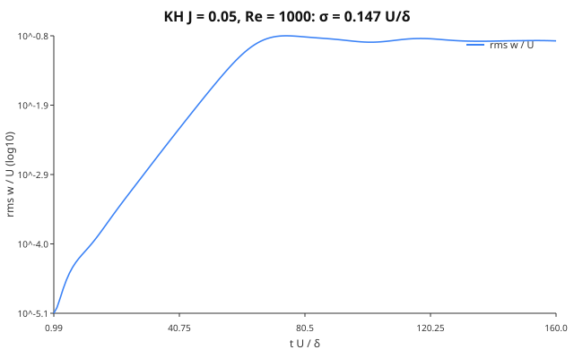
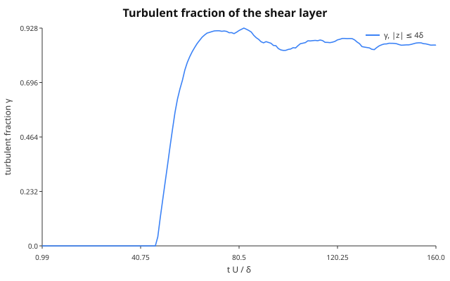
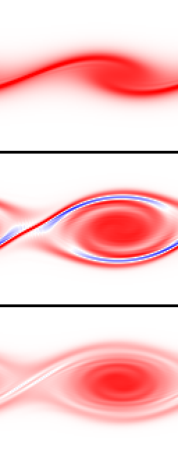
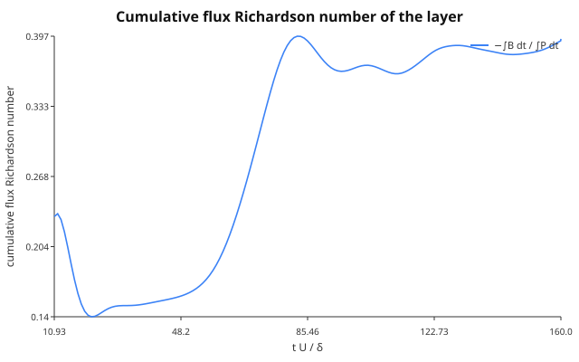

# Transition and wall-bounded flow

Era VI resolves the near-wall layer instead of modelling it wherever a
case is small enough to afford it: laminar and transitional channels,
the wall-resolved stratified channel, and the laminar checks of the
turbulence closures. This page collects the wall treatment those runs
share and the laminar–turbulent transition diagnostics
(`Aeolus.Transition`). Wall-*modelled* runs (the Berlin case among them) keep the
free-slip wall and add the wall-model stress on top.

## Walls

### The no-slip / moving-wall condition

[`NoSlipWall(u_wall, v_wall)`](@ref Aeolus.BoundaryConditions.NoSlipWall)
is the single no-slip wall type. On the staggered grid the horizontal
velocities `u @ FaceX`, `v @ FaceY` are cell-centred in ``z``, so the wall
lies half a cell below the first interior value ``u_1``. The halo is the
odd reflection about the wall velocity,

```math
u_{1-h} = 2u_\mathrm{wall} - u_h, \qquad h = 1,\dots,H_z,
```

so the face average ``\tfrac12(u_0 + u_1)`` seen by every stencil is
exactly ``u_\mathrm{wall}`` and a linear profile through the wall is
extended exactly. The viscous operator in the wall cell becomes

```math
\nu\,\frac{u_2 - u_1}{\Delta z^2} - \nu\,\frac{2(u_1 - u_\mathrm{wall})}{\Delta z^2},
```

the standard second-order ghost-cell treatment (Ferziger & Perić 2002,
§8.10). The vertical velocity and every cell-centred field (``p, θ, ν_t``)
are treated exactly as by the free-slip `ImpermeableWall`: ``w = 0`` on the
wall face with an antisymmetric halo, mirror (Neumann) for scalars. The
pressure problem therefore does not change, and the cosine-FFT solve
stays exact.

A no-slip wall can face a free-slip one, which gives an open channel:

```julia
FieldBoundaryConditions(:periodic, :periodic; bottom = :noslip, top = :wall)
FieldBoundaryConditions(:periodic, :periodic; bottom = :noslip, top = NoSlipWall(U, 0))  # Couette lid
```

A time-dependent wall (Stokes' second problem) reassigns `sim.bcs` with
the new wall velocity before each step.

### Wall stress

`wall_shear_stress(sim; side = :bottom, component = :u)` is a method of
the cut-cell generic [`wall_shear_stress`](@ref Aeolus.CutCell.wall_shear_stress),
not a new name. It returns the plane mean of ``ν\,∂u/∂z`` across the wall
face, formed from the same halo the viscous operator uses:
``ν\,2(u_1 - u_\mathrm{wall})/Δz`` on a no-slip wall and exactly zero on a
free-slip one. With periodic ``x, y`` and ``w = 0`` on the walls, advection
and the pressure gradient drop out of the plane-integrated momentum
budget, which is

```math
\frac{d}{dt}\int_0^{L_z} \bar u\,dz = τ(\mathrm{top}) - τ(\mathrm{bottom}) + G L_z .
```

### Implicit diffusion with a moving wall

A moving wall makes the discrete diffusion operator affine,
``∇·(ν∇φ) = L_0 φ + g``, where ``g`` is the wall term. The CG solve of
[`solve_implicit_diffusion!`](@ref Aeolus.TimeIntegration.solve_implicit_diffusion!)
iterates with the stationary wall (``L_0``, symmetric positive definite),
using [`homogeneous_bcs`](@ref Aeolus.BoundaryConditions.homogeneous_bcs),
and adds ``Δt\,g`` to the right-hand side. ARK2 stages solve for the state,
so the wall term is kept. Rosenbrock stages solve for increments, whose
wall value is zero, so it is dropped. `:wall` runs have no wall term and
take the same code path as before (`homogeneous_bcs(bcs) === bcs`).

The places that special-case a wall were all audited. A missed one would
silently fall back to free slip:

| Site | Treatment of `NoSlipWall` |
| :--- | :--- |
| `fill_halos!` (`_fill_z!`) | new wall-pair methods; the `ImpermeableWall` pair keeps its own |
| `FieldBoundaryConditions`, `nest_bcs` | `:noslip` symbol, `bottom`/`top` keywords; a mixed z pair must be two walls, anything else is an `ArgumentError` |
| pressure solver choice (`_default_solver`) | non-periodic → `CosineFFTPoissonSolver`, unchanged |
| IMEX implicit diffusion | affine wall term (`homogeneous_bcs`) |
| IMEX pinned `w` row (`_constraint_index`) | **behaviour change:** was "`bottom` or `top` is an `ImpermeableWall`", now `is_wall(bcs.bottom)`. The pinned row is the bottom wall face `Hz + 1`; the top wall face sits in the halo, so only the bottom decides. The old symbol constructor could not build a case where the two differ |
| `apply_cutcell_velocity_bc!` | acts on apertures only; the wall comes through `fill_halos!` |
| anelastic / pseudo-incompressible cores | through `fill_halos!`; only z-periodic is rejected |

### Verification

All runs below are on `(4, 4, Nz)` grids with the full 3-D
fractional-step driver (`step!`, ``Δt = 0.3\,Δz^2/ν``), in
`test/era6_walls.jl`.

| Flow | Reference | Measured |
| :--- | :--- | :--- |
| Couette, Re = 100, Nz = 16, from rest | ``u = Uz/h``, ``τ = νU/h`` | ``‖u - Uz/h‖_∞ = 2.7\times10^{-15}U``; ``τ = νU/h`` to ``10^{-15}`` |
| Plane Poiseuille, Nz = 16/32/64 | ``u = \frac{G}{2ν} z(h-z)``, ``u_b = Gh^2/(12ν)`` | L2 order 2.0000 / 2.0000; ``u_b`` off by ``4.9\times10^{-4}`` at Nz = 64; ``τ_b = Gh/2`` to ``10^{-10}`` |
| Stokes I, Nz = 128, ``t = 0.1h^2/ν`` | ``U\,\mathrm{erfc}(z/2\sqrt{νt})`` | ``L_∞`` error ``2.3\times10^{-5}U``; wall stress ``-1.7839`` vs ``-ν U/\sqrt{πνt} = -1.7841`` |
| Stokes II, ``ω = 2π``, 6th period | decay length ``δ = \sqrt{2ν/ω}`` | ``δ`` fitted to ``2.8\times10^{-4}``; phase lag ``z/δ`` to 2 % |
| 3-D random flow, lid moving in ``x`` and ``y`` | plane momentum budget | residual ``8.7\times10^{-18}`` per step |
| IMEX Couette (ARK2, Rosenbrock2, ``Δt ≈ 13×`` explicit limit) | explicit steady state | ``1.1\times10^{-14}U``, ``2.6\times10^{-15}U`` |

``\mathrm{erfc}`` is `GasOptics.erfc_series` (one source of truth). The
Stokes I domain is ``2h`` deep, so the semi-infinite solution is the exact
reference: the top's image term is ``\mathrm{erfc}(2h/\sqrt{4νt}) ≈ 8\times10^{-6}``.
In a domain only ``h`` deep, the top wall reflects ``2.5\,\%\,U`` by
``t = 0.1h^2/ν``. That 2.5 % is a finite-domain effect of the reference,
not a solver error. A `:wall` run (explicit, ARK2 and Rosenbrock2, SGS on)
is bitwise identical to the code before the change. That comparison
against the previous `master` was made by hand. The suite does not
automate it. It checks only that `:wall` keeps the original `fill_halos!`
methods and that `_constraint_index` and `homogeneous_bcs` leave it
unchanged.

### The Berlin case

The Berlin ground is not a `NoSlipWall`. It is a rough, wall-modelled
surface: the `MOSTWallLaw` stress of `Aeolus.WallModels` (#169) is
applied as an implicit drag over a free-slip `:wall`, see [The Berlin case](../design/berlin_case.md). A
resolved no-slip wall at ``Δx = 15.6`` m would put the first velocity
point ``Δz/2 ≈ 3`` m from the wall, with a viscous sublayer of
``ν/u_* ∼ 10^{-4}`` m. `BoundaryConditions` is exempt infrastructure in
the coverage test, so no Berlin list changes.

## Laminar–turbulent transition

Era VI (Phase 59, #180) gives the repository one owner for the
laminar/turbulent and intermittency diagnostics, the module
`Aeolus.Transition`. The stable-boundary-layer collapse (P58-e), the
CASES-99 "hockey stick" (P58-d) and relaminarisation (P59-e) use these
functions and do not redefine them. Transition defines no Richardson
number: ``N^2`` and ``Ri_g`` come from the
[stability contract](turbulence_stability.md) and its pointwise fields
(`buoyancy_frequency_squared!`, `gradient_richardson!`).

### Shear instability and intermittency

#### The tanh shear layer

The parallel shear layer ``U(z) = U\tanh(z/δ)`` is inviscidly unstable to
waves ``e^{iα(x - ct)}``. Its most unstable wavenumber is ``αδ = 0.4446``,
with growth rate ``σ = αc_i = 0.1897\,U/δ`` (Michalke 1964). With a
stable stratification ``N^2(z) = J (U/δ)^2 \operatorname{sech}^2(z/δ)``,
the local gradient Richardson number is
``Ri_g(z) = J\cosh^2(z/δ)``. Its minimum, at the centre, is the bulk
parameter ``J``. For this profile the neutral curve is
``J_c(α) = α^2 (1 - α^2)`` (Drazin 1958), with maximum ``J_c = 1/4`` at
``αδ = 1/\sqrt 2``. This agrees with the Miles–Howard theorem: a
parallel flow with ``Ri_g ≥ 1/4`` everywhere is linearly stable (Miles
1961; Howard 1961).

`test/era6_transition_kh.jl` checks these results with the Boussinesq
core in 2-D (``N_y = 1``), with free-slip walls at ``z = ±L_z/2``
(``≥ 8.9δ``) and ``Re = Uδ/ν = 1000``. The seed is
``w' = 10^{-4} U \sin(αx)\,e^{-z^2/δ^2}``. The base state is held against
its own viscous diffusion by the body force ``-ν∇^2(\text{base})``, which
is the frozen parallel flow that the linear theory assumes. The time
stepping is projected SSP-RK3 (`step_rk3!` with `body_force!`) at CFL 0.6.

| case | grid | measured | reference |
| :-- | :-- | :-- | :-- |
| ``J = 0``, ``αδ = 0.4446`` | 128 × 1 × 256 | ``σ = 0.1864\,U/δ`` (``R^2 = 0.99995``) | 0.1897 inviscid (Michalke 1964): 1.76 % below |
| ``J = 0``, ``αδ = 0.7071`` | 128 × 1 × 256 | ``σ = 0.1396\,U/δ`` | — (sets the e-folding time ``τ_0 = 7.2\,δ/U``) |
| ``J = 0.15``, ``αδ = 0.7071`` | 128 × 1 × 256 | ``σ = 0.0391\,U/δ`` | unstable: ``J < J_c = 1/4`` |
| ``J = 0.30``, ``αδ = 0.7071`` | 128 × 1 × 256 | ``A(5τ_0)/A(τ_0) = 0.223``, fitted ``σ = -0.054`` | stable: ``Ri_g > 1/4`` everywhere |
| ``J = 0``, ``αδ = 0.4446``, no SGS | 64 × 1 × 128 | ``σ = 0.1820`` | quoted |
| the same, Smagorinsky ``C_s = 0.1`` | 64 × 1 × 128 | ``σ = 0.1769`` (−2.8 %) | quoted |

The 1.76 % shortfall at ``J = 0`` is the sum of the viscous reduction at
``Re = 1000`` and the discretisation error of the second-order operators
at ``Δx = 0.11δ``. At ``64 × 128`` (``Δx = 0.22δ``) the shortfall grows
to 4.1 %, so most of it is numerical. The Smagorinsky closure removes
another 2.8 %, because its ``ν_t`` acts on the laminar shear of the base
flow. Comparing it with the σ closure, which is zero for a pure shear,
is P59-b's job.

#### The turbulent fraction γ(z)

A cell is turbulent when the vorticity fluctuation exceeds a fraction of
the mean vorticity magnitude of its level,

```math
\frac{|ω'|}{⟨|ω|⟩} > \text{threshold}, \qquad ω' = ω - ⟨ω⟩,
```

and ``γ(z)`` is the fraction of the level's fluid cells that are
turbulent (`turbulent_fraction`). This is the plane-averaged indicator
of Brandt, Schlatter & Henningson (2004). ``ω`` is computed at the cell
centre with the same velocity-gradient stencil as the Smagorinsky
strain rate. A laminar parallel shear flow has a uniform ``ω`` in each
plane, so ``γ = 0`` exactly. The default threshold 0.2 marks almost all
of a developed isotropic field: if ``ω'`` were a Gaussian vector, only
about 1 % of cells would fall below ``0.2⟨|ω|⟩ = 0.32σ``. Measured on a
decaying 32³ random solenoidal field, ``γ ≥ 0.984`` on every level. On a
synthetic field that is random in one half of the domain and at rest in
the other, ``γ`` = 0.513–0.515. The excess over 0.5 is the vortex sheet
at the two cuts, about 1.8 cell columns each. `laminar_mask!` is the
complement within the fluid, and solid cells are never turbulent.
`normalization = :volume` divides by the domain-mean ``|ω|`` instead.
Use it when the levels of interest have very different vorticity levels.

In the Kelvin–Helmholtz billow of `examples/transition/kelvin_helmholtz.jl`
(``J = 0.05``, ``Re = 1000``, free base state), ``γ`` of the layer
``|z| ≤ 4δ`` stays exactly 0 through the linear stage. It rises once the
billow rolls up (0.78 at ``t = 60\,δ/U``, when ``A = 0.075U``) and peaks
at 0.92 at saturation (``t = 75``):





#### Time-series intermittency

The intermittency factor is the fraction of time a signal spends above a
threshold (Townsend 1976): `intermittency_factor(series; threshold)`
counts samples, and `intermittency_factor(t, series; threshold)` weights
each sample by the interval it starts. An on/off signal with duty cycle
0.3 gives 0.3 exactly.

#### Flux Richardson number, buoyancy Reynolds number, V_TKE

```math
Ri_f = -\frac{B}{P}, \qquad B = \frac{g}{θ_0}⟨w'θ'⟩, \qquad
P = -⟨u'w'⟩\partial_z U - ⟨v'w'⟩\partial_z V
```

(Ellison 1957). Its irreversible part is the mixing efficiency (Ivey &
Imberger 1991). `flux_richardson` uses the resolved plus the SGS fluxes
(``τ_{i3} = -2ν_t S_{i3}``, ``⟨w'θ'⟩_{\rm sgs} = -(ν_t/Pr_t)\partial_zθ``)
and matches the hand values of an analytic field to ``10^{-10}``. In the
billow example, the cumulative ``-∫B\,dt/∫P\,dt`` of the layer is about
0.15 through the linear stage, 0.345 at saturation and 0.394 at
``t = 160\,δ/U``:



The buoyancy Reynolds number is ``Re_b = ε/(νN^2)`` (Gibson 1980; Smyth &
Moum 2000). The turbulence velocity scale of Sun et al. (2012) is
``V_{TKE} = \sqrt{(σ_u^2 + σ_v^2 + σ_w^2)/2}``. The grid Reynolds number
``UΔ/(ν + ν_t)`` and the fraction of cells with ``Ri_g > 1/4``
(`supercritical_fraction`, which counts cells of a `gradient_richardson!`
field) are the transition diagnostics of the Berlin
[`turbulence_diag` addon](../design/berlin_case.md).

#### Growth-rate fit

`growth_rate(t, A)` fits ``\ln A = σt + c`` by least squares. Without an
explicit window it picks the longest run of samples that meets two
conditions: ``R^2 ≥ 0.999``, and the rates of the run's three thirds
agree to 1 %. ``R^2`` alone is not enough, because it grows with the span
of ``\ln A``. A window that includes the seed adjustment and the onset of
saturation still passes 0.999, but its rate is biased: 0.1859 instead of
0.1864 in the KH test, and 2.8 % low on a synthetic saturating series,
where the thirds criterion is 0.3 % low.

## References

### Wall treatment

- Ferziger, J. H. & Perić, M. (2002). *Computational Methods for Fluid
  Dynamics*, 3rd ed., Springer, §8.10.
- Pope, S. B. (2000). *Turbulent Flows*, Cambridge University Press, §7.1.
- Schlichting, H. (1979). *Boundary-Layer Theory*, 7th ed., McGraw-Hill,
  ch. V (Stokes' first and second problems).

### Transition diagnostics

* Brandt, L., Schlatter, P. & Henningson, D. S. (2004). Transition in
  boundary layers subject to free-stream turbulence. *J. Fluid Mech.*,
  517, 167-198.
* Drazin, P. G. (1958). The stability of a shear layer in an unbounded
  heterogeneous inviscid fluid. *J. Fluid Mech.*, 4, 214-224.
* Ellison, T. H. (1957). Turbulent transport of heat and momentum from an
  infinite rough plane. *J. Fluid Mech.*, 2, 456-466.
* Gibson, C. H. (1980). Fossil temperature, salinity, and vorticity
  turbulence in the ocean. *Marine Turbulence*, Elsevier, 221-257.
* Howard, L. N. (1961). Note on a paper of John W. Miles. *J. Fluid
  Mech.*, 10, 509-512.
* Ivey, G. N. & Imberger, J. (1991). On the nature of turbulence in a
  stratified fluid. Part I. *J. Phys. Oceanogr.*, 21, 650-658.
* Michalke, A. (1964). On the inviscid instability of the hyperbolic-
  tangent velocity profile. *J. Fluid Mech.*, 19, 543-556.
* Miles, J. W. (1961). On the stability of heterogeneous shear flows.
  *J. Fluid Mech.*, 10, 496-508.
* Smyth, W. D. & Moum, J. N. (2000). Length scales of turbulence in
  stably stratified mixing layers. *Phys. Fluids*, 12, 1327-1342.
* Sun, J., Mahrt, L., Banta, R. M. & Pichugina, Y. L. (2012). Turbulence
  regimes and turbulence intermittency in the stable boundary layer
  during CASES-99. *J. Atmos. Sci.*, 69, 338-351.
* Townsend, A. A. (1976). *The Structure of Turbulent Shear Flow*, 2nd
  ed. Cambridge University Press.
