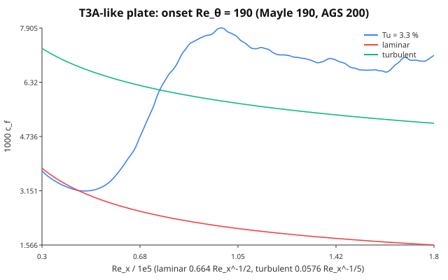
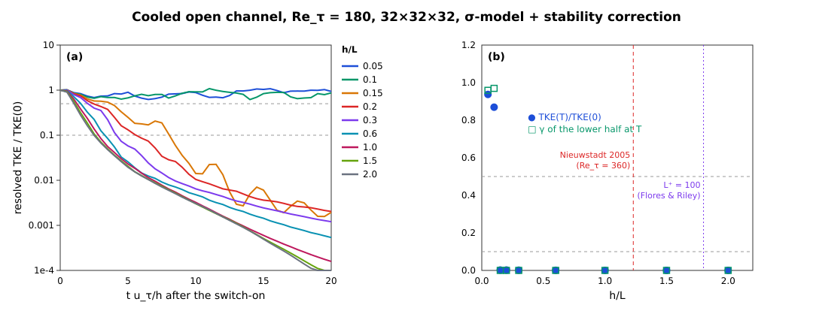
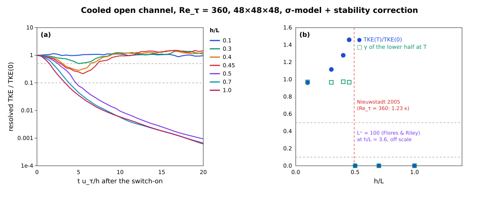

# Transition and wall-bounded flow

Era VI resolves the near-wall layer instead of modelling it wherever a
case is small enough to afford it: laminar and transitional channels,
the wall-resolved stratified channel, and the laminar checks of the
turbulence closures. This page collects the wall treatment those runs
share and the laminar–turbulent transition diagnostics
(`Aeolus.Transition`). Wall-*modelled* runs (the Berlin case among them) keep the
free-slip wall and add the wall-model stress on top.

## Walls

### The no-slip / moving-wall condition

[`NoSlipWall(u_wall, v_wall)`](@ref Aeolus.BoundaryConditions.NoSlipWall)
is the single no-slip wall type. On the staggered grid the horizontal
velocities `u @ FaceX`, `v @ FaceY` are cell-centred in ``z``, so the wall
lies half a cell below the first interior value ``u_1``. The halo is the
odd reflection about the wall velocity,

```math
u_{1-h} = 2u_\mathrm{wall} - u_h, \qquad h = 1,\dots,H_z,
```

so the face average ``\tfrac12(u_0 + u_1)`` seen by every stencil is
exactly ``u_\mathrm{wall}`` and a linear profile through the wall is
extended exactly. The viscous operator in the wall cell becomes

```math
\nu\,\frac{u_2 - u_1}{\Delta z^2} - \nu\,\frac{2(u_1 - u_\mathrm{wall})}{\Delta z^2},
```

the standard second-order ghost-cell treatment (Ferziger & Perić 2002,
§8.10). The vertical velocity and every cell-centred field (``p, θ, ν_t``)
are treated exactly as by the free-slip `ImpermeableWall`: ``w = 0`` on the
wall face with an antisymmetric halo, mirror (Neumann) for scalars. The
pressure problem therefore does not change, and the cosine-FFT solve
stays exact.

A no-slip wall can face a free-slip one, which gives an open channel:

```julia
FieldBoundaryConditions(:periodic, :periodic; bottom = :noslip, top = :wall)
FieldBoundaryConditions(:periodic, :periodic; bottom = :noslip, top = NoSlipWall(U, 0))  # Couette lid
```

A time-dependent wall (Stokes' second problem) reassigns `sim.bcs` with
the new wall velocity before each step.

### Wall stress

`wall_shear_stress(sim; side = :bottom, component = :u)` is a method of
the cut-cell generic [`wall_shear_stress`](@ref Aeolus.CutCell.wall_shear_stress),
not a new name. It returns the plane mean of ``ν\,∂u/∂z`` across the wall
face, formed from the same halo the viscous operator uses:
``ν\,2(u_1 - u_\mathrm{wall})/Δz`` on a no-slip wall and exactly zero on a
free-slip one. With periodic ``x, y`` and ``w = 0`` on the walls, advection
and the pressure gradient drop out of the plane-integrated momentum
budget, which is

```math
\frac{d}{dt}\int_0^{L_z} \bar u\,dz = τ(\mathrm{top}) - τ(\mathrm{bottom}) + G L_z .
```

### Implicit diffusion with a moving wall

A moving wall makes the discrete diffusion operator affine,
``∇·(ν∇φ) = L_0 φ + g``, where ``g`` is the wall term. The CG solve of
[`solve_implicit_diffusion!`](@ref Aeolus.TimeIntegration.solve_implicit_diffusion!)
iterates with the stationary wall (``L_0``, symmetric positive definite),
using [`homogeneous_bcs`](@ref Aeolus.BoundaryConditions.homogeneous_bcs),
and adds ``Δt\,g`` to the right-hand side. ARK2 stages solve for the state,
so the wall term is kept. Rosenbrock stages solve for increments, whose
wall value is zero, so it is dropped. `:wall` runs have no wall term and
take the same code path as before (`homogeneous_bcs(bcs) === bcs`).

The places that special-case a wall were all audited. A missed one would
silently fall back to free slip:

| Site | Treatment of `NoSlipWall` |
| :--- | :--- |
| `fill_halos!` (`_fill_z!`) | new wall-pair methods; the `ImpermeableWall` pair keeps its own |
| `FieldBoundaryConditions`, `nest_bcs` | `:noslip` symbol, `bottom`/`top` keywords; a mixed z pair must be two walls, anything else is an `ArgumentError` |
| pressure solver choice (`_default_solver`) | non-periodic → `CosineFFTPoissonSolver`, unchanged |
| IMEX implicit diffusion | affine wall term (`homogeneous_bcs`) |
| IMEX pinned `w` row (`_constraint_index`) | **behaviour change:** was "`bottom` or `top` is an `ImpermeableWall`", now `is_wall(bcs.bottom)`. The pinned row is the bottom wall face `Hz + 1`; the top wall face sits in the halo, so only the bottom decides. The old symbol constructor could not build a case where the two differ |
| `apply_cutcell_velocity_bc!` | acts on apertures only; the wall comes through `fill_halos!` |
| anelastic / pseudo-incompressible cores | through `fill_halos!`; only z-periodic is rejected |

### Verification

All runs below are on `(4, 4, Nz)` grids with the full 3-D
fractional-step driver (`step!`, ``Δt = 0.3\,Δz^2/ν``), in
`test/era6_walls.jl`.

| Flow | Reference | Measured |
| :--- | :--- | :--- |
| Couette, Re = 100, Nz = 16, from rest | ``u = Uz/h``, ``τ = νU/h`` | ``‖u - Uz/h‖_∞ = 2.7\times10^{-15}U``; ``τ = νU/h`` to ``10^{-15}`` |
| Plane Poiseuille, Nz = 16/32/64 | ``u = \frac{G}{2ν} z(h-z)``, ``u_b = Gh^2/(12ν)`` | L2 order 2.0000 / 2.0000; ``u_b`` off by ``4.9\times10^{-4}`` at Nz = 64; ``τ_b = Gh/2`` to ``10^{-10}`` |
| Stokes I, Nz = 128, ``t = 0.1h^2/ν`` | ``U\,\mathrm{erfc}(z/2\sqrt{νt})`` | ``L_∞`` error ``2.3\times10^{-5}U``; wall stress ``-1.7839`` vs ``-ν U/\sqrt{πνt} = -1.7841`` |
| Stokes II, ``ω = 2π``, 6th period | decay length ``δ = \sqrt{2ν/ω}`` | ``δ`` fitted to ``2.8\times10^{-4}``; phase lag ``z/δ`` to 2 % |
| 3-D random flow, lid moving in ``x`` and ``y`` | plane momentum budget | residual ``8.7\times10^{-18}`` per step |
| IMEX Couette (ARK2, Rosenbrock2, ``Δt ≈ 13×`` explicit limit) | explicit steady state | ``1.1\times10^{-14}U``, ``2.6\times10^{-15}U`` |

``\mathrm{erfc}`` is `GasOptics.erfc_series` (one source of truth). The
Stokes I domain is ``2h`` deep, so the semi-infinite solution is the exact
reference: the top's image term is ``\mathrm{erfc}(2h/\sqrt{4νt}) ≈ 8\times10^{-6}``.
In a domain only ``h`` deep, the top wall reflects ``2.5\,\%\,U`` by
``t = 0.1h^2/ν``. That 2.5 % is a finite-domain effect of the reference,
not a solver error. A `:wall` run (explicit, ARK2 and Rosenbrock2, SGS on)
is bitwise identical to the code before the change. That comparison
against the previous `master` was made by hand. The suite does not
automate it. It checks only that `:wall` keeps the original `fill_halos!`
methods and that `_constraint_index` and `homogeneous_bcs` leave it
unchanged.

### The Berlin case

The Berlin ground is not a `NoSlipWall`. It is a rough, wall-modelled
surface: the `MOSTWallLaw` stress of `Aeolus.WallModels` (#169) is
applied as an implicit drag over a free-slip `:wall`, see [The Berlin case](../design/berlin_case.md). A
resolved no-slip wall at ``Δx = 15.6`` m would put the first velocity
point ``Δz/2 ≈ 3`` m from the wall, with a viscous sublayer of
``ν/u_* ∼ 10^{-4}`` m. `BoundaryConditions` is exempt infrastructure in
the coverage test, so no Berlin list changes.

## Laminar–turbulent transition

Era VI (Phase 59, #180) gives the repository one owner for the
laminar/turbulent and intermittency diagnostics, the module
`Aeolus.Transition`. The stable-boundary-layer collapse (P58-e), the
CASES-99 "hockey stick" (P58-d) and relaminarisation (P59-e) use these
functions and do not redefine them. Transition defines no Richardson
number: ``N^2`` and ``Ri_g`` come from the
[stability contract](turbulence_stability.md) and its pointwise fields
(`buoyancy_frequency_squared!`, `gradient_richardson!`).

### Shear instability and intermittency

#### The tanh shear layer

The parallel shear layer ``U(z) = U\tanh(z/δ)`` is inviscidly unstable to
waves ``e^{iα(x - ct)}``. Its most unstable wavenumber is ``αδ = 0.4446``,
with growth rate ``σ = αc_i = 0.1897\,U/δ`` (Michalke 1964). With a
stable stratification ``N^2(z) = J (U/δ)^2 \operatorname{sech}^2(z/δ)``,
the local gradient Richardson number is
``Ri_g(z) = J\cosh^2(z/δ)``. Its minimum, at the centre, is the bulk
parameter ``J``. For this profile the neutral curve is
``J_c(α) = α^2 (1 - α^2)`` (Drazin 1958), with maximum ``J_c = 1/4`` at
``αδ = 1/\sqrt 2``. This agrees with the Miles–Howard theorem: a
parallel flow with ``Ri_g ≥ 1/4`` everywhere is linearly stable (Miles
1961; Howard 1961).

`test/era6_transition_kh.jl` checks these results with the Boussinesq
core in 2-D (``N_y = 1``), with free-slip walls at ``z = ±L_z/2``
(``≥ 8.9δ``) and ``Re = Uδ/ν = 1000``. The seed is
``w' = 10^{-4} U \sin(αx)\,e^{-z^2/δ^2}``. The base state is held against
its own viscous diffusion by the body force ``-ν∇^2(\text{base})``, which
is the frozen parallel flow that the linear theory assumes. The time
stepping is projected SSP-RK3 (`step_rk3!` with `body_force!`) at CFL 0.6.

| case | grid | measured | reference |
| :-- | :-- | :-- | :-- |
| ``J = 0``, ``αδ = 0.4446`` | 128 × 1 × 256 | ``σ = 0.1864\,U/δ`` (``R^2 = 0.99995``) | 0.1897 inviscid (Michalke 1964): 1.76 % below |
| ``J = 0``, ``αδ = 0.7071`` | 128 × 1 × 256 | ``σ = 0.1396\,U/δ`` | — (sets the e-folding time ``τ_0 = 7.2\,δ/U``) |
| ``J = 0.15``, ``αδ = 0.7071`` | 128 × 1 × 256 | ``σ = 0.0391\,U/δ`` | unstable: ``J < J_c = 1/4`` |
| ``J = 0.30``, ``αδ = 0.7071`` | 128 × 1 × 256 | ``A(5τ_0)/A(τ_0) = 0.223``, fitted ``σ = -0.054`` | stable: ``Ri_g > 1/4`` everywhere |
| ``J = 0``, ``αδ = 0.4446``, no SGS | 64 × 1 × 128 | ``σ = 0.1820`` | quoted |
| the same, Smagorinsky ``C_s = 0.1`` | 64 × 1 × 128 | ``σ = 0.1769`` (−2.8 %) | quoted |
| the same, σ-model ``C_σ = 1.35`` (P59-b, #184) | 64 × 1 × 128 | ``σ = 0.1820`` (``ν_t ≡ 0``) | within 3 % of no SGS |

The 1.76 % shortfall at ``J = 0`` is the sum of the viscous reduction at
``Re = 1000`` and the discretisation error of the second-order operators
at ``Δx = 0.11δ``. At ``64 × 128`` (``Δx = 0.22δ``) the shortfall grows
to 4.1 %, so most of it is numerical. The Smagorinsky closure removes
another 2.8 %, because its ``ν_t`` acts on the laminar shear of the base
flow. The [σ-model](sgs.md#σ-model) (P59-b, #184) does not. Its
``ν_t`` is zero for any 2-D flow (``σ_3 = 0``), so the layer grows at
exactly the no-SGS rate. The same property keeps the molecular wall
stress of a laminar Couette flow ([Walls](#Walls), above) unchanged with
the SGS on: σ gives ``νU/h`` to 2.8e-14, while Smagorinsky adds
``(C_sΔ)^2(U/h)/ν`` = 4.5 % at ``Re = 100``, ``N_z = 32``.

#### The turbulent fraction γ(z)

A cell is turbulent when the vorticity fluctuation exceeds a fraction of
the mean vorticity magnitude of its level,

```math
\frac{|ω'|}{⟨|ω|⟩} > \text{threshold}, \qquad ω' = ω - ⟨ω⟩,
```

and ``γ(z)`` is the fraction of the level's fluid cells that are
turbulent (`turbulent_fraction`). This is the plane-averaged indicator
of Brandt, Schlatter & Henningson (2004). ``ω`` is computed at the cell
centre with the same velocity-gradient stencil as the Smagorinsky
strain rate. A laminar parallel shear flow has a uniform ``ω`` in each
plane, so ``γ = 0`` exactly. The default threshold 0.2 marks almost all
of a developed isotropic field: if ``ω'`` were a Gaussian vector, only
about 1 % of cells would fall below ``0.2⟨|ω|⟩ = 0.32σ``. Measured on a
decaying 32³ random solenoidal field, ``γ ≥ 0.984`` on every level. On a
synthetic field that is random in one half of the domain and at rest in
the other, ``γ`` = 0.513–0.515. The excess over 0.5 is the vortex sheet
at the two cuts, about 1.8 cell columns each. `laminar_mask!` is the
complement within the fluid, and solid cells are never turbulent.
`normalization = :volume` divides by the domain-mean ``|ω|`` instead.
Use it when the levels of interest have very different vorticity levels.

In the Kelvin–Helmholtz billow of `examples/transition/kelvin_helmholtz.jl`
(``J = 0.05``, ``Re = 1000``, free base state), ``γ`` of the layer
``|z| ≤ 4δ`` stays exactly 0 through the linear stage. It rises once the
billow rolls up (0.78 at ``t = 60\,δ/U``, when ``A = 0.075U``) and peaks
at 0.92 at saturation (``t = 75``):


#### Time-series intermittency

The intermittency factor is the fraction of time a signal spends above a
threshold (Townsend 1976): `intermittency_factor(series; threshold)`
counts samples, and `intermittency_factor(t, series; threshold)` weights
each sample by the interval it starts. An on/off signal with duty cycle
0.3 gives 0.3 exactly.

#### Flux Richardson number, buoyancy Reynolds number, V_TKE

```math
Ri_f = -\frac{B}{P}, \qquad B = \frac{g}{θ_0}⟨w'θ'⟩, \qquad
P = -⟨u'w'⟩\partial_z U - ⟨v'w'⟩\partial_z V
```

(Ellison 1957). Its irreversible part is the mixing efficiency (Ivey &
Imberger 1991). `flux_richardson` uses the resolved plus the SGS fluxes
(``τ_{i3} = -2ν_t S_{i3}``, ``⟨w'θ'⟩_{\rm sgs} = -(ν_t/Pr_t)\partial_zθ``)
and matches the hand values of an analytic field to ``10^{-10}``. In the
billow example, the cumulative ``-∫B\,dt/∫P\,dt`` of the layer is about
0.15 through the linear stage, 0.345 at saturation and 0.394 at
``t = 160\,δ/U``:


The buoyancy Reynolds number is ``Re_b = ε/(νN^2)`` (Gibson 1980; Smyth &
Moum 2000). The turbulence velocity scale of Sun et al. (2012) is
``V_{TKE} = \sqrt{(σ_u^2 + σ_v^2 + σ_w^2)/2}``. The grid Reynolds number
``UΔ/(ν + ν_t)`` and the fraction of cells with ``Ri_g > 1/4``
(`supercritical_fraction`, which counts cells of a `gradient_richardson!`
field) are the transition diagnostics of the Berlin
[`turbulence_diag` addon](../design/berlin_case.md).

#### Growth-rate fit

`growth_rate(t, A)` fits ``\ln A = σt + c`` by least squares. Without an
explicit window it picks the longest run of samples that meets two
conditions: ``R^2 ≥ 0.999``, and the rates of the run's three thirds
agree to 1 %. ``R^2`` alone is not enough, because it grows with the span
of ``\ln A``. A window that includes the seed adjustment and the onset of
saturation still passes 0.999, but its rate is biased: 0.1859 instead of
0.1864 in the KH test, and 2.8 % low on a synthetic saturating series,
where the thirds criterion is 0.3 % low.

## Flat-plate transition

P59-d (#185) adds the spatially developing zero-pressure-gradient
flat-plate boundary layer: the Blasius solution, the fringe region that
makes such a layer possible on the `x`-periodic FFT grid, a free-stream
top boundary, free-stream turbulence, and the integral diagnostics that
locate transition. Everything lives in `Aeolus.Transition`, except the
damping profile (`Operators`) and the top boundary (`BoundaryConditions`).

### The Blasius layer

[`blasius_solution`](@ref Aeolus.Transition.blasius_solution) integrates
``f''' + \tfrac12 f f'' = 0``, ``f(0) = f'(0) = 0``, ``f'(∞) = 1`` with
classical RK4 (12 000 steps on ``0 ≤ η ≤ 12``) and finds ``s = f''(0)``
by a secant iteration on ``f'(η_{\max}; s) - 1``. Five iterations give
``f''(0) = 0.3320573362`` (Howarth 1938: 0.332057), the displacement
constant ``∫(1 - f')dη = 1.7207876575``, ``θ`` constant ``0.6641146724
= 2f''(0)`` to 1e-10 (the momentum-integral identity, checked by an
independent Simpson quadrature), ``η_{99} = 4.90999`` and
``H = 2.59110``. [`blasius_profile`](@ref Aeolus.Transition.blasius_profile)
is the cubic Hermite interpolant of the table (``f'``, ``f''`` and
``f''' = -\tfrac12 f f''`` are all tabulated, so each interpolant is C¹),
and [`blasius_velocity`](@ref Aeolus.Transition.blasius_velocity) returns
``u = U f'``, ``w = \tfrac12\sqrt{νU/x}\,(ηf' - f)``.

### The fringe region

A spatially developing layer grows downstream, so a periodic domain needs
a region that returns the outflow to the inflow. The fringe of
Nordström, Nordin & Henningson (1999) adds
``-λ(x)(\mathbf u - \mathbf u_{\rm target})`` with

```math
λ(x) = λ_{\max}\Big[S\Big(\frac{x - x_{\rm start}}{Δ_{\rm rise}}\Big)
                    - S\Big(\frac{x - x_{\rm end}}{Δ_{\rm fall}} + 1\Big)\Big],
\qquad
S(x) = \frac{1}{1 + \exp\big(\frac{1}{x - 1} + \frac{1}{x}\big)}\ (0 < x < 1),
```

``S = 0`` below and ``1`` above (their eq. 2.3). The rate comes from the
`Operators.DampingProfile` with a `NordstromRamp`, the same type, rate
function and kernel (`_add_damping!`) that the Rayleigh sponge
[`add_sponge!`](@ref Aeolus.Operators.add_sponge!) uses with its
`SinSquaredRamp`: one damping-profile implementation for every
relaxation term. `add_sponge!` is bit for bit unchanged on all three mesh
types (asserted against the verbatim Phase-7 kernel; the Berlin smoke run
gives an identical state with either kernel).

The target is the Blasius layer at the
[`fringe_distance`](@ref Aeolus.Transition.fringe_distance) — the
distance from the leading edge of the upstream periodic image inside the
fringe — so the profile the fringe releases is already developing at the
right rate and its ``w`` satisfies continuity. A target frozen at the
inflow ``x_{in}`` released a layer with ``H = 2.37`` instead of 2.59 at
the inflow, and ``c_f`` stayed 4–5 % low for half the plate.

### The free-stream boundary

A closed lid cannot hold a growing layer: the free stream must
accelerate by ``Δδ^*/H`` and the layer feels a favourable pressure
gradient. On the 2-D test grid (``H = 16δ^*_0``) a free-slip lid gave
``c_f`` 16–28 % above Blasius, even normalised by the local edge
velocity. [`FreeStreamBoundary`](@ref Aeolus.BoundaryConditions.FreeStreamBoundary)
is the far-field condition of the spatial DNS of Spalart (1988) and
Brandt et al. (2004): zero shear for ``u, v`` and a prescribed
transpiration ``w = W(x)`` on the top face. The pressure problem stays a
Neumann problem (the face value enters the divergence of the top cell),
so the cosine FFT solver remains exact, provided the net transpiration
vanishes. [`blasius_freestream`](@ref Aeolus.Transition.blasius_freestream)
prescribes the displacement velocity
``W_∞ = U\,dδ^*/dx = 0.8604\,U/\sqrt{Re_x}`` and returns the plate's
outflow through a bump confined to the fringe rise, upstream of the
plateau where the velocity is pinned.

The momentum budget of one explicit step closes exactly:
``\frac{d}{dt}∫u\,dV = ∫F_{\rm fringe}dV - τ_w A - ∮u\,w_{\rm top}dA``,
residual 5e-12 (2e-13 relative) with the lid and with the free-stream
top.

### Laminar plate

[`flat_plate_setup`](@ref Aeolus.Transition.flat_plate_setup) assembles
the case in units of the inflow ``δ^*_0`` and ``U_∞``. In 2-D at
``Re_{δ^*_0} = 200`` (256 × 64 cells on 512 × 16 ``δ^*_0``, plate
``Re_x`` = 1.35e4 to 1.0e5), started from a uniform stream and run for
1200 RK3 steps (12 s), the layer develops from the fringe inflow to
``c_f/c_{f,\rm Blasius} ∈ [0.9982, 1.0001]`` and ``H ∈ [2.574, 2.583]``
over the middle 60 % of the plate; the target is recovered at the fringe
exit to 5.2e-4 ``U``. The issue's σ-model variant of this check is not
run separately: P59-b (#184) merged after this section was written, and
in this 2-D flow (``N_y = 1``, ``v = 0``) the velocity gradient has rank
≤ 2, so ``σ_3 = 0`` and the [σ-model](sgs.md#σ-model)'s ``ν_t`` vanishes
identically; the variant would reproduce the run above.

### Free-stream turbulence and bypass transition

[`FreeStreamDisturbance`](@ref Aeolus.Transition.FreeStreamDisturbance)
represents isotropic turbulence by random Fourier modes
(Jacobs & Durbin 2001; Brandt et al. 2004) with the von Kármán spectrum
``E(κ) = \tfrac23 a (κL)^4/(b + (κL)^2)^{17/6}\,Lq``. The velocity is the
grid curl of a vector potential sampled on the cell edges, so its
discrete divergence is zero to round-off (3.9e-16 measured); the energy
is scaled to ``q = \tfrac32 (Tu\,U)^2`` and the spectrum length
calibrated so the discrete mode set has the requested ``L_{11}``
(measured on a 512 × 32 × 32 box with 400 modes: Tu 0.0497 for 0.05,
``L_{11}`` 1.042 for 1.0 with seed 1; one realisation scatters with the
seed — 0.82–1.43 over seeds 1–16, standard deviation 0.14 — and the
ensemble mean over those 16 seeds is 1.027, which is what the test
asserts). The disturbances enter through the fringe
target as Taylor's frozen turbulence
([`disturbance_fringe_update`](@ref Aeolus.Transition.disturbance_fringe_update)),
kept out of the inflow layer by a damping of the vector potential.

The onset is located by
[`transition_onset`](@ref Aeolus.Transition.transition_onset): the
minimum of ``c_f`` upstream of the point from which ``c_f`` stays 10 %
above laminar. In the coarse 3-D sanity test (96 × 24 × 48,
``Re_{δ^*_0} = 300``, plate ``Re_x`` = 3.0e4 to 1.26e5, ``c_f`` averaged
over the last 200 of 700 steps) Tu = 6 % raises the outlet ``c_f``
(``Re_x`` 1.03e5–1.17e5) to 3.47 times Blasius. Two laminar controls
run beside it:

* **Tu = 0 in 2-D** (``N_y = 1``), the cheap exact check: without a seed
  the 3-D run stays exactly 2-D. Outlet ``c_f`` 1.015 times Blasius
  (2 s).
* **Tu = 0.1 % in 3-D** on the same grid, seeded by the same
  `FreeStreamDisturbance` generator at 1/60 of the amplitude (55 s on
  3 threads). This checks that the laminar layer survives small 3-D
  disturbances. It does not transition:

| quantity (seeded 3-D control) | measured | asserted |
| :-- | :-- | :-- |
| ``c_f / c_f(\text{2-D}, Tu = 0)``, pointwise, ``Re_x`` 3.5e4–1.17e5 | 0.9981–0.9995 | within 1 % |
| ``[1\,2\,1]``-filtered ``c_f`` / Blasius, ``Re_x`` 3.5e4–1.12e5 | 0.9805–1.0074 | within 5 % |
| the same at 0.9 of the plate (``Re_x`` 1.17e5) | 1.052 | — |
| ``v_{\rm rms}`` in the layer, sampled every 50 steps | rises to 1.97e-3 by step 500, then falls to 1.34e-3 | < 5e-3 throughout |
| mean layer ``v_{\rm rms}``, steps 550–700 over steps 400–550 | 0.795 | < 1.2 |
| free-stream ``v_{\rm rms}`` | 0.90e-3 | 0.5e-3–1.5e-3 |
| layer ``v_{\rm rms}`` at Tu = 6 % (for scale) | 8.2e-2 | > 10× the control |

The disturbances need about one flow-through (≈ 270 steps) to fill the
plate. After that, the spanwise velocity in the layer stays at about
twice the free-stream value and decays over the last 300 steps. It does
not grow. ``Re_{δ^*}`` reaches 589 at 0.9 of the plate, which is above
the Tollmien–Schlichting critical value of 520 (``Re_x ≈ 9.1\times10^4``).
The unstable stretch is too short for TS waves to grow anywhere near
transition amplitudes, and the measured ``c_f`` shows no sign of them.
The 5 % tolerance matches the 2-D laminar plate. Blasius is a
parallel-flow similarity solution, the two ends of the plate feel the
inflow (−2 %) and the fringe, and transition would add 50 % or more. At
0.9 of the plate the fringe alone raises ``c_f`` by 5 %: a 2-D Tu = 0 run
at ``Δx = 2.1`` gives 1.053 at the same point. That is why the Blasius
window stops 48 ``δ^*_0`` before the fringe. A first version ran to 0.9
of the plate and failed there; the expectation was wrong, not the code.

**Finding: a grid-scale wiggle on the coarse grid.** At
``Δx = 4.2\,δ^*_0`` both laminar runs, with and without the seed, carry
the same stationary ``2Δx`` (odd–even) oscillation in ``c_f``. It is
±0.6 % near the inflow and grows to ±17 % just upstream of the fringe,
so the unfiltered ``c_f``/Blasius is 0.88–1.22 over the plate. The
outlet-window average used for the Tu = 0 number (1.015) hides it. It is
a resolution artefact: the 2-D control at ``Δx = 2.1\,δ^*_0`` has it at
±0.03 % and stays within 1.6 % of Blasius up to ``x ≈ 265\,δ^*_0``. The
``[1\,2\,1]/4`` filter removes exactly this mode, which is why the
Blasius comparison uses filtered ``c_f``. The grids of the 2-D laminar
plate (``Δx = 2``) and of the T3A-like example (``Δx = 1.04``) are fine
enough not to need it.

The T3A-like example (`examples/transition/flat_plate_t3a.jl`, Tu = 3.3 %
as in Roach & Brierley 1992) runs 576 × 64 × 96 cells on
600 × 36 × 24 ``δ^*_0`` (``Re_x`` = 3.0e4 to 1.9e5; ``Δx = 1.04``,
``Δy = 0.56``, ``Δz = 0.25\,δ^*_0``, i.e. ``Δx^+ ≈ 17``, ``Δy^+ ≈ 9``,
``Δz^+ ≈ 4`` with the downstream ``u_τ``) without an SGS model —
a Smagorinsky ``ν_t`` from the laminar wall shear alone would be several
times ``ν`` and keep the layer laminar.

Measured (1500 RK3 steps at ``Δt = 1\,δ^*_0/U``, statistics over the
last 600; 8034 s, 5.4 s per step on 8 threads of a shared machine):

| quantity | result | reference |
| :-- | :-- | :-- |
| free-stream Tu (streamwise) | 3.23 % at the inflow, 2.77 % at ``Re_x = 10^5``, 2.60 % at the plate end | 3.3 % requested |
| onset (minimum of ``c_f``) | ``x = 48\,δ^*_0``, ``Re_x = 4.48\times10^4`` | — |
| ``Re_θ`` at onset, measured ``θ`` | 198 | Mayle (1991) 190 (+5 %), Abu-Ghannam & Shaw (1980) 200 (−1 %) |
| ``Re_θ`` at onset, Blasius ``θ`` at that ``Re_x`` | 141 | −26 % / −30 % |
| downstream ``c_f/(0.0576\,Re_x^{-1/5})``, ``Re_x`` 1.2e5–1.8e5 | 1.057–1.135 (mean 1.084) | issue target: within 20 % — met |
| downstream ``H`` | 1.45–1.50 | ≈ 1.4 |

The onset is within the ±30 % band of both correlations whichever ``θ`` is
used (the free-stream turbulence thickens the pre-transitional layer, so
the measured ``θ`` at onset is 40 % above Blasius). Against the ``Re_θ``
form ``0.024\,Re_θ^{-1/4}`` (Kays & Crawford) at the measured
``Re_θ`` = 443–552 the ratio is 1.12–1.17.

The turbulent ``c_f`` of this model-free calculation is
resolution-limited. Refining ``z`` alone saturates near 1.2 at the
coarse ``Δx, Δy``; the streamwise and spanwise spacing has to come down
with it. Same case, same seed, same 1500-step protocol:

| grid ``N_x × N_y × N_z`` | ``Δx, Δy, Δz`` (``δ^*_0``) | ``c_f/(0.0576\,Re_x^{-1/5})``, ``Re_x`` 1.2e5–1.8e5 | onset ``Re_θ`` |
| :-- | :-- | :-- | :-- |
| 288 × 32 × 48 | 2.08, 1.13, 0.50 | 1.260–1.387 (mean 1.297) | 190 |
| 288 × 32 × 96 | 2.08, 1.13, 0.25 | 1.180–1.248 (mean 1.211) | 191 |
| 288 × 32 × 128 | 2.08, 1.13, 0.19 | 1.156–1.258 (mean 1.204) | 191 |
| 432 × 48 × 96 | 1.39, 0.75, 0.25 | 1.122–1.200 (mean 1.173) | 232 |
| 576 × 64 × 64 | 1.04, 0.56, 0.38 | 1.135–1.197 (mean 1.162) | 199 |
| **576 × 64 × 96** (the example) | 1.04, 0.56, 0.25 | **1.057–1.135 (mean 1.084)** | 198 |

The first row is what the example ran before; it missed the 20 % target.
The local edge velocity is within 0.7 % of ``U_∞`` downstream on every
grid, so normalising by it changes none of these ratios by more than 0.012.



The boundary-layer integrals of a disturbed layer are taken to its
[`boundary_layer_edge`](@ref Aeolus.Transition.boundary_layer_edge): the
fringe-fed free stream carries a ≈ 0.5 % mean deficit, and integrating
to the top inflated ``θ`` by 50 % at the inflow.

### The Berlin case

Stated exception (#185): the Berlin domain is laterally periodic with
geostrophic forcing and has no inflow direction, so a fringe, a
free-stream top and an inflow generator have no place in it; inflow
boundaries arrive with nesting and ERA5 driving (Phase 68). Transition
stays coupled through the `turbulence_diag` addon (P59-c), and the
Rayleigh sponge of every Berlin step now takes its rate from the shared
damping profile (state bit-identical to the Phase-7 kernel in the smoke
run). No Berlin list changed.

## Relaminarisation in strongly stable stratification

P59-e (#195) validates laminar–turbulent coexistence and collapse with
the closures that exist — the σ-model (P59-b), the stability correction
(P55-e) on the TurbulenceStability functions (P58-a) — and adds no
closure and no stability function. Transition gains the three numbers
the collapse studies use, all from existing definitions:

* `friction_reynolds(sim)` — ``Re_τ = u_τ h/ν``, ``u_τ`` from the
  molecular wall stress of the no-slip bottom (`wall_shear_stress`,
  P59-a) or the nominal value;
* `relaminarisation_criteria(sim; heat_flux)` — ``h/L`` with the Obukhov
  length of the surface flux (`SurfaceExchange.obukhov_length`, there is
  no second one), ``L^+ = L u_τ/ν = Re_τ/(h/L)``, and the bulk
  Richardson number of the top and bottom cell layers and the bulk
  velocity (`SurfaceExchange.bulk_richardson`);
* `relaminarised_fraction(laminar, Ri, νt, ν)` — the share of the
  ``Ri_g > 1/4`` cells that are γ-laminar with ``ν_t/ν < 10^{-2}``.

`Operators.laminar_consistent(closure)` marks the closures whose
``ν_t`` vanishes identically in laminar flow (σ, and the wrappers around
it). The cases are the P54-d builder with `bottom_bc = :noslip` (P55-f)
and the new `channel_case(surface_heat_flux = Q)` hook: the flux-cooled
open channel of Nieuwstadt (2005), no-slip bottom, free-slip insulated
top, the prescribed bottom θ flux of the core, molecular ``Pr = 0.71``.

### Laminar stratified Poiseuille flow (exact)

`test/era6_relaminarisation.jl`, test 1. At ``Re_τ = 10`` the steady
closed-channel Poiseuille flow with the stable conduction profile
(``Ri_τ = 50``) gives ``ν_t ≡ 0`` (exactly, ``ν_h``, ``ν_v`` and
``κ_v``) with σ, σ + correction (isotropic and anisotropic length
scales); the velocity equals the closure-free run and the unstratified
(``g = 0``) run to < 1e-10 (measured 0: buoyancy is balanced by the
hydrostatic pressure). The wall stress is ``u_τ^2`` to 1.4e-7.
Smagorinsky 0.17 keeps max ``ν_t = 0.53 ν`` and lowers the molecular
wall stress to 0.659 ``u_τ^2``. The flux-cooled open channel (``Q = -0.05``)
reproduces the long-time conduction solution under a constant flux and
an insulated top, ``θ = \bar θ(t) + Q(z - h)^2/(2κh)``,
``d\bar θ/dt = Q/h``, to 1.6e-11 of ``|Q|h/κ``; θ is conserved to the
prescribed flux to 1.5e-10 (round-off at θ ≈ 10³); u is unchanged by
the buoyancy (measured 0). The criteria match their closed forms to
1e-12 (``h/L = κg|Q|h/(θ_0 u_τ^3)``, ``L^+ = Re_τ/(h/L)``, ``Ri_b`` of a
linear θ).

### Decaying stratified turbulence

Test 2: a laminar shear ``S`` held fixed (the plane mean of ``u`` is
reset to ``S(z - H/2)`` after each step — a function of ``z`` only, so
``∇·u`` is untouched) under a random-phase perturbation
(``E ∝ k^4 e^{-2(k/k_p)^2}``, ``k_p = 8π/H``, ``u_{rms} = 0.05 SH``),
free-slip walls, 32³, ``ν = 3 × 10^{-4} SH^2``, σ + correction
(isotropic). The homogeneous stratified shear flow decays above a
stationary Richardson number ``Ri_s ≈ 0.1–0.2`` and grows below it
(Holt, Koseff & Ferziger 1992; Jacobitz, Sarkar & Van Atta 1997).
Measured at ``Ri = N^2/S^2 = 1`` against the neutral control:

| | ``Ri = 1`` | neutral |
| :-- | --: | --: |
| resolved ``⟨w'θ'⟩``, peak down-gradient | ``-7.5 × 10^{-4}`` | — |
| reversed (counter-gradient) peak, at ``tN`` | ``+9.5 × 10^{-5}``, 2.5 | — |
| γ (volume-normalised) < 0.1 at ``tN`` | 11.1 | never (min 0.959) |
| resolved TKE at ``tS = 12`` | ``3.5 × 10^{-5}`` | ``2.4 × 10^{-3}`` |
| collapsed max ``ν_v/ν``, σ + correction | 0 | |
| collapsed max ``ν_h/ν``, σ + correction | 0.017 | |
| collapsed max ``ν_t/ν``, Smagorinsky 0.17 (same field) | 0.118 | |

The issue expected γ < 0.1 "within about 10 ``N^{-1}``": measured 11.1,
asserted ≤ 12. The time is set by the viscous decay of the residual
wave field rather than by ``N``: at ``Ri`` = 2 and 4 (``ν = 3 × 10^{-4}``)
γ falls below 0.1 at ``tS ≈ 11`` in both, i.e. 16 and 22 ``N^{-1}``
(scan, not in CI). The issue expected max ``ν_t/ν < 10^{-2}`` for σ +
correction in the collapsed state; that holds for the corrected
(vertical) viscosity, not for the horizontal one (0.017), which the
correction does not touch and which σ keeps on the three-dimensional
residual waves. Smagorinsky stays at 0.12 ν, ``10^2``–``10^3`` times the
corrected value (at this ``ν``; it scales as ``1/ν``).

### The cooled open channel (example)

Test 3 of the issue — the 32³ open channel at ``Re_τ = 180``, collapse at
``h/L = 2.0`` and survival at ``h/L = 0.3`` after 20 ``h/u_τ`` — costs
4.5–9 min per 20 ``h/u_τ`` run (6 200–9 900 SSP-RK3 steps; 267–521 s wall
time on the shared machine), plus a 2-min neutral spin-up,, over the 2-min CI budget, so it is
`examples/sbl/relaminarisation_channel.jl` (with the sweep against the
references) and is not in the suite. Set-up: ``2πh × πh × h``, ``Re_τ``
by the forcing ``u_τ^2/h``, σ + correction (isotropic length scales),
stress form, ``Pr = 0.71``, ``g/θ_0 = 1``. A neutral spin-up of 10
``h/u_τ`` from the law of the wall plus a smooth random perturbation
(white grid-scale noise does not trip the 32³ channel: from
`noise = 3` the σ and the dynamic-Smagorinsky runs relaminarise,
``⟨τ_w⟩ → 0.44 u_τ^2``) reaches TKE 2.24 ``u_τ^2``,
``⟨τ_w⟩ = 0.94 u_τ^2``, ``U_b = 15.5 u_τ``; the neutral restart keeps
TKE at 0.76–1.04 of its switch-on value over 5 ``h/u_τ``. Each ``h/L``
then runs 20 ``h/u_τ``; *collapsed* means the volume-mean resolved TKE
ends below 10 % of the switch-on value, *survived* above 50 %.

| ``Re_τ``, grid | ``h/L`` survived (TKE(20)/TKE(0)) | ``h/L`` collapsed | critical ``h/L`` | ``L^+_c`` |
| :-- | :-- | :-- | --: | --: |
| 180, 32³ (``Δx^+ = 35``, ``Δz^+ = 5.6``) | 0.05 (0.94), 0.10 (0.87) | 0.15, 0.2, 0.3, 0.6, 1, 1.5, 2 (all ≤ 0.002) | 0.12 | 1470 |
| 180, 48³ | — | 0.15 (0.001), 0.3 (0.000) | < 0.15 | > 1200 |
| 360, 48³ (``Δx^+ = 47``, ``Δz^+ = 7.5``) | 0.10 (0.96), 0.30 (1.12) | 0.5, 0.7, 1.0 (all 0.001) | 0.39 | 930 |
| Nieuwstadt (2005), DNS, ``L`` without ``κ`` | | | 1.23 at ``Re_τ = 360`` | 293 |
| the same, this page's ``L`` (with ``κ``) | | | ``1.23 κ`` = 0.49 at ``Re_τ = 360`` | 730 |
| Flores & Riley (2011), DNS | | | | ≈ 100 |

The critical ``h/L`` is the geometric mean of the largest surviving and
the smallest collapsed value. Every ``L`` on this page is the Obukhov
length of `SurfaceExchange.obukhov_length`, ``L = u_τ^3 θ_0/(κ g |Q|)``,
which **includes** ``κ`` (as does `relam_heat_flux` of the example
driver). Nieuwstadt (2005) defines ``L`` without ``κ``, so his
``h/L = 1.23`` is ``h/L = 1.23 κ = 0.49`` (``κ = 0.40``) here — the
comparison value that Donda's thesis (TU/e) states for this
convention. Before #236 this page compared 0.39 against 1.23 directly
and reported a factor-3 miss that was a convention error. Collapse is complete in every collapsed
run: γ of the lower half is 0.000 at ``T`` and the wall stress falls to
0.51–0.53 ``u_τ^2`` (``Re_τ = 180``) and 0.37 ``u_τ^2`` (360) while the
flow accelerates. In the surviving runs γ stays at 0.96–0.97. The
neutral spin-ups reach TKE 2.24 / 1.46 / 1.68 ``u_τ^2`` and
``⟨τ_w⟩`` = 0.94 / 0.86 / 0.94 ``u_τ^2`` (180 at 32³ and 48³, 360 at 48³).





**Against the references.** The issue's targets were ±30 % on the
critical ``h/L`` and a factor 1.5 on ``L^+``. At ``Re_τ = 360``, in one
convention (``L`` with ``κ``), the measured 0.39 is 0.79 of Nieuwstadt's
``1.23 κ = 0.49`` (−21 %, inside the ±30 %), and the reference lies at
the top edge of the measured bracket (survived 0.30, collapsed 0.50).
``L^+_c`` = 930 (360) and 1470 (180) are 9 and 15 times the ≈ 100 of
Flores & Riley. That ``L^+`` target is **not consistent** with
Nieuwstadt's at ``Re_τ = 360`` either: his threshold is
``L^+ = 360/0.49 ≈ 730`` with ``κ`` in ``L`` (293 without). ``L^+ = 100``
in this convention would need ``h/L = 3.6``; read as a ``κ``-free
``L^+`` (250 here) it would need ``h/L = 1.44`` — either way 3–7 times
Nieuwstadt's 0.49, so the two DNS thresholds cannot both be met at this
``Re_τ``. This page does not resolve the
inconsistency; the ``h/L`` comparison with Nieuwstadt, at the same
``Re_τ`` and in the same set-up, is the one used here.
Test 3 of the issue — collapse at ``h/L = 2.0``, survival at
``h/L = 0.3`` at ``Re_τ = 180`` — holds for the collapse and fails for
the survival: ``h/L = 0.3`` collapses on 32³ and on 48³. The trend is
right — the threshold rises with ``Re_τ`` (0.12 → 0.39 for a doubling;
a constant ``L^+_c`` would give a factor 2) — and the collapse itself is
the physical one (the near-wall shear production cannot keep up with
the buoyancy sink, the wall stress drops and the flow accelerates
laminar-like; Donda et al. 2015).

At ``Re_τ = 180`` test 3's survival at ``h/L = 0.3`` still fails, and
there is no Nieuwstadt threshold at that ``Re_τ`` to set against the
0.12. The flux boundary condition, the
molecular ``Pr`` and the buoyancy are verified exactly by test 1 (θ
budget 1.5e-10, the conduction profile 1.6e-11, u blind to the
hydrostatic buoyancy); ``L`` is that of the surface flux and the nominal
``u_τ``, with ``κ`` (Nieuwstadt's is without), and
``L^+ = Re_τ/(h/L)``. What differs is resolution: the DNS thresholds are
for a resolved near-wall cycle, and these grids are coarse wall-resolved
LES (``Δx^+`` = 35–47). The collapse at ``h/L = 0.3``, ``Re_τ = 180``, is
insensitive to the closure, ``Pr`` and ``Pr_t``: σ + correction, σ with
``Pr_t = 1`` (instead of the core's 1/3) and no SGS model at all end at
TKE ratios 0.001, 0.001 and 0.001 after 20 ``h/u_τ`` (without a model
the decay is slower: 0.46 at 5 ``h/u_τ``, against 0.06); plain σ,
Smagorinsky 0.1 and ``Pr = 1`` are at 0.06, 0.10 and 0.05 after
5 ``h/u_τ``, on the same path. Refining 32³ → 48³ did not move
``h/L = 0.15`` or 0.3 to survival. A resolution study that reaches the
DNS grids (≈ 128³ at ``Re_τ = 180``, beyond the budget of this phase)
is the open step; until then the example documents the coarse-LES
threshold and is not a validation against the DNS numbers.

The command lines are in the header of the example; every run is cached,
`REUSE=1` reprints the table and redraws the figures.

### The Berlin case

`turbulence_diag` reports the relaminarised fraction of the stable layer
(see [The Berlin case](../design/berlin_case.md#Relaminarisation-of-the-stable-layer-(#195))):
in `:winter` at 06:00, 4.0 % of the 49 056 stable cells (Smagorinsky;
4.1 % with σ), 0.1 % of 15 392 with ``ν`` reduced from 2 to 0.2 m² s⁻¹.

## References

### Wall treatment

- Ferziger, J. H. & Perić, M. (2002). *Computational Methods for Fluid
  Dynamics*, 3rd ed., Springer, §8.10.
- Pope, S. B. (2000). *Turbulent Flows*, Cambridge University Press, §7.1.
- Schlichting, H. (1979). *Boundary-Layer Theory*, 7th ed., McGraw-Hill,
  ch. V (Stokes' first and second problems).

### Transition diagnostics

* Brandt, L., Schlatter, P. & Henningson, D. S. (2004). Transition in
  boundary layers subject to free-stream turbulence. *J. Fluid Mech.*,
  517, 167-198.
* Drazin, P. G. (1958). The stability of a shear layer in an unbounded
  heterogeneous inviscid fluid. *J. Fluid Mech.*, 4, 214-224.
* Ellison, T. H. (1957). Turbulent transport of heat and momentum from an
  infinite rough plane. *J. Fluid Mech.*, 2, 456-466.
* Gibson, C. H. (1980). Fossil temperature, salinity, and vorticity
  turbulence in the ocean. *Marine Turbulence*, Elsevier, 221-257.
* Howard, L. N. (1961). Note on a paper of John W. Miles. *J. Fluid
  Mech.*, 10, 509-512.
* Ivey, G. N. & Imberger, J. (1991). On the nature of turbulence in a
  stratified fluid. Part I. *J. Phys. Oceanogr.*, 21, 650-658.
* Michalke, A. (1964). On the inviscid instability of the hyperbolic-
  tangent velocity profile. *J. Fluid Mech.*, 19, 543-556.
* Miles, J. W. (1961). On the stability of heterogeneous shear flows.
  *J. Fluid Mech.*, 10, 496-508.
* Smyth, W. D. & Moum, J. N. (2000). Length scales of turbulence in
  stably stratified mixing layers. *Phys. Fluids*, 12, 1327-1342.
* Sun, J., Mahrt, L., Banta, R. M. & Pichugina, Y. L. (2012). Turbulence
  regimes and turbulence intermittency in the stable boundary layer
  during CASES-99. *J. Atmos. Sci.*, 69, 338-351.
* Townsend, A. A. (1976). *The Structure of Turbulent Shear Flow*, 2nd
  ed. Cambridge University Press.

### Flat-plate boundary layer

* Abu-Ghannam, B. J. & Shaw, R. (1980). Natural transition of boundary
  layers — the effects of turbulence, pressure gradient, and flow
  history. *J. Mech. Eng. Sci.*, 22, 213-228.
* Blasius, H. (1908). Grenzschichten in Flüssigkeiten mit kleiner
  Reibung. *Z. Math. Phys.*, 56, 1-37.
* Howarth, L. (1938). On the solution of the laminar boundary layer
  equations. *Proc. R. Soc. Lond. A*, 164, 547-579.
* Jacobs, R. G. & Durbin, P. A. (2001). Simulations of bypass
  transition. *J. Fluid Mech.*, 428, 185-212.
* Kays, W. M. & Crawford, M. E. (1993). *Convective Heat and Mass
  Transfer*, 3rd ed., McGraw-Hill.
* Mayle, R. E. (1991). The role of laminar-turbulent transition in gas
  turbine engines. *J. Turbomach.*, 113, 509-537.
* Nordström, J., Nordin, N. & Henningson, D. (1999). The fringe region
  technique and the Fourier method used in the direct numerical
  simulation of spatially evolving viscous flows. *SIAM J. Sci.
  Comput.*, 20(4), 1365-1393.
* Roach, P. E. & Brierley, D. H. (1992). The influence of a turbulent
  free-stream on zero pressure gradient transitional boundary layer
  development. Part I. In *Numerical Simulation of Unsteady Flows and
  Transition to Turbulence*, Cambridge University Press, 319-347.
* Spalart, P. R. (1988). Direct simulation of a turbulent boundary
  layer up to R_θ = 1410. *J. Fluid Mech.*, 187, 61-98.

### Relaminarisation

* Donda, J. M. M. et al. (2015). Collapse of turbulence in stably stratified channel flow: a transient
  phenomenon. *Q. J. R. Meteorol. Soc.*, 141, 2137-2147.
* Flores, O. & Riley, J. J. (2011). Analysis of turbulence collapse in the
  stably stratified surface layer using direct numerical simulation.
  *Boundary-Layer Meteorol.*, 139, 241-259.
* Holt, S. E., Koseff, J. R. & Ferziger, J. H. (1992). A numerical study
  of the evolution and structure of homogeneous stably stratified sheared
  turbulence. *J. Fluid Mech.*, 237, 499-539.
* Jacobitz, F. G., Sarkar, S. & Van Atta, C. W. (1997). Direct numerical
  simulations of the turbulence evolution in a uniformly sheared and
  stably stratified flow. *J. Fluid Mech.*, 342, 231-261.
* Nieuwstadt, F. T. M. (2005). Direct numerical simulation of stable
  channel flow at large stability. *Boundary-Layer Meteorol.*, 116,
  277-299.
